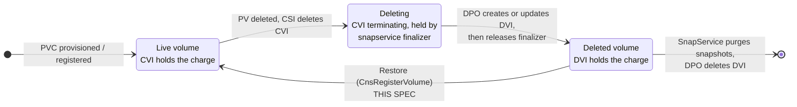
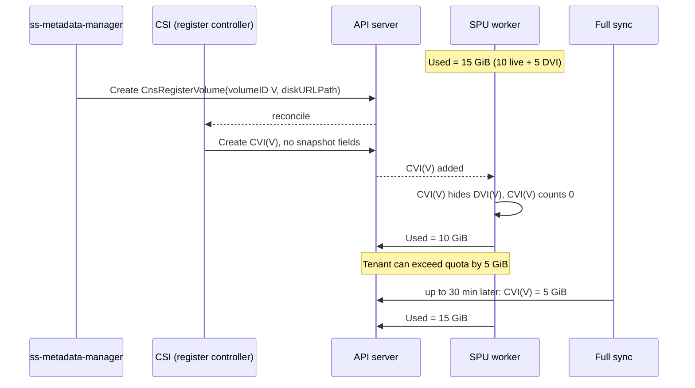
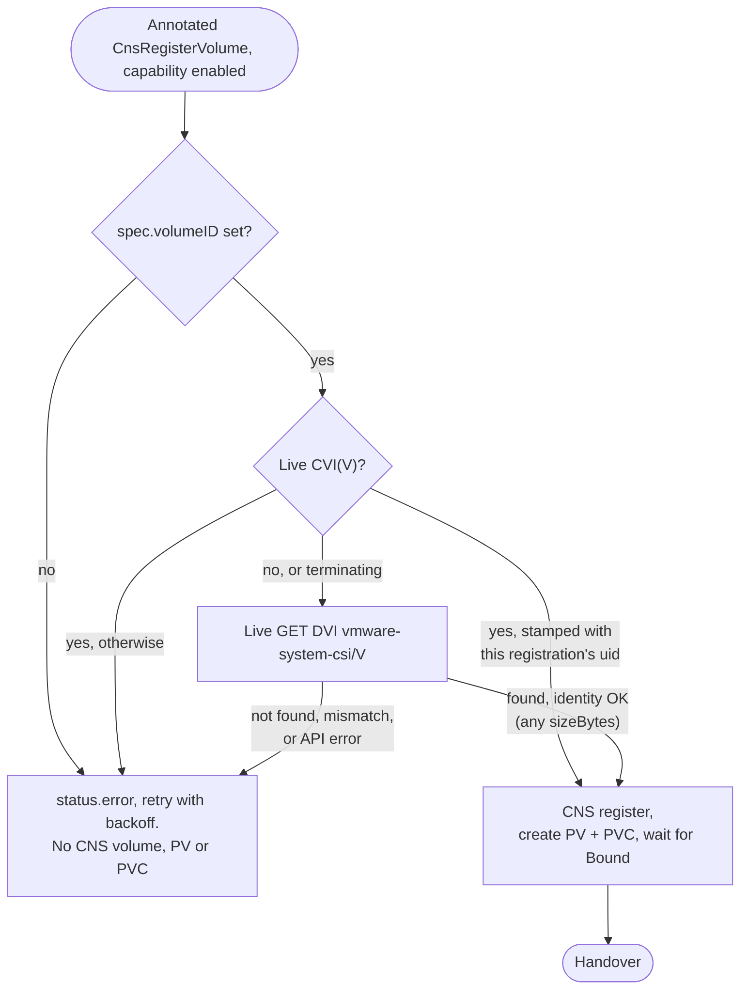
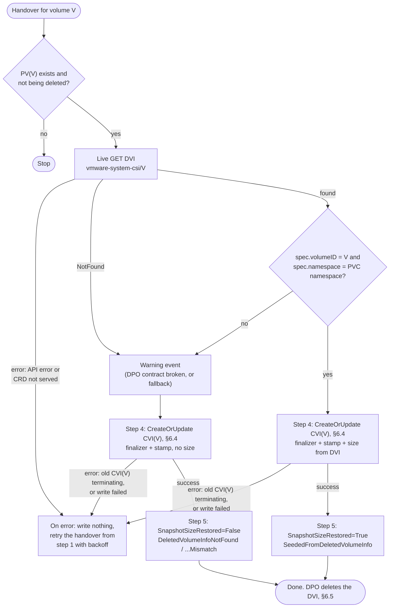
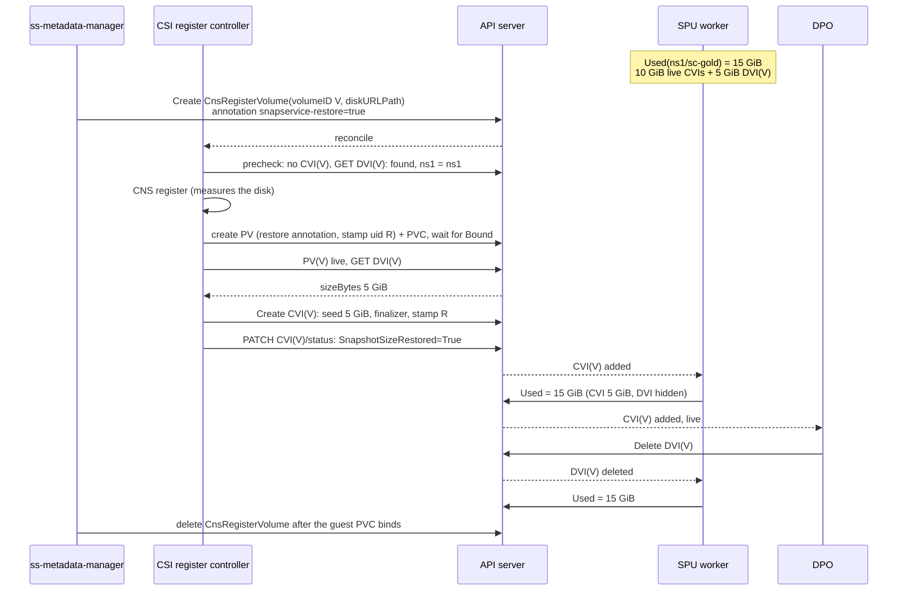
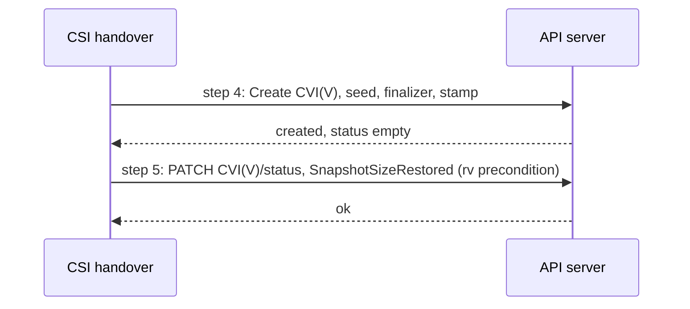
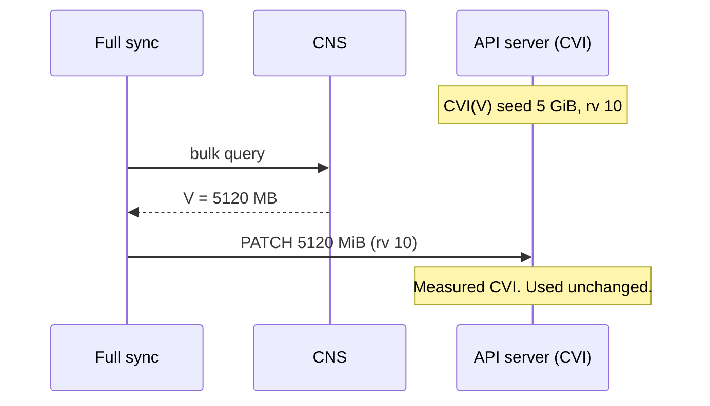
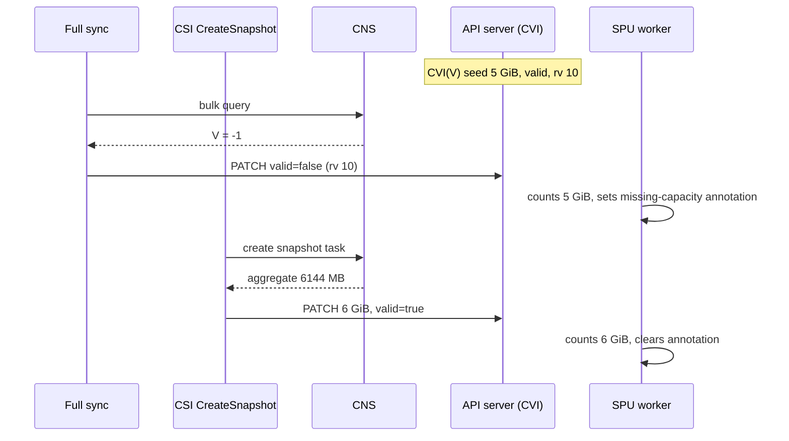

<!-- markdownlint-disable -->
# Seed the snapshot aggregate into a restored CnsVolumeInfo

Jira: [CNAS-12485](https://vmw-jira.broadcom.net/browse/CNAS-12485), "Populate branch-aware snapshot usage during
restored CVI creation".
Source ask: [Quota Management Asks/Dependencies, Ask #4](https://vmw-confluence.broadcom.net/spaces/SABU/pages/3119085298/Quota+Management+Asks+Dependencies).
CNS prerequisite: [UBMCNS-2620](https://vmw-jira.broadcom.net/browse/UBMCNS-2620). This spec assumes it is fixed (§7.4).

| Related spec | Relationship |
|---|---|
| [UBMCNS-2572: snapshot Used reconciliation](../UBMCNS-2572/design-no-reserve-fix.md) | Unchanged. The existing recompute worker counts the restored CVI. |
| [UBMCNS-2591: deleted-volume snapshot quota accounting](../UBMCNS-2591/design.md) | **Changed**: DVI kind, API group, namespace, CRD ownership, `validSize`, API discovery, restore handoff ([§12.1](#121-ubmcns-2591)). |
| [CNAS-12489: conditional writes for CVI snapshot aggregates](../CNAS-12489/spec.md) | **Changed**: the restore is a new writer whose value comes from the DVI, not CNS ([§12.2](#122-cnas-12489)). The write rules are unchanged. |

| Term | Meaning |
|---|---|
| CVI | CnsVolumeInfo, CSI's per-volume record in `vmware-system-csi`. Its snapshot aggregate (`aggregatedsnapshotsize`, `validaggregatedsnapshotsize`, `snapshotlatestoperationcompletetime`) is the volume's charge on the snapshot SPU. |
| DVI | CnsDeletedVolumeInfo (formerly DeletedVolumeInfo), the record of a volume deleted while SnapService still holds its snapshots. Also in `vmware-system-csi`. |
| SPU | Snapshot StoragePolicyUsage (`<storageClass>-snapshot-usage` or `vac-<vac>-snapshot-usage`) in the tenant user namespace. |
| DPO / MM | Data Protection Operator / per-tenant ss-metadata-manager. |
| Seed | A snapshot size copied from a DVI into a CVI, instead of measured by CNS. |
| Handover | The CSI steps that move a restored volume's snapshot charge from its DVI back to its CVI (§6.2). |
| Restore annotation | `protectionandrecovery.vmware.com/snapservice-restore: "true"` on a CnsRegisterVolume (set by MM) and on its PV (copied by CSI). It marks a SnapService restore. |
| Restore stamp | `cns.vmware.com/restored-by-cnsregistervolume: <CnsRegisterVolume uid>`, set by CSI on a restored volume's PV and CVI. It records which registration restored the volume. |
| Not-processed marker | `cns.vmware.com/restore-not-processed: <owner uid>`, set by CSI on a CnsRegisterVolume whose volume another registration restored (§6.9). |

---

## 1. Context

A SnapService-protected volume moves between two records:



DPO handles deletion and owns every DVI write and delete. This spec covers restore: CSI creates
the restored CVI already carrying the DVI's size, and DPO then deletes the DVI.

Restore keeps the volume ID. SnapService reverts the disk to a snapshot. MM then creates a
CnsRegisterVolume with `volumeID` (the original FCD ID), `diskURLPath` (the reverted disk) and the
restore annotation. CSI registers the disk with CNS under that ID, creates the PV and PVC, and then
creates the CVI. The DVI and the new CVI share the volume ID.

The SPU worker (UBMCNS-2572, UBMCNS-2591) computes:

```text
Used = sum(CVI snapshot aggregate, for CVIs of this SPU)
     + sum(DVI.sizeBytes, for DVIs of this SPU whose volume ID has no CVI)
```

Any CVI for a volume ID hides that volume's DVI, even a CVI without a snapshot aggregate, and even
one in a different SPU.

## 2. Problem

The register path creates the CVI without snapshot fields. From that moment the DVI no longer
counts and the CVI counts 0, until the next full sync (30 minutes by default) or snapshot
operation fills in the aggregate.

Example: namespace `ns1`, StorageClass `sc-gold`, 10 GiB of snapshots on live volumes, and volume
`V` deleted with a 5 GiB DVI. `V` is restored:

| Time | Event | CVI(V) | DVI(V) counted? | `Used` |
|---|---|---|---|---|
| t0 | Before restore | (none) | yes, 5 GiB | **15 GiB** |
| t1 | Register creates CVI(V) without snapshot fields | counts 0 | no, hidden | **10 GiB** ← undercount |
| t2 | DPO deletes DVI(V) | counts 0 | (gone) | 10 GiB |
| t3 | Next full sync writes CNS's 5 GiB | 5 GiB | (gone) | **15 GiB** |



Ask #4 asks for the CVI to come up already carrying the aggregate. DP chose the DVI as the source
(option 2).

## 3. Goals and non-goals

**Goals**

- G1. The restored CVI is created with the DVI's size, a valid flag and a timestamp in one
  Create call, so `Used` does not drop during the restore.
- G2. The restored CVI carries `protectionandrecovery.vmware.com/snapservice-finalizer` from
  creation, so DPO sees its deletion.
- G3. CSI only reads DVIs; it never writes or deletes one. DPO deletes the DVI once the restored
  CVI exists. DPO no longer needs a CNS sync or CVI update for quota during PersistenceRestore.
- G4. The seed is an ordinary CVI aggregate. The first CNS value replaces it under the existing
  CNAS-12489 rules.
- G5. CSI installs and upgrades the DVI CRD, in the same API group as CVI.
- G6. Every step is safe to repeat after a crash.
- G7. Only registrations with the restore annotation are affected. Every other CVI create is
  unchanged and reads no DVI.
- G8. If the restore could not copy the size, the CVI shows it in a status condition.

**Non-goals**

- Creating, sizing or deleting DVIs, and removing the snapservice finalizer: DPO does these.
- Deciding which snapshot branch the DVI size measures: DP owns that (O1).
- Changing CNS. The CNS fix is UBMCNS-2620.
- Restores that create a new FCD ID. Restore always reuses the volume ID.

## 4. Decisions

| # | Decision | Reason |
|---|---|---|
| D1 | Seed from the DVI (Ask #4 option 2). | DP's choice. The DVI holds SnapService's size for the deleted volume. |
| D2 | CSI reads the DVI itself. No new CnsRegisterVolume field. | The DVI is named by the volume ID, so CSI can read it directly. There is no caller-supplied value to trust. |
| D3 | The Create of the CVI writes the seed. | A CVI hides the DVI as soon as it exists. Writing the size afterwards leaves an undercount window. |
| D4 | The seed has no marker. Other writers treat it like any other aggregate. | With UBMCNS-2620 fixed, CNS reports a measurement or -1, and a -1 keeps the seed counted (§7.2). Nothing needs to tell a seed from a measurement. |
| D5 | A seed only fills a missing aggregate. It never replaces an existing one. | An existing value is an earlier seed or a CNS value. Neither should be overwritten. |
| D6 | CSI adds the snapservice finalizer only to restored CVIs, with or without a seed. | The restore annotation says the volume is SnapService-protected. For other protected volumes, MM adds the finalizer at protection time. |
| D7 | The DVI CRD is renamed `CnsDeletedVolumeInfo`, moves to `cns.vmware.com/v1alpha1`, and CSI installs it. | Same group, naming and lifecycle as CVI and CnsRegisterVolume. Removes UBMCNS-2591's API discovery and syncer restart. |
| D8 | The DVI has no `validSize`; its size is always valid. | DPO never publishes an unknown size into a DVI. |
| D9 | DVIs live in `vmware-system-csi`, named like CVIs. | CSI can GET a DVI by volume ID without finding the tenant namespace first. The API server allows only one DVI per volume ID. |
| D10 | DPO deletes the DVI on restore, once the restored CVI is live (§6.5). CSI never deletes a DVI. | With one writer, a restore cannot race with a new deletion of the same volume. |
| D11 | MM marks a restore with the restore annotation on the CnsRegisterVolume. CSI copies it to the PV (§6.1). | The restore is explicit, not guessed from a DVI's existence. The PV copy lets the full-sync fallback see it after the CnsRegisterVolume is gone. The `protectionandrecovery.vmware.com` prefix matches its setter (MM) and the snapservice finalizer. |
| D12 | An annotated CnsRegisterVolume without a matching DVI fails a precheck before CNS register: `status.error`, retried with backoff (§6.2). `sizeBytes` is not validated. | DP guarantees a DVI for every restore, so a missing one is a broken contract. Failing before anything is created makes it visible on the CnsRegisterVolume. A DVI that shows up late passes on the next retry. |
| D13 | CSI writes the restore stamp on the restored PV and CVI. The precheck accepts a live CVI(V) only if it carries this registration's stamp. | A restore expects no live CVI. The stamp tells this registration's own earlier attempt apart from a volume that was never deleted, or was restored by another registration. The PV copy lets the full-sync fallback stamp the CVI. |
| D14 | Every restored CVI has a `SnapshotSizeRestored` condition in a new `status.conditions` list (§6.8). It is `False` when the size could not be copied; full sync sets it `True` once a valid aggregate is present. | Shows a failed copy on the CVI without marking the aggregate invalid. A condition has a typed reason and a transition time, and it stays after the fix. |
| D15 | Restores of one volume run one at a time, under a lock held in the syncer's memory. The first registration to stamp the volume owns the restore; every other registration of the volume is marked not processed and never retried (§6.9). | The syncer runs the register controller only in the leader, so a process-local lock is enough. Ownership lives in the stamps, so losing the lock on a restart is harmless. |
| D16 | A CnsRegisterVolume never changes or cleans up a PV or CVI stamped by another registration. Deleting a registration that is not processed removes only its own finalizer. | Only the owner's own retries and deletion act on the restored volume, as for any registration today. |

---

## 5. CnsDeletedVolumeInfo API

### 5.1 Resource

| Property | Value |
|---|---|
| Group / version, kind | `cns.vmware.com/v1alpha1`, `CnsDeletedVolumeInfo` (singular `cnsdeletedvolumeinfo`, plural `cnsdeletedvolumeinfoes`, as controller-gen pluralizes `cnsvolumeinfoes`) |
| Replaces | `protectionandrecovery.vmware.com/v1alpha1` `DeletedVolumeInfo` (UBMCNS-2591). CSI no longer reads the old kind and does not migrate its objects (O5). |
| Scope and namespace | Namespaced. Every DVI lives in `vmware-system-csi` (D9). |
| Name | The volume ID, using the CVI naming rule. A volume's DVI and CVI share a name; they are different kinds. |
| Installed by | CSI syncer at startup, when `supports_snap_service_local_protection` is enabled |
| Created and sized by | DPO |
| Deleted by | DPO only: after the restore handover (§6.5), or when SnapService purges the volume's snapshots |

### 5.2 Example

```yaml
apiVersion: cns.vmware.com/v1alpha1
kind: CnsDeletedVolumeInfo
metadata:
  name: 3c6b9a1e-5d2f-4f4e-9b8a-2a71c0e5d9f4
  namespace: vmware-system-csi
spec:
  volumeID: 3c6b9a1e-5d2f-4f4e-9b8a-2a71c0e5d9f4
  namespace: ns1                             # tenant user namespace charged by the SPU
  storageClassName: sc-gold
  volumeAttributeClassName: ""               # set if the volume had moved policy through a VAC
  storagePolicyID: 4d5f0a2c-7e31-4b9e-a0c2-1f6e8d3b7a90
  sizeBytes: 5368709120                      # 5 GiB, copied at deletion, then refreshed by DPO
```

### 5.3 Fields

| Field | Required | Validation | Used by CSI for |
|---|---|---|---|
| `spec.volumeID` | yes | non-empty; equals `metadata.name` | Handover identity; SPU handoff index |
| `spec.namespace` | yes | DNS-1123 label | SPU owner (the only tenant reference); identity check (§6.3) |
| `spec.storageClassName` | yes | DNS-1123 subdomain | SPU association |
| `spec.volumeAttributeClassName` | no | empty or DNS-1123 subdomain | SPU association; a VAC SPU takes precedence |
| `spec.storagePolicyID` | yes | non-empty | Must match the SPU's policy |
| `spec.sizeBytes` | yes | integer ≥ 0 | DVI's contribution to `Used`; the seed |

The schema has no `validSize` (D8); the API server prunes it if it is sent. The OpenAPI schema
enforces types, required fields and `sizeBytes >= 0`. CSI's decoder keeps its stricter checks, so a
malformed record holds only its own SPU (UBMCNS-2591 §DVI validation).

### 5.4 Installation

- The CRD manifest (`cns.vmware.com_cnsdeletedvolumeinfoes.yaml`) is embedded next to the CVI
  manifest and applied the same way at syncer startup, including on upgrade, but only when
  `supports_snap_service_local_protection` is enabled. With the capability off there is no DVI CRD,
  informer or handover.
- The manifest and the deepcopy functions are generated by controller-gen (the version pinned in the
  Makefile) from the Go types, including the validation markers (`minLength: 1` on the identity
  fields, `minimum: 0` on `sizeBytes`). The CVI manifest stays as it is, with only the
  `status.conditions` block added.
- If installation fails, the syncer retries with backoff. The SPU worker waits until the CRD is
  established and the DVI cache has synced, so it does not publish `Used` from CVIs alone.
  Prechecks and handovers fail and retry until the CRD is served.
- Installation creates the CRD, or replaces the spec of the existing one, and then waits up to 60s
  for it to be established. If it is not established in time, installation fails and is retried.
  The shared CRD helper is not used, because it deletes a CRD that does not become established, and
  deleting the CRD would delete every DVI with it.
- An absent API is no longer a normal state, so UBMCNS-2591's discovery probe, poll and restart
  are removed. CSI never deletes the CRD.

### 5.5 RBAC

CSI's ClusterRole in `manifests/supervisorcluster/{1.33,1.34,1.35}/cns-csi.yaml`:

| API group | Resource | Verbs | Change |
|---|---|---|---|
| `protectionandrecovery.vmware.com` | `deletedvolumeinfos` | get, list, watch | **removed** |
| `cns.vmware.com` | `cnsdeletedvolumeinfoes` | get, list, watch | **added** (needed only in `vmware-system-csi`) |
| `cns.vmware.com` | `cnsvolumeinfoes` | create, get, list, watch, delete, patch | unchanged |
| `cns.vmware.com` | `cnsvolumeinfoes/status` | patch | unchanged; used for the condition (§6.8) |
| `apiextensions.k8s.io` | `customresourcedefinitions` | as today | unchanged |

DPO ships its own RBAC in `vmware-system-csi`: create, get, list, watch, update, patch and delete
on `cnsdeletedvolumeinfoes`, and update and patch on `cnsvolumeinfoes`. DPO already writes CVIs there.

---

## 6. Restore handover

### 6.1 When it runs

MM marks every restore by creating the CnsRegisterVolume with the annotation:

```yaml
metadata:
  annotations:
    protectionandrecovery.vmware.com/snapservice-restore: "true"
```

Any other value, or no annotation, means an ordinary registration. When the register controller
creates the PV, it adds the restore annotation and the restore stamp to it. The handover copies the
stamp from the PV to the CVI. Because both are on the PV, the full-sync fallback can recognise a
restore, and stamp the CVI, after the CnsRegisterVolume is gone.

| Path | Restore signal | What runs |
|---|---|---|
| CnsRegisterVolume controller | annotation on the CnsRegisterVolume | **ownership check** before anything else (§6.9), **precheck** before CNS register, **handover** after the PVC is bound (§6.2) |
| Full sync, "PV without CVI" fallback: the register controller stopped after binding the PVC, or the CnsRegisterVolume was deleted first | annotation on the PV | **handover** only (recovery) |
| CnsRegisterVolume or PV without the annotation | none | nothing: plain CVI create, as today, with no DVI read |
| CSI CreateVolume (dynamic provisioning) | none | nothing |

The precheck and the handover also require `supports_snap_service_local_protection`. With it off,
CVI creation is unchanged and the annotation is ignored. `StorageQuotaM2` is enabled by default in
every Supervisor manifest, so it is not checked.

A registration without the annotation does not get a seed or the finalizer, even if a DVI exists
for its volume ID. Its CVI hides the DVI, as today (§10).

### 6.2 Steps

**Ownership check (register controller, before the finalizer is added).** The register controller
takes the restore lock of V and checks that no other registration has stamped V (§6.9). Only then
does it continue with the precheck.

**Precheck (register controller, before CNS register).** Every restore must have a DVI (D12). The
register controller checks this before it creates anything, next to its existing StorageClass
entitlement check:

1. The annotated CnsRegisterVolume must set `spec.volumeID` (V). Restore always reuses the volume
   ID.
2. Read CVI(V) live. A restore expects the volume to be deleted, so its CVI should not be live:

   | CVI(V) | Result |
   |---|---|
   | none, or terminating | Continue with step 3. A terminating CVI means the deletion is still in progress; the handover waits for it to go (§6.4). |
   | live, restore stamp equals this CnsRegisterVolume's uid | Pass; skip step 3. An earlier attempt of this registration already created the CVI, and DPO may have deleted the DVI since. |
   | live, with no stamp or another uid | **Fail**. The volume was never deleted, or another registration already restored it. |
3. Live GET of the DVI `vmware-system-csi/<V>`. It must exist and pass the identity check (§6.3).
   `sizeBytes` is not checked beyond the CRD schema, so any value, including 0, passes.

If the precheck fails, the controller sets `status.error` and retries with its usual backoff. It
creates no CNS volume, PV or PVC. Example messages:

| Cause | `status.error` |
|---|---|
| No `volumeID` | `restore requires spec.volumeID` |
| Live CVI(V) not stamped by this registration | `restore requires a deleted volume: CnsVolumeInfo vmware-system-csi/<V> is live` |
| DVI not found | `restore prerequisite not met: CnsDeletedVolumeInfo vmware-system-csi/<V> not found` |
| Namespace mismatch | `restore prerequisite not met: CnsDeletedVolumeInfo vmware-system-csi/<V> belongs to namespace ns1, not ns2` |
| API error, CRD not served | `failed to read CnsDeletedVolumeInfo vmware-system-csi/<V>: <error>` |

The failure is not final. If the DVI appears later, for example because DPO was still recording
the deletion, the next retry passes.

**The precheck runs only until the registration stamps the volume.** Once an earlier attempt of this
registration has stamped V's PV or CVI (§6.9), the retry skips the precheck. CNS register and the PV
already happened, so a check meant to stop a restore before anything is created no longer applies.
The DVI may be gone by then, for example after a SnapService purge or a broken DPO contract, and the
handover copes without it. Otherwise every retry would fail the precheck and never reach the
handover. If the DVI disappears after the precheck passed but before the PV is created, the retry
still fails the precheck; nothing in Kubernetes exists yet, and `status.error` says why.

**Handover (after the PVC is bound, and in the full-sync fallback).** Each attempt, including every
retry, runs these steps in order:

1. **Check the PV.** A live read of the PV for V. If it is missing or being deleted, the volume
   is no longer a restore in progress: stop without creating a CVI. A CVI created now would hide
   the DVI that DPO is about to capture the deletion into.
2. **Find the DVI.** A live GET of `vmware-system-csi/<V>`, not an informer read, because a stale
   cache could miss the DVI.
3. **Check identity** (§6.3).
4. **CreateOrUpdate the restored CVI** (§6.4), reading the CVI live. CSI creates the CVI if it
   does not exist, or patches the live one. It always writes the finalizer and the stamp, and it
   writes the seed if steps 2 and 3 found a matching DVI.
5. **Report the outcome** in the CVI's `SnapshotSizeRestored` condition, with a status patch
   (§6.8).

**If the handover finds no matching DVI.** After a passed precheck, this happens only if the DVI
was deleted or changed in between, which breaks DPO's contract (§9), or in the full-sync fallback,
which has no precheck. The PV and PVC already exist, so CSI can no longer reject the restore. It
creates the CVI with the finalizer and the stamp but no seed, sets `SnapshotSizeRestored=False`
with the reason, and emits a warning event and an error log. The volume is undercounted until
CNS's value is written; full sync then sets the condition to `True` (§6.8).

That is all CSI does. DPO deletes the DVI afterwards (§6.5).





After an error, the next attempt re-runs every step of its phase from the start.

### 6.3 Identity check

The DVI's `spec.volumeID` must equal V. Its `spec.namespace`, the tenant namespace charged for the
deleted volume, must equal the CnsRegisterVolume's namespace, where the PVC is created. The DVI's
own `metadata.namespace` is always `vmware-system-csi` and is not compared. For example, a DVI with
`spec.namespace: ns1` does not match a CnsRegisterVolume in `ns2`.

Storage class, VAC and policy are not checked. A restored volume may land in a different SPU than
its DVI did, for example when the DVI had a VAC and the register path sets only the storage
class. The SPU worker already recomputes both SPUs when a CVI appears for a DVI's volume ID, so
the charge moves from one SPU to the other.

A namespace mismatch fails the precheck, so a cross-namespace restore is rejected until O2 is
decided.

### 6.4 CreateOrUpdate of the restored CVI

CreateOrUpdate means: create the CVI if there is none, otherwise patch the live one. Unlike a
plain CreateOrUpdate, a terminating CVI is an error, not an update target.

The restored CVI always gets the finalizer and the stamp. It gets the seed fields only if handover
steps 2 and 3 found a matching DVI:

| CVI field | Value | Example |
|---|---|---|
| `metadata.finalizers` | add `protectionandrecovery.vmware.com/snapservice-finalizer` (always) | |
| `metadata.annotations["cns.vmware.com/restored-by-cnsregistervolume"]` | copied from the PV (always) | `9b1f…7a2e` |
| `spec.aggregatedsnapshotsize` | `DVI.spec.sizeBytes`, copied exactly | `5368709120` |
| `spec.validaggregatedsnapshotsize` | `true` (D8) | |
| `spec.snapshotlatestoperationcompletetime` | handover time (informational, CNAS-12489 R7) | `2026-10-28T17:04:11Z` |

Other CVI fields are filled in as today. What happens depends on the existing CVI, read live:

| Existing CVI(V) | Action | Why |
|---|---|---|
| none | **Create** with the finalizer, the stamp and, if there is one, the seed | D3 |
| terminating | **Error**, retry with backoff | The previous CVI is still held by DPO's finalizer. Today's create treats `AlreadyExists` as success, so the restore would end up with no CVI once DPO released the old one. |
| live; stamped by another registration | **Error**, retry with backoff; nothing written | The CVI belongs to that registration's restore (D16). The ownership check normally stops such a registration first; this only guards the write. |
| live; no snapshot aggregate | **Update**: patch the finalizer, the stamp if missing and, if there is one, the seed | An earlier attempt created the CVI without a seed |
| live; has a snapshot aggregate | **Update**: patch the finalizer and the stamp if missing; leave the aggregate | A retry after the Create, or CNS has already written a value (D5) |

A patch carries the CVI's `resourceVersion` (CNAS-12489 R1). On 409, re-read the CVI and
re-evaluate the table. Every row except "terminating" is followed by step 5, which sets the
condition.

**Example: CVI created by the handover**

```yaml
apiVersion: cns.vmware.com/v1alpha1
kind: CNSVolumeInfo
metadata:
  name: 3c6b9a1e-5d2f-4f4e-9b8a-2a71c0e5d9f4
  namespace: vmware-system-csi
  finalizers:
    - protectionandrecovery.vmware.com/snapservice-finalizer
  annotations:
    cns.vmware.com/restored-by-cnsregistervolume: 9b1f0c3d-4e5a-4b6c-8d7e-0f1a2b3c7a2e
spec:
  volumeID: 3c6b9a1e-5d2f-4f4e-9b8a-2a71c0e5d9f4
  namespace: ns1
  vCenterServer: vc1.example.com
  storagePolicyID: 4d5f0a2c-7e31-4b9e-a0c2-1f6e8d3b7a90
  storageClassName: sc-gold
  capacity: 20Gi
  aggregatedsnapshotsize: "5368709120"
  validaggregatedsnapshotsize: true
  snapshotlatestoperationcompletetime: "2026-10-28T17:04:11Z"
  isLinkedClone: false
status:                                      # written by step 5, not by the Create
  conditions:
    - type: SnapshotSizeRestored
      status: "True"
      reason: SeededFromDeletedVolumeInfo
      message: seeded 5368709120 bytes from CnsDeletedVolumeInfo vmware-system-csi/3c6b9a1e-5d2f-4f4e-9b8a-2a71c0e5d9f4
      observedGeneration: 1
      lastTransitionTime: "2026-10-28T17:04:11Z"
```

### 6.5 DPO deletes the DVI

CSI never deletes a DVI (D10). DPO decides from the CVI it reads:

| CVI(V) as DPO reads it | DPO action | Why |
|---|---|---|
| none | Keep the DVI | The handover has not run. Deleting now would leave CSI no seed source, which is the undercount in §2. |
| terminating | Capture the deletion into the DVI, as today | This is a new deletion of V, not a restore |
| live | Delete the DVI | The CVI hides the DVI, so the delete does not change `Used` |

- **No race with a new deletion of V.** If the restored volume is deleted again, DPO sees the CVI
  terminating and captures instead of deleting. DPO is the only actor that writes or deletes the
  DVI, so it orders the capture and the delete itself.
- **A stale seed corrects itself.** If DPO refreshes the DVI's `sizeBytes` between CSI's GET
  (step 2) and the Create (step 4), the CVI carries the size from before the refresh. The next CNS
  value replaces it, at the latest at the next full sync (§7.2).
- If DPO is down, the DVI stays. Accounting is still correct, because the CVI hides it.

### 6.6 End-to-end sequence



| Time | Event | CVI(V) | DVI(V) counted? | `Used` |
|---|---|---|---|---|
| t0 | Before restore | (none) | yes, 5 GiB | **15 GiB** |
| t1 | Handover creates seeded CVI(V) | 5 GiB (seed) | no, hidden | **15 GiB** |
| t2 | DPO deletes DVI(V) | 5 GiB (seed) | (gone) | **15 GiB** |
| t3 | Full sync, CNS reports 5120 MB | 5 GiB (measured) | (gone) | **15 GiB** |

### 6.7 Crash and retry

Every attempt starts its phase again from the first step, and every step is safe to repeat.

| Interrupted | State left | Accounting meanwhile | Recovery |
|---|---|---|---|
| After the precheck, before step 4 | DVI; some of the CNS volume, PV and PVC; no CVI | DVI counts | The register controller retries. Once the PV carries this registration's stamp, the retry skips the precheck; before that, the precheck passes again, because with no CVI DPO keeps the DVI. If the CnsRegisterVolume is gone, the full-sync "PV without CVI" fallback runs the handover. |
| After step 4, before step 5 | CVI without the condition; DPO may delete the DVI | CVI counts | The register controller retries, passes the precheck on the stamp, and runs step 5 (§6.8). |
| After step 5, before the CnsRegisterVolume is marked registered | CVI with the condition; DPO may delete the DVI | CVI counts | The retry passes the precheck on the stamp. Steps 4 and 5 change nothing. |
| While a registration holds the restore lock (crash or leader change) | The lock is gone with the process | unchanged | The new leader starts with no locks. The stamps on the PV and CVI still say who owns the restore, so the ownership check decides as before. |
| After the marker is set, before `status.error` | Marker only | unchanged | The registration is not reconciled again. Its `status.error` keeps the previous attempt's message. |

### 6.8 `SnapshotSizeRestored` condition

Every restored CVI says in a status condition how it got its snapshot size (D14). This is a CVI
API change.

**API.** CNSVolumeInfo gets a new list, `status.conditions`, of `metav1.Condition`. It is separate
from `status.migrationConditions`, which stays migration-only. Like `migrationConditions`, it is a
map keyed by `type` with at most 8 entries. `GetConditions()` and `SetConditions()` stay bound to
`migrationConditions`; the new list is written with `apimeta.SetStatusCondition`.

CVI already has a status subresource, and CSI already has `patch` on `cnsvolumeinfoes/status`. The
only new piece is the CRD schema, which CSI applies at startup with the rest of the CVI CRD.

**Condition type `SnapshotSizeRestored`:**

| Situation | `status` | `reason` | Set by |
|---|---|---|---|
| Seeded from a matching DVI | `True` | `SeededFromDeletedVolumeInfo` | handover |
| No DVI found | `False` | `DeletedVolumeInfoNotFound` | handover |
| DVI found, different `spec.namespace` | `False` | `DeletedVolumeInfoNamespaceMismatch` | handover |
| Was `False`, and the CVI now holds a valid aggregate | `True` | `MeasuredByCNS` | full sync |

The `message` gives the details, for example `CnsDeletedVolumeInfo vmware-system-csi/<V> belongs
to namespace ns1, not ns2`. `observedGeneration` is the CVI's `generation`.

**When it is written.** The API server ignores `status` in a Create when the CRD has a status
subresource, so the condition cannot be part of step 4. Step 5 writes it right after, in the same
attempt:



**What step 5 writes.** Step 5 looks at what step 4 did and at the CVI it left. A retry often runs
after DPO has deleted the DVI, so a DVI that is not found must not undo an earlier `True`:

| Step 4 in this attempt | Condition written by step 5 |
|---|---|
| Wrote the seed | `True`, `SeededFromDeletedVolumeInfo` |
| Wrote no seed; the CVI has no snapshot aggregate | `False`, `DeletedVolumeInfoNotFound` or `DeletedVolumeInfoNamespaceMismatch` |
| Wrote no seed; the CVI already has a snapshot aggregate | Keep any existing condition. If none, `True`, `SeededFromDeletedVolumeInfo`: an earlier attempt seeded the CVI and stopped before step 5. |

- Step 5 reads the CVI, sets the condition and patches `/status` with the CVI's
  `resourceVersion`. On 409 it re-reads and retries. The patch carries only the condition.
- If the condition already has the same status and reason, step 5 changes nothing.
- A crash between steps 4 and 5 leaves the CVI without the condition. In the register controller,
  the CnsRegisterVolume is not yet marked registered, so the controller retries and step 5 runs
  (§6.7). In the full-sync fallback the CVI now exists, so the fallback does not run again and the
  condition stays missing. Nothing depends on the condition: the SPU worker reads the seed from
  `spec`, DPO checks that the CVI is live, and the precheck uses the stamp.

**How `False` turns `True`.** In its snapshot pass, full sync checks the condition on every
restored CVI it reads. If the condition is `False` and the CVI has a valid aggregate, full sync
sets it to `True` with reason `MeasuredByCNS`, in a separate `/status` patch after its spec patch.
The value may come from full sync itself or from any other writer. A CNS -1 is not a valid
aggregate, so the condition stays `False`. Full sync never creates a missing condition, because it
cannot tell whether an aggregate was seeded or measured.

The condition stays in the list after the problem is fixed. Its `lastTransitionTime` shows when
the size became known.

**Example: restore that found no DVI, after the next full sync**

```yaml
status:
  conditions:
    - type: SnapshotSizeRestored
      status: "True"
      reason: MeasuredByCNS
      message: snapshot size reported by CNS; restore found no CnsDeletedVolumeInfo vmware-system-csi/3c6b9a1e-5d2f-4f4e-9b8a-2a71c0e5d9f4
      observedGeneration: 3
      lastTransitionTime: "2026-10-28T17:34:02Z"
```

### 6.9 Registrations of the same volume

MM should create one annotated CnsRegisterVolume per restore. If it creates more than one for the
same volume V, at the same time or later, only one is processed: the first to stamp V's PV or CVI.

**Ownership check.** Before it adds its finalizer, the register controller runs these steps for an
annotated CnsRegisterVolume, every attempt:

1. If the CnsRegisterVolume carries the not-processed marker, stop. No retry.
2. Take the restore lock of V. If another registration holds it, retry with the usual backoff. This
   is not an error, and `status.error` is not changed. The lock is held until the attempt returns,
   and released on every exit.
3. Read the owner of V live: the stamp on `static-pv-<V>` if the PV exists, is not being deleted and
   is stamped; otherwise the stamp on the live CVI(V). A terminating PV or CVI belongs to the
   previous deletion of V and is ignored.

| Owner of V | Result |
|---|---|
| none | Continue with the precheck (§6.2) |
| this registration | Continue, skipping the precheck (§6.2) |
| another registration | Set the not-processed marker, then `status.error`; no retry |
| read failed | `status.error`, retry with backoff |

Example `status.error`: `volume <V> was restored by CnsRegisterVolume <uid>; this CnsRegisterVolume is
not processed`.

**Why it is safe.** The register controller runs only in the leader syncer, so the lock serializes
every restore of V. A PV is created with its stamp in the same call, so no other registration can
see the PV without the stamp. The full-sync fallback writes the stamp already on the PV, so it
agrees with the owner and does not need the lock. A blocked registration retries, rather than
failing, because the holder may still fail before it stamps anything; the next registration then
owns the restore.

**Why the marker.** The decision must survive a restart. Without it, a registration that is not
processed would be reconciled again after a restart, and if V had been deleted again meanwhile, its
stamps would be gone and the registration would restore V a second time.

**Backstops.** If a registration gets past the check anyway, neither write replaces another
registration's stamp:

- Annotating an existing PV adds only the missing restore annotation and stamp, with the PV's
  `resourceVersion`. A PV stamped by another registration is an error, so it is never recreated
  either.
- The CVI write rejects a CVI stamped by another registration (§6.4).

**Deleting a CnsRegisterVolume.** A CnsRegisterVolume that is not registered yet cleans up the
unbound `static-pv-<V>` it finds, and untags the CNS volume, as today. With the capability enabled,
it skips both if the PV carries another registration's stamp, and only removes its own finalizer.
This applies whether or not the registration was marked: one that failed before it stamped anything
must not clean up the owner's PV either. The owner's deletion is unchanged.

**Not covered.** The lock covers annotated registrations only. An ordinary registration and a
restore of the same deleted volume at the same time can still race, as two ordinary registrations
can today. This is not handled, because a deleted volume is expected to be registered only by a
restore.

---

## 7. Seed lifetime

### 7.1 What CNS reports for a restored volume

CNS register ends by measuring the disk (`QueryAllocatedSpaceAction` → VSLM `QueryRuntimeInfo` →
`UpdateAllocatedSpaceAction`). With UBMCNS-2620 fixed, CNS reports for the restored volume either:

- **a measurement** of the restored disk, including a real 0; or
- **-1** if it has no measurement, for example because the register-time measurement failed.

CNS no longer reports a placeholder 0 for a volume it has not measured.

### 7.2 How the seed is replaced

The seed bridges the gap until CNS's first value. Every CNAS-12489 writer treats it like any
other aggregate:

| CNS value | Effect on the seeded CVI | `Used` | SPU missing-capacity annotation |
|---|---|---|---|
| A measurement | Replaces the seed (conditional write) | CNS's value | not set |
| -1 | `valid=false`; the seed stays as the last known size | still counts the seed | **set**, until a valid value arrives |

The writers are full sync, CSI CreateSnapshot and DeleteSnapshot, the VM snapshot controller, and
DPO. In the normal case the first full sync after the restore writes CNS's register-time
measurement.

The -1 row is existing behaviour for every CVI. The SPU worker counts an invalid CVI at its last
known size, so the seed is not lost; the annotation reports, correctly, that CNS has no
measurement.

A restored CVI created without a seed (§6.2) gets its first value the same way. When a valid
value is present, full sync also sets its `SnapshotSizeRestored` condition to `True` (§6.8).

The seed is copied in bytes, while CNS reports whole MB. When CNS's value replaces the seed,
`Used` can change by less than 1 MiB even if the sizes agree.

### 7.3 Examples

**E1. CNS measured the disk at register.**



Had CNS reported 4096 MB, full sync would have written 4 GiB and `Used` would have dropped by
1 GiB. The seed bridges the gap until CNS has a value; it does not override CNS (O1).

**E2. CNS has no measurement, then a snapshot.**



**E3. The snapshots are purged after the restore.** SnapService deletes the snapshots through
VSLM. With UBMCNS-2620 fixed, CNS measures after the VSLM operation, and the next full sync writes
0.

### 7.4 Dependency on UBMCNS-2620

On a vCenter without the fix, CNS can report a placeholder 0 for a restored volume: after a
failed register-time measurement, or after a VSLM snapshot, revert or metadata operation. Full sync
then writes 0 over the seed, and the volume is undercounted until a CNS snapshot task or a
successful measurement. Every volume on such a vCenter can see this undercount; the seed does not
introduce it. Whether the handover must be gated on a vCenter version with the fix is O3.

---

## 8. SPU accounting changes

The SPU formula is unchanged. Without `validSize`:

| Before (UBMCNS-2591) | After |
|---|---|
| DVI decoding requires `validSize` | `validSize` is not read |
| `validSize=false` adds the last-known size and sets the missing-capacity annotation | Removed. A DVI never sets that annotation. |
| A DVI change is detected on seven fields | Six fields |

A seeded CVI is valid, so it adds its seed without the missing-capacity annotation. The CVI add
event already enqueues the CVI's SPU and its DVI's SPU, so the "AddFunc accounts the populated
value" criterion needs no code change.

---

## 9. Contract with DP

| Responsibility | Before | After |
|---|---|---|
| Install / upgrade the DVI CRD | DPO | **CSI** |
| DVI kind, group and namespace | `DeletedVolumeInfo`, `protectionandrecovery.vmware.com`, tenant system namespace | **`CnsDeletedVolumeInfo`, `cns.vmware.com`, `vmware-system-csi`**, named by volume ID |
| `validSize` | written by DPO | **removed** |
| Create the DVI on a protected-volume deletion, before releasing the CVI finalizer | DPO | DPO |
| Keep DVI `sizeBytes` current; delete the DVI when SnapService purges | DPO | DPO |
| Delete the DVI on restore | DPO / MM | **DPO only, after the restored CVI is live** (§6.5) |
| Mark a restore | — | **MM**: restore annotation on the CnsRegisterVolume (D11) |
| Add `snapservice-finalizer` | MM, at protection time | MM; **CSI** for restored CVIs |
| Remove `snapservice-finalizer` | DPO | DPO, for restored CVIs too |
| CnsSyncVolume + CVI Update during PersistenceRestore | DPO | **not needed** |

DPO must also not create a DVI for a volume whose CVI is live, only while it is terminating. DP
must confirm that the DVI `sizeBytes` is the right charge for the restored volume (O1).

The one ordering rule DP must keep: **never delete the DVI of a restored volume before CSI has
created its CVI.** CSI reads the size from the DVI; without it the CVI gets no size and the volume
is undercounted (§2).

MM creates the CnsRegisterVolume with `volumeID` set to the original FCD ID and with the restore
annotation. If MM creates more than one for the same volume, only the first to stamp the volume is
processed. The others get the not-processed marker and a final `status.error`, and MM may delete
them; deleting them leaves the restored volume alone (§6.9).

**Every annotated restore has a DVI.** Before MM creates the CnsRegisterVolume, a DVI must exist in
`vmware-system-csi` named by the volume ID, with `spec.namespace` set to the CnsRegisterVolume's
namespace. Its `sizeBytes` can be any valid value, including 0. Otherwise the registration fails
the precheck (D12).

---

## 10. Failure modes

| Condition | Behaviour |
|---|---|
| Capability disabled | No DVI CRD or handover |
| DVI CRD install fails | Syncer retries; SPU worker not started; `Used` unchanged; prechecks and handovers fail and retry |
| DVI GET fails | Precheck or handover fails and retries; no CVI is written |
| Annotated CnsRegisterVolume without `volumeID` | Precheck fails: `status.error`, retried with backoff. Nothing created. |
| Annotated CnsRegisterVolume for a volume with a live CVI not stamped by it (never deleted, or already restored) | Precheck fails as above |
| Annotated CnsRegisterVolume, DVI not found | Precheck fails as above. Passes once the DVI exists. |
| Annotated CnsRegisterVolume, DVI in another namespace | Precheck fails as above (O2) |
| DVI deleted or changed after the precheck (DPO contract broken, or a SnapService purge), or none found by the full-sync fallback. A retry after this registration stamped the PV skips the precheck and reaches the handover. | CVI with finalizer, no seed; `SnapshotSizeRestored=False`, warning event and error log; undercount until CNS's value, then full sync sets the condition `True` |
| CSI crashes between steps 4 and 5 | Condition missing until the register controller retries; stays missing in the full-sync fallback (§6.8) |
| DVI exists, but the registration has no restore annotation (for example an older MM) | Plain CVI, as today. It hides the DVI, and DPO deletes the DVI. Undercount until CNS's value. |
| PV of V missing or being deleted | Handover stops without creating a CVI; DPO captures the deletion |
| Another annotated CnsRegisterVolume is restoring V right now | Retried with backoff, no error, until the lock is free (§6.9) |
| Another annotated CnsRegisterVolume already stamped V | Not-processed marker and final `status.error`; never retried |
| Owner of V cannot be read | `status.error`, retried with backoff |
| CnsRegisterVolume not processed, or failed before stamping, is deleted | Only its finalizer is removed; the owner's PV and CNS volume are left alone |
| DVI CRD not established within 60s | Installation fails and is retried; the CRD is never deleted |
| Previous CVI(V) still terminating | Handover fails and retries until DPO releases it |
| CVI patch 409 | Re-read and re-evaluate §6.4 |
| DPO refreshed the DVI between steps 2 and 4 | Seed off by the refresh until CNS's next value (§6.5) |
| DPO down | Restore and accounting unaffected; the DVI stays (hidden by the CVI) until DPO deletes it |
| DPO uninstalled | Remaining `snapservice-finalizer`s are removed manually (existing DP guidance) |
| CNS reports a measurement | Replaces the seed (E1) |
| CNS reports -1 | `valid=false`; seed still counted; SPU annotated (E2) |
| vCenter without UBMCNS-2620 | A placeholder 0 can replace the seed (§7.4, O3) |

---

## 11. Tests

**CRD**

- The DVI CRD is installed only when the capability is enabled.
- Installation updates an existing CRD's spec, and a CRD that is not established in time is an
  error; the CRD is never deleted.
- The SPU worker waits for CRD establishment and DVI cache sync.
- `validSize` is pruned, and a DVI without it decodes as valid.
- The generated DVI manifest has `minLength: 1` on the identity fields, `minimum: 0` on `sizeBytes`,
  and the five required fields.

**Ownership (§6.9)**

- Lock: another registration of V is blocked and retries without an error; a different volume is
  not blocked; only the holder releases the lock; the lock is released on every exit.
- Owner on the PV, or on the CVI, is another registration: marker and `status.error` set, no retry,
  no finalizer, no precheck. A second reconcile reads nothing and stops.
- No owner, own stamp on the PV or CVI, or another registration's PV being deleted: continues to the
  precheck.
- Owner read error: `status.error`, retried, no marker.
- Annotating an existing PV: adds only the missing stamp, with the `resourceVersion`; never replaces
  another registration's stamp.
- CVI write: a CVI stamped by another registration is an error, and nothing is written.
- Deleting an unregistered CnsRegisterVolume when the unbound PV carries another registration's stamp:
  the finalizer is removed, the PV is not deleted.

**Precheck**

- No `volumeID`, DVI not found, namespace mismatch, or GET error: `status.error` set, retried, and
  no CNS register, PV or PVC. A DVI with `sizeBytes: 0` passes.
- A DVI that appears after a failed attempt lets the next retry continue.
- A retry after this registration stamped the PV or the CVI skips the precheck, even if the DVI is
  gone, and continues to CNS register.
- Live CVI(V): passes without a DVI read if the CVI carries this registration's stamp (a retry
  after DPO deleted the DVI); fails if it has no stamp or another uid.
- Terminating CVI(V) and a matching DVI: passes; the handover then retries until the old CVI is
  gone.

**Handover**

- DVI present, 5 GiB: one Create with the seed, `valid=true`, the timestamp, the finalizer and the
  stamp. CSI makes no write or delete call on the DVI.
- No restore annotation (absent, or not `"true"`), with or without a DVI: plain CVI, no DVI read,
  no finalizer.
- The register controller copies the annotation and the stamp to the PV. Both handover paths copy
  the stamp to the CVI, including the §6.4 patch rows.
- The full-sync fallback runs the handover only for annotated PVs.
- After a passed precheck, no DVI or a mismatch: CVI with the finalizer, the stamp and no seed,
  `SnapshotSizeRestored=False` with the matching reason, and a warning event.
- DVI GET error: retried, no CVI.
- PV missing or being deleted: stop, no CVI.
- Each row of the §6.4 table, including a 409 on the patch.
- Crash after step 4 or step 5: the retry makes no further change to the CVI spec.

**Condition (§6.8)**

- Each row of the step 5 table. In particular, a retry after DPO deleted the DVI keeps `True`.
- The status patch is safe to repeat, and a 409 re-reads and retries.
- Crash between steps 4 and 5: the register controller retry adds the condition.
- Full sync sets `False` to `True`, reason `MeasuredByCNS`, once a valid aggregate is present from
  any writer. It leaves `False` alone on a CNS -1, and never creates a missing condition.
- `status.migrationConditions`, `GetConditions()` and `SetConditions()` are unchanged (regression).

**Accounting**

- `Used` is unchanged across t0–t2 of §6.6.
- Cross-SPU: the DVI's SPU drops and the CVI's SPU rises by the same amount.
- E1 and E2: CNS's measurement replaces the seed; a -1 keeps the seed counted and annotates the SPU.

**DPO (DP's tests, listed for the contract)**

- Each row of the §6.5 table.

---

## 12. Changes to existing specs

### 12.1 UBMCNS-2591

[UBMCNS-2591](../UBMCNS-2591/design.md) has a change notice and an "Update: CNAS-12485" section:

- **Ownership.** CSI installs the DVI CRD, seeds the restored CVI from the DVI, and adds the
  finalizer to restored CVIs. MM marks a restore with
  `protectionandrecovery.vmware.com/snapservice-restore`. DPO creates, sizes and deletes DVIs (on
  restore, only after the restored CVI is live), and removes finalizers.
- **API.** Kind `CnsDeletedVolumeInfo`, `cns.vmware.com/v1alpha1`, in `vmware-system-csi`, named by volume ID, without `validSize`.
- **Discovery.** The probe, poll and restart are replaced by CRD install at startup.
- **Reconciliation.** Rows for an absent API, probe failures and `validSize=false` are removed. The
  "multiple DVIs for a volume" error becomes unreachable. The informer watches one namespace.
- **DP contract.** DPO must not create a DVI for a live CVI, and on restore deletes the DVI only
  under the §6.5 rule. Every annotated restore must have a DVI for the restore's namespace, or the
  CnsRegisterVolume fails the precheck.
- **Delivery.** CSI RBAC is get, list, watch on `cns.vmware.com/cnsdeletedvolumeinfoes`. The
  activation tests are rewritten.

### 12.2 CNAS-12489

[CNAS-12489](../CNAS-12489/spec.md) has a change notice and an "Update: CNAS-12485" section:

- **Writer table.** The restore writes `DVI.spec.sizeBytes` at CVI creation, or into a live CVI
  that has no aggregate.
- **A1/A2.** The seed is the one aggregate that does not come from CNS, until the first CNS value.
- R1–R8 and convergence are unchanged.

[UBMCNS-2572](../UBMCNS-2572/design-no-reserve-fix.md) is unchanged.

---

## 13. Open items and risks

| # | Item | Owner | Impact if unresolved |
|---|---|---|---|
| O1 | **Branch correctness.** The ticket requires that the DVI total is not copied unless DP/CNS confirms it measures the restored branch. With D1, DP asserts that it does; get this on record. CVI and DVI share the volume ID, so only one is counted: the seed must cover every snapshot still held for the FCD, source branch included. Once CNS reports a value, CNS's value is used (E1). | DP / vSAN | Wrong seed, or a wrong CNS value after it |
| O2 | **Cross-namespace restore.** If restoring into a namespace other than the DVI's `spec.namespace` is supported, §6.3 must allow it, and the charge moves between tenants. | DP | Such restores are rejected by the precheck |
| O3 | **vCenters without [UBMCNS-2620](https://vmw-jira.broadcom.net/browse/UBMCNS-2620).** Decide whether CSI's minimum vCenter for this feature includes the fix, or whether the §7.4 undercount is accepted there. | CNS / CSI | Undercount after a placeholder 0 on such vCenters |
| O4 | **DVIs after tenant deletion.** DVIs in `vmware-system-csi` outlive the tenant's namespaces, and their lifecycle stays with DPO. While one exists without an SPU, the SPU worker retries that key with backoff. | DP | Retry noise only |
| O5 | **Objects of the old `DeletedVolumeInfo` kind.** If any build has shipped DPO writing them, DP decides whether DPO recreates them as `CnsDeletedVolumeInfo` on upgrade. | DP | Their charges are missing from `Used` after upgrade |

---

## 14. Acceptance

| Ticket criterion | How it is met |
|---|---|
| The new CVI contains the restored branch's aggregate snapshot size, validity flag and observation/completion time | §6.4: DVI `sizeBytes`, `valid=true`, handover time, all set by the Create |
| CSI obtains the value from an agreed CNS result or registration input | The DVI, read by CSI at registration (D1, D2) |
| The source DVI total is not copied unless DP/CNS confirms it measures the restored branch | DP's choice of option 2; to be recorded on the ticket (O1) |
| The existing CVI AddFunc accounts the populated value into live SPU usage | §8; no worker change |
| Restore tests cover non-zero snapshot usage and branch correctness | §11. Branch correctness itself is O1 and cannot be unit-tested in CSI. |
