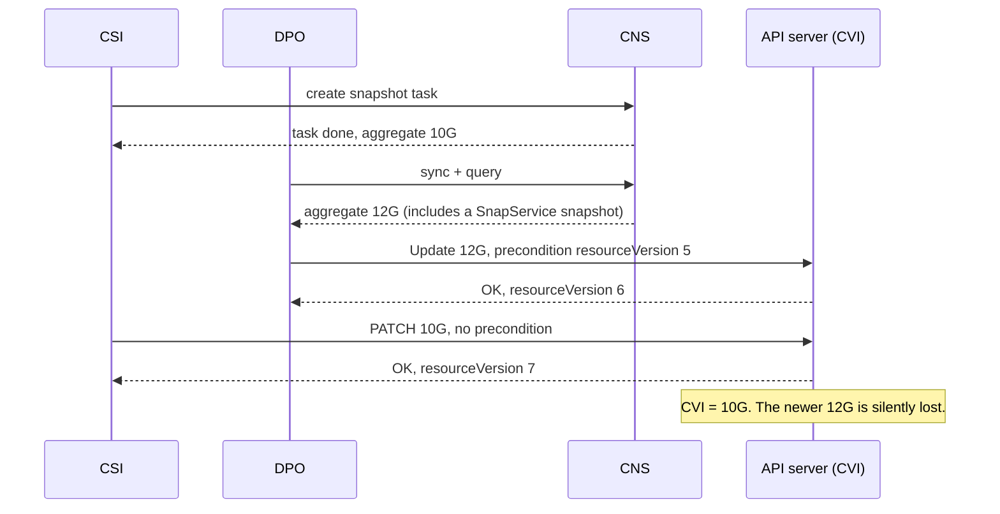
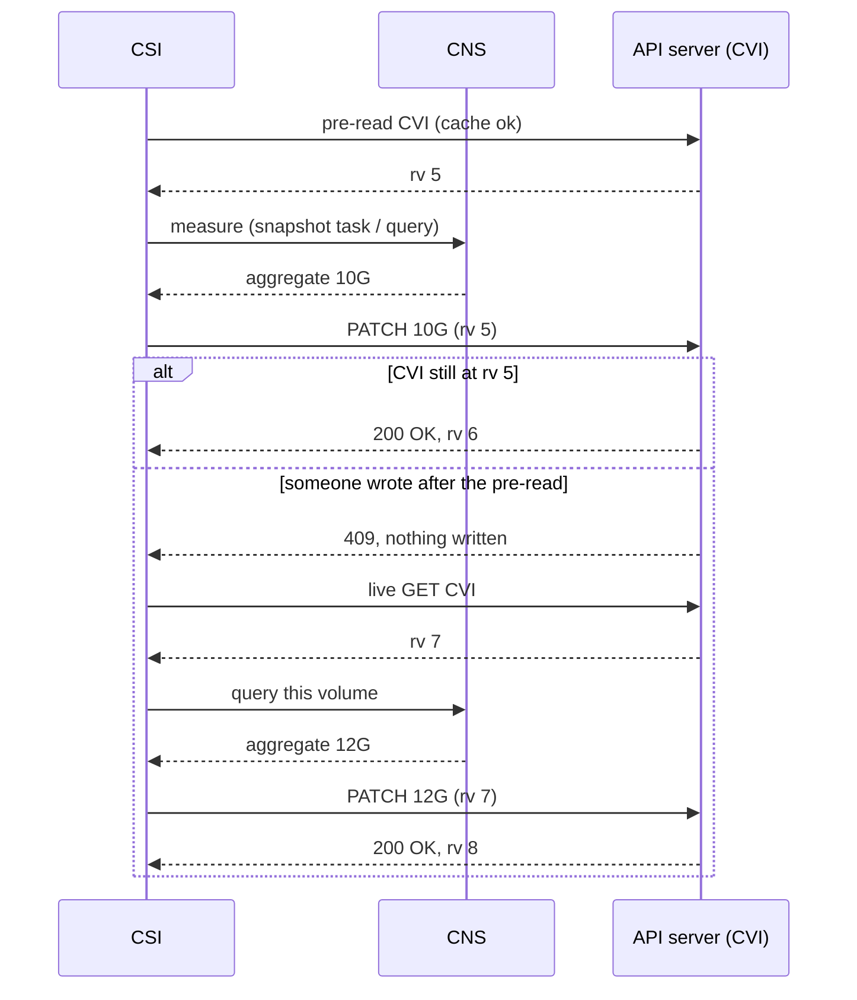
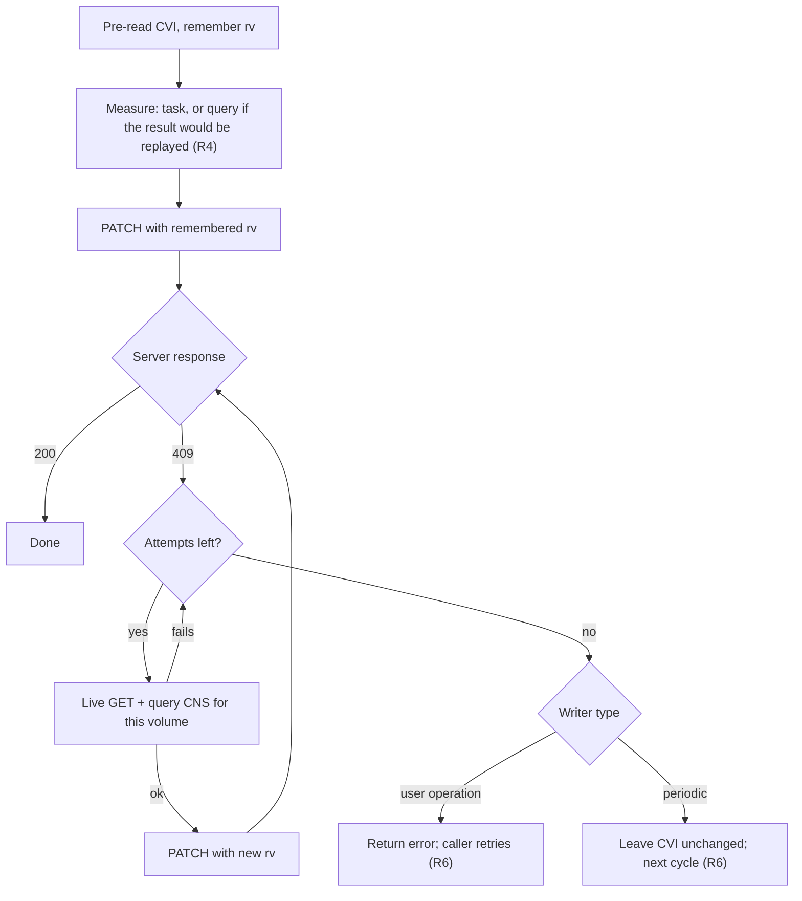
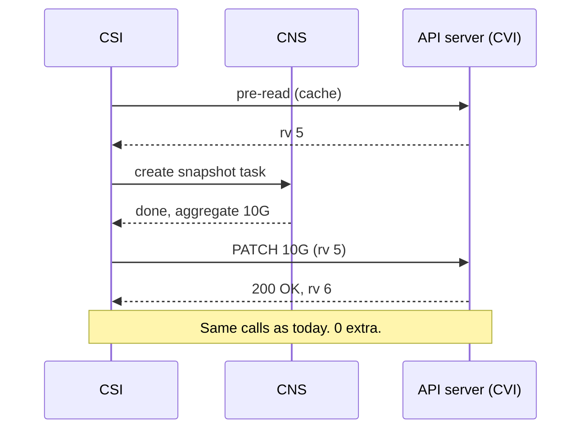
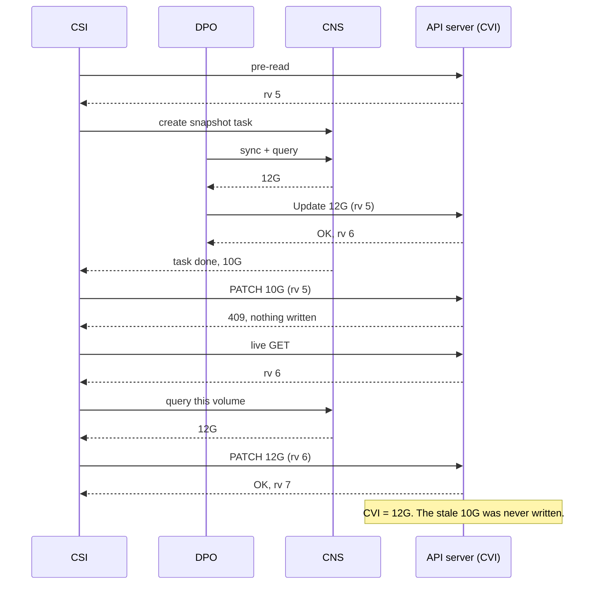
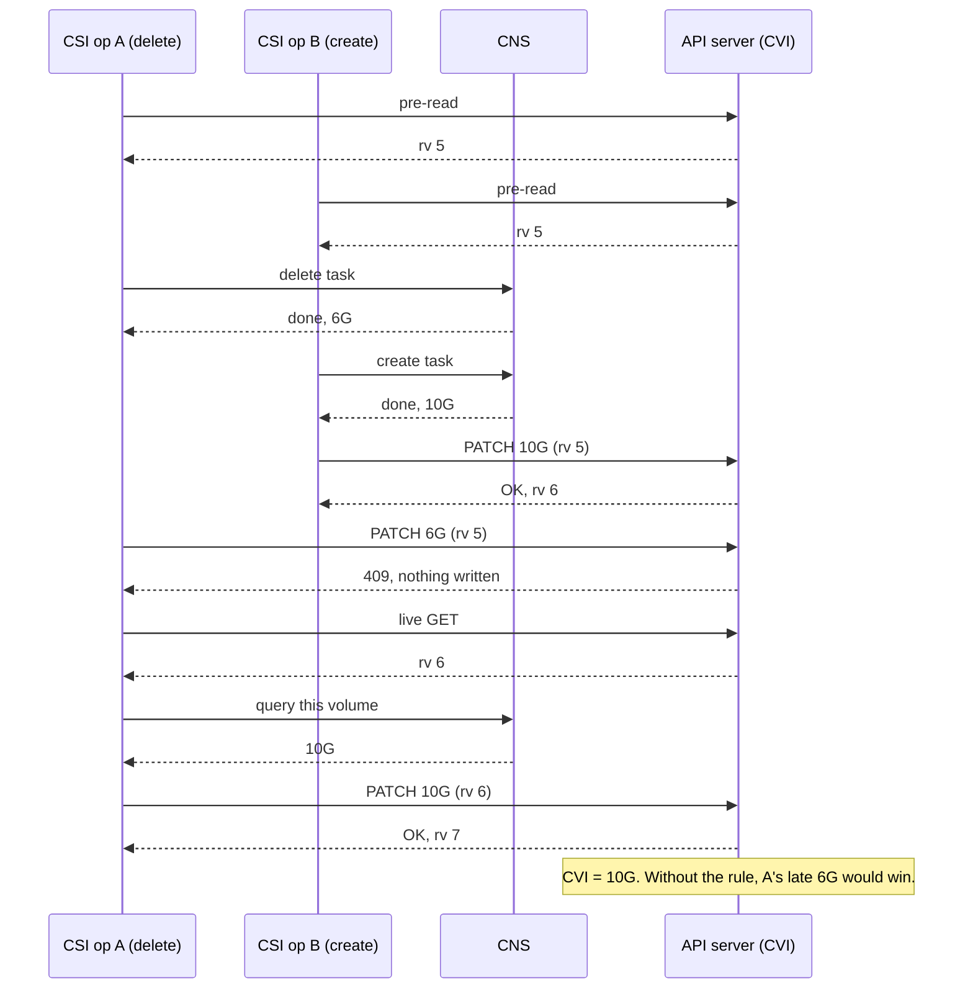
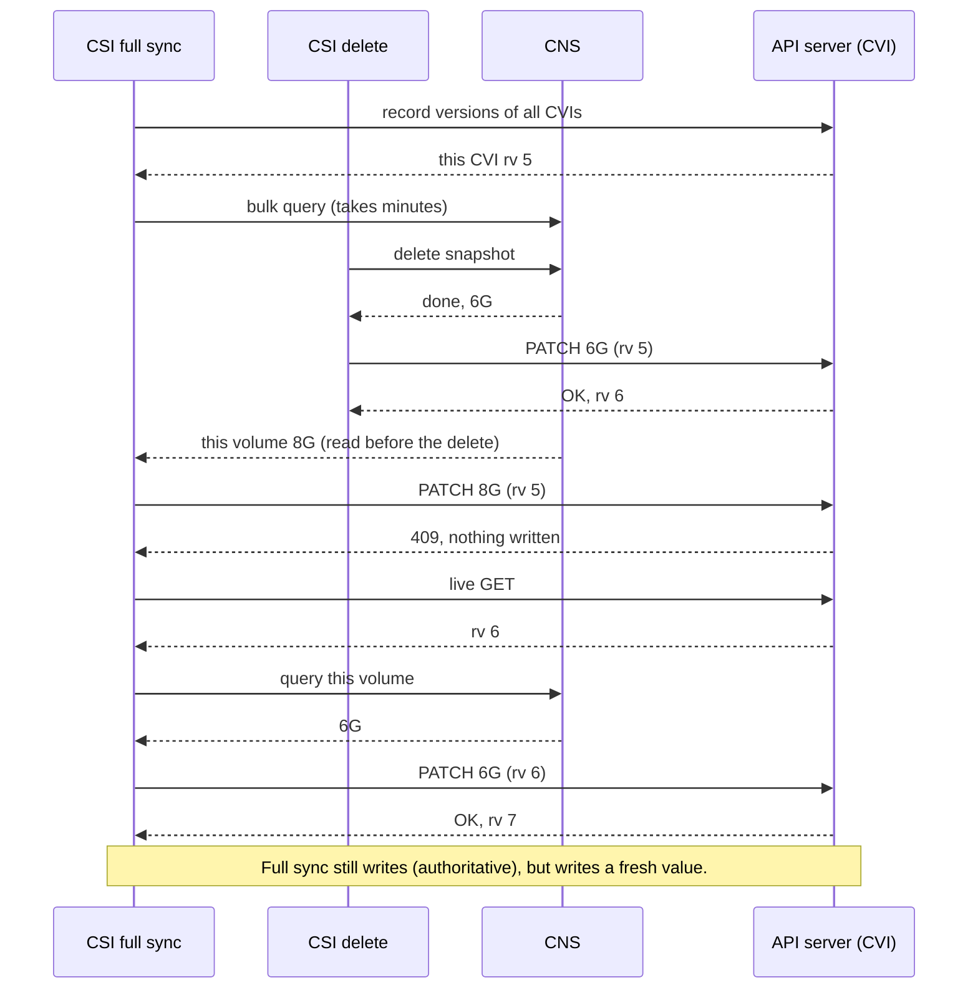
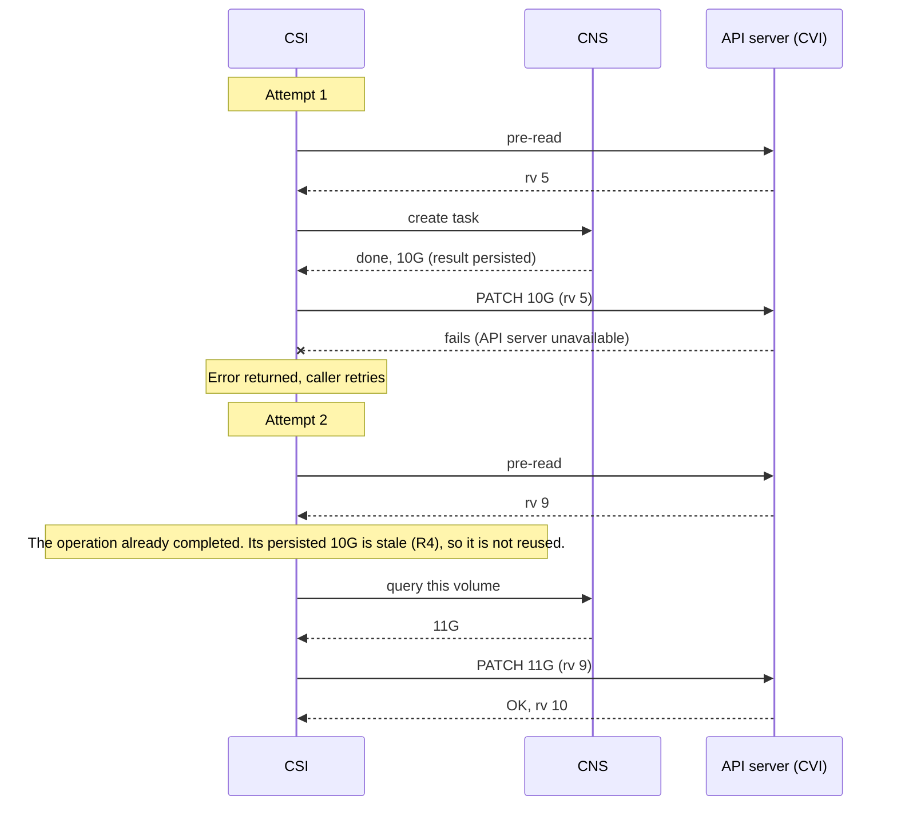
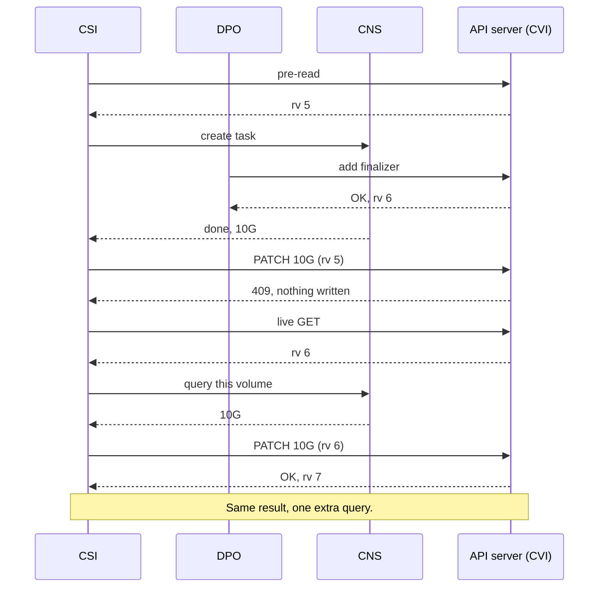

<!-- markdownlint-disable -->
# Conditional writes for CnsVolumeInfo snapshot aggregates

Jira: [CNAS-12489](https://vmw-jira.broadcom.net/browse/CNAS-12489) (parent CNAS-12484).
Source ask: [Quota Management Asks/Dependencies, CSI Ask #1](https://vmw-confluence.broadcom.net/spaces/SABU/pages/3119085298/Quota+Management+Asks+Dependencies).

## 1. Context

Each volume's CnsVolumeInfo (CVI) carries a **snapshot aggregate**: the total bytes of all
snapshots of that volume, plus a validity flag. The snapshot StoragePolicyUsage (SPU) is
recomputed from these aggregates, so a wrong aggregate is a wrong quota.

The true value lives in **CNS**. Several writers copy it into the CVI:

| Writer | Trigger | Where its value comes from |
|---|---|---|
| CSI snapshot create / delete | user operation | returned by the CNS task |
| CSI VM (crash-consistent) snapshot | VM snapshot reconcile | CNS sync + query |
| CSI full sync | every 30 min (default) | bulk CNS query |
| DPO | SnapService snapshot events, DP full sync | CNS sync + query |
| Registration / restore | CVI creation | seeded at creation (CNAS-12485) |

DPO already does read → Update conditioned on `resourceVersion` → retry. CSI writes the
same fields with no precondition.

## 2. Problem

### 2.1 Lost update

A write with no precondition never conflicts, so CSI cannot tell that it is replacing a
value it never saw.



The CSI value (10G) was measured before DPO's (12G) but written after it. Nothing reports the
loss. The quota is wrong until the next full sync.

### 2.2 Timestamps cannot order writers

The CVI also stores an "operation complete" time. Ordering writes by it is unreliable:

- It is the time vCenter marked the **task** complete, not the time the snapshot operation
  completed. Two snapshots can finish in one order and have their tasks marked complete in
  the other:

  ```mermaid
  sequenceDiagram
      participant A as Snapshot A
      participant B as Snapshot B
      participant VC as vCenter tasks
      A->>A: operation completes
      B->>B: operation completes (later)
      VC->>VC: B's task marked complete
      VC->>VC: A's task marked complete (later)
      Note over VC: Ordering by the task timestamp says A is newer, which is wrong.
  ```
- Writers use different clocks (vCenter, Supervisor nodes, DPO).
- It is stored at one-second precision, so operations within the same second cannot be ordered.

So comparing timestamps can't decide which value is newer.

### 2.3 Nobody has priority

Neither writer's value is reliably newer:

- A CSI task result can miss SnapService snapshots that CNS has not synced yet.
- A DPO value can be from before a CSI operation that just finished.

"CSI wins" and "DPO wins" are both wrong some of the time.

## 3. Goals and non-goals

**Goals**
- G1. An older measurement never overwrites a newer one, from any writer, without a clock.
  The one exception is a write that changes nothing (§7.2), which full sync corrects.
- G2. The common path makes **no additional** CNS or API-server calls. The task result
  carries the size so that no extra call is needed.
- G3. Full sync remains authoritative: it corrects every value that differs from CNS, so
  everything converges within one interval, or two in a narrow race (§7.2).

**Non-goals**
- Changing how SPU `Used` is derived from CVIs (already recomputed from inventory).
- Seeding the aggregate at restore (CNAS-12485).
- Making CNS itself fresher (e.g. syncing SnapService snapshots into CNS).

## 4. Core principle: read the version before measuring

> **Write a measurement only if the CVI has not changed since *before* that measurement started.**

### 4.1 How the conditional write works

The check is done **by the API server, atomically, as part of the write**. CSI never compares
versions itself and does **not** do a second GET before writing.

1. **Pre-read.** Before measuring, CSI reads the CVI (a cached copy is fine, see R8) and keeps
   its `metadata.resourceVersion`, say `5`. CSI already does this read today; nothing is added.
2. **Measure.** Run the CNS task, or the query.
3. **Conditional write.** Send the usual PATCH with the remembered version included in the body:
   ```json
   {
     "metadata": { "resourceVersion": "5" },
     "spec":     { "aggregatedsnapshotsize": "10Gi", "validaggregatedsnapshotsize": true }
   }
   ```
4. **The API server decides**, in one step:
   - the CVI's current version is still `5` → apply the patch; the version becomes `6`.
   - the CVI's current version is anything else → `409 Conflict`; nothing is written.

A client-side "GET, compare, then PATCH" would not work. Another writer can land between the
GET and the PATCH, which is today's race. The check only works because the server compares
and writes in one atomic step.

**Notation used below**

| Notation | Meaning |
|---|---|
| `pre-read → rv 5` | the CVI read taken before measuring; remembered `resourceVersion` is 5 |
| `PATCH 10G (rv 5)` | one write request carrying `resourceVersion: 5` as its precondition |
| `409` | the server rejected the write because the CVI's version is no longer 5; nothing was written |
| `live GET` | a read straight from the API server (not the cache); used only after a 409 |

### 4.2 Flow



### 4.3 Why this is enough

Suppose `PATCH (rv 5)` succeeds:

1. Nothing has written the CVI since version 5.
2. So whatever the CVI holds was written before CSI's pre-read.
3. Every writer measures *before* it writes, so that value was measured before CSI's pre-read.
4. CSI's measurement started *after* the pre-read.
5. Therefore CSI's value is at least as fresh as the one it replaces. ∎

No timestamps are compared. Order follows only from the CVI version and CNS being the single
source. Step 1 assumes every write advances the version. A write that changes nothing doesn't
advance it (§7.2).

A 409 means someone wrote during CSI's measurement, and their value may be newer. CSI throws
away its measurement, reads the CVI live, queries CNS for that one volume and writes with the
new version. The conflicting writer updated or synced CNS before writing, so the new query
reflects its value too.

## 5. Rules

| # | Rule |
|---|---|
| R1 | Every write of the snapshot aggregate carries, as its precondition, the CVI `resourceVersion` read **before** the measurement started. |
| R2 | Common path: write the measurement already in hand. No extra calls. |
| R3 | On 409: discard the measurement, do a live GET, query CNS for that one volume, and write with the new version. Retry a bounded number of times. |
| R4 | A measurement from an earlier attempt (e.g. a retried operation replaying a persisted result or resuming an earlier task) is stale by definition. Whatever would replay it measures CNS again instead, so a writer only ever holds a measurement taken after its pre-read. |
| R5 | Full sync is authoritative. It records CVI versions before its bulk query, writes every CVI whose recorded value differs from CNS, and follows R3 on a 409. It skips only a CVI whose recorded value already matches CNS. |
| R6 | Never write an unverified measurement. A conflict, a failed re-query and a failed write each use up one bounded attempt, with a short wait between attempts. When the attempts run out, user operations return an error (the caller retries, which hits R4); periodic writers leave the CVI unchanged and retry on their next cycle. |
| R7 | Timestamps are informational. They are still written, but never decide whether to write. A disagreement between the timestamp and the decision is logged for diagnosis. |
| R8 | The pre-read may come from a cache. A stale cache only causes a false 409 (one extra query), never a stale write. |

The version covers the whole object. Any change, such as status, finalizers or labels, causes
a 409. Unrelated changes cost one query and never affect correctness.



## 6. Examples

### E1. No contention (common case)



### E2. DPO writes during a CSI snapshot



### E3. Two CSI operations on one volume, measured in one order and written in the other

Start at 10G. Delete A finishes first (6G). Create B finishes second (A and B applied: 10G),
but B writes first.



### E4. Full sync with a stale bulk read



### E5. Retried snapshot operation



### E6. Unrelated CVI change



## 7. Trade-offs

### 7.1 Options considered

| Option | Common-path cost | Older value can overwrite newer? | Full sync authoritative | Verdict |
|---|---|---|---|---|
| Unconditioned write (today) | 0 | yes, silently | yes | ✗ lost updates |
| Order by timestamp | 0 | yes, when clocks or task times disagree | no | ✗ unreliable (§2.2) |
| Conditional write, reapply the same value on 409 | 0 | yes, after a "detected" conflict | yes | ✗ detects but doesn't prevent |
| Conditional write, yield on 409 | 0 | no, but CSI's own result is lost | no | ✗ wrong whenever CSI is newer |
| Conditional write, keep the larger value on 409 | 0 | yes, when the newer value is smaller (deletes) | yes | ✗ breaks G1 |
| Re-measure from CNS before every write | **+1 CNS query per operation** | no | yes | ✗ breaks G2 |
| **Version read before measuring, re-measure on 409** | **0** | **no** | **yes** | ✓ chosen |

### 7.2 What we accept

- **Conflicts cost a CNS query.** That's one query plus one live GET per retry, for the
  affected volume only. A 409 needs a concurrent write during a measurement window: a snapshot
  task, a VM snapshot sync, or a full-sync bulk query.
- **False conflicts.** Unrelated CVI changes during that window also cost one query (E6).
- **Failures delay, they don't corrupt.** A failed re-query is retried like any other failure.
  When the attempts run out, the CVI keeps its previous value until the caller retries or the
  next cycle runs (R6). We chose correctness over an
  over-report bias: a "keep the larger value" fallback would break G1 after deletes.
- **Full sync can skip in a narrow race.** Full sync compares CNS with the value it recorded
  before its bulk query. Suppose another writer stores a different value in between, and CNS
  returns to the recorded value before the query reads it. For example, a CSI create writes 8G
  while a DP delete brings CNS back from 8G to 5G. Full sync then sees 5G = 5G and skips, so 8G
  stays until the next full sync, or until any other write to that volume gets a 409 and
  re-measures. If either condition doesn't hold, full sync sees the mismatch and corrects it in
  the same cycle.
- **A write that changes nothing doesn't advance the version.** The API server applies a patch
  that leaves the CVI unchanged without bumping `resourceVersion`. So an older measurement in
  flight can still pass its precondition after a newer, identical write: CNS goes from X to Y and
  back to X, and the newer writer writes X again. Most writes carry a new timestamp, so they
  always change the CVI. Identical writes come only from a replay whose size hasn't changed,
  repeated "size unknown" writes, or two writes of the same value within one second. Full sync
  corrects the result.
- **Convergence holds.** It is bounded by one full-sync interval, or two in the races above,
  because every failed write is retried and every mismatch full sync sees is corrected.
- **No timestamp ordering.** If two values are both verified fresh, the last write wins.
  That's correct, because the later one measured later.

## 8. Assumptions

- A1. CNS is the single source of truth, and its reads are monotonic: a query issued later
  never returns an older state than one issued earlier.
- A2. Every writer measures before it writes and never writes a value it hasn't measured.
- A3. A newly created CVI has no earlier value to protect. Creation is already conditional:
  it fails if the CVI exists. Any later update follows §5.

If A1 or A2 doesn't hold, the reasoning in §4.3 doesn't hold either.

## 9. Requirements on DPO

DPO already uses version-conditioned updates with retries. For G1 to hold in both directions,
DPO must also:

- **Take its pre-read before its CNS sync/query, not after.** Reading it afterwards lets DPO
  overwrite a CSI value written during DPO's measurement.
- **Re-measure on 409** instead of reapplying the value it already holds.
- **Write only values read from CNS** (A2).

## 10. Acceptance

| Ticket criterion | How it is met |
|---|---|
| Create, delete, VM snapshot, registration and full sync covered | R1 applies to every writer; registration via A3 |
| Conflicts reread, reconsider, retry safely | R3, R4, R6 |
| A test proves an older CSI value can't overwrite a newer DP value | E2 and E4 as tests: a concurrent write between the pre-read and the write → 409 → re-measured value written, old value never written |
| Don't claim the version makes an old measurement fresh | §4.3: the version is read *before* measuring, and a 409 always forces a new measurement |

Additional tests: E3 (out-of-order CSI operations), E5 (replay is re-measured), E6 (unrelated
change), R6 (re-query failure leaves the CVI unchanged and reports an error), R8 (stale cache
causes a 409, not a stale write).
