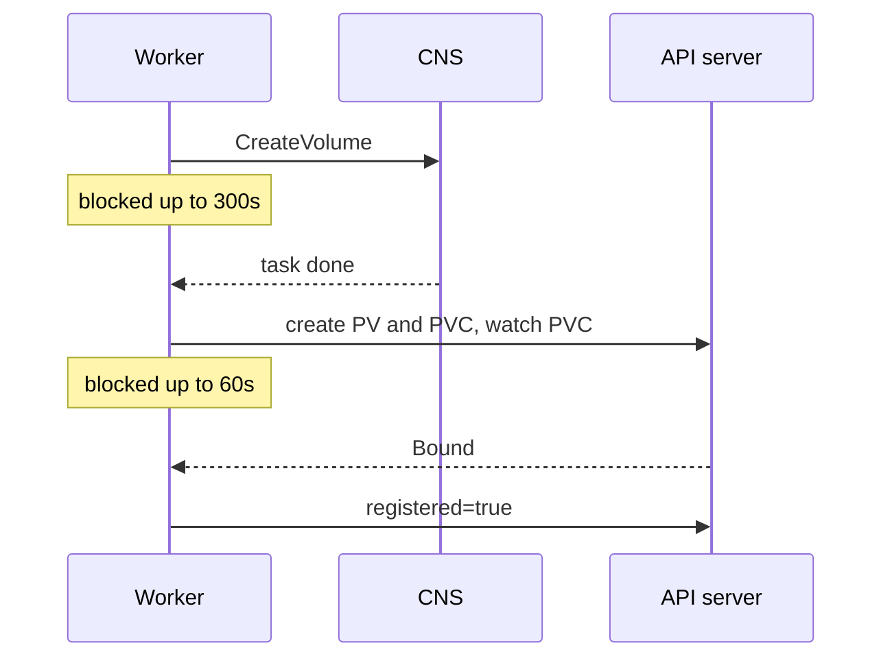
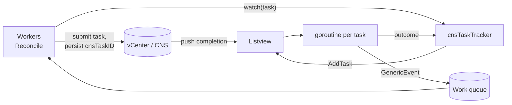
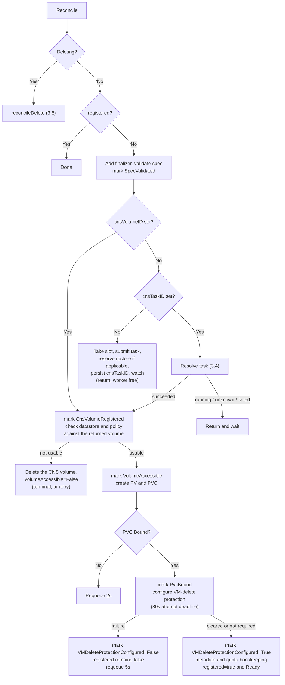
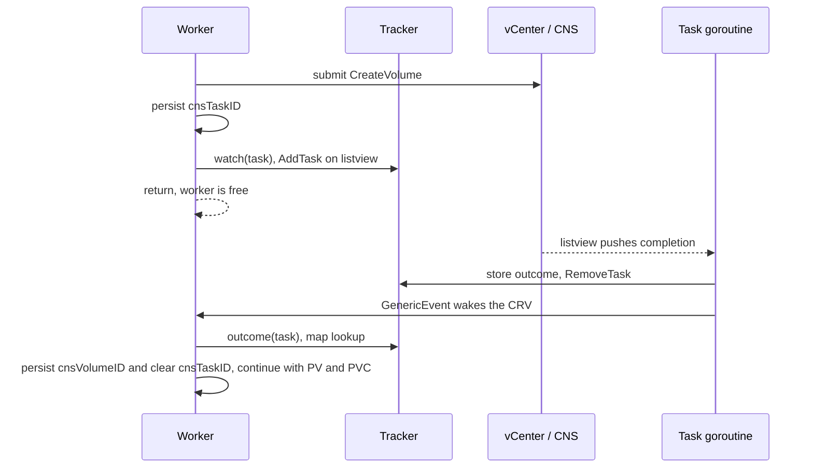
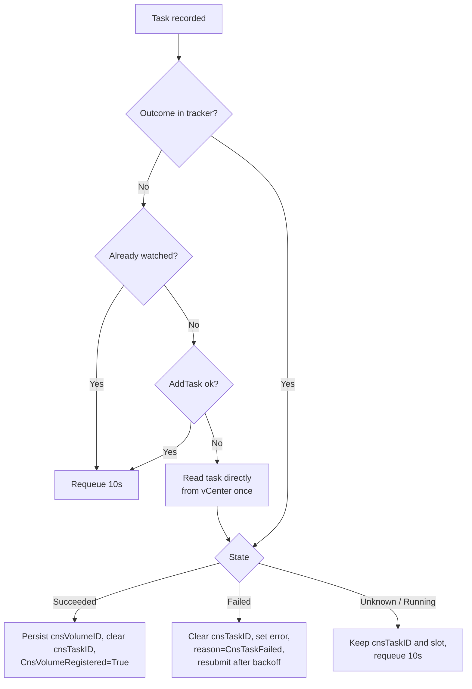
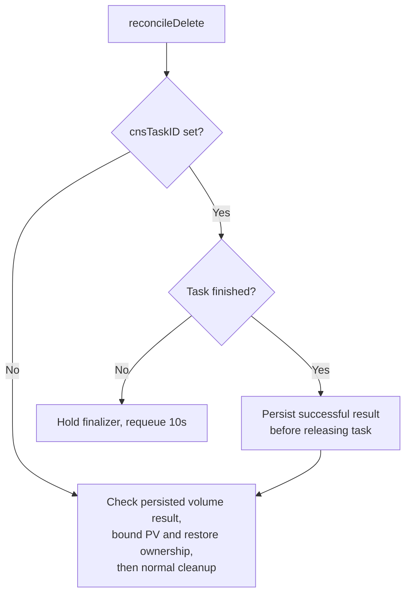

<!-- markdownlint-disable -->
# Asynchronous CnsRegisterVolume reconcile

Jira: UBMCNS-2482.

This implementation is based on upstream `6a84be7f` (PR #4402). SnapService restore must
preserve [CNAS-12485](../CNAS-12485/spec.md), especially §6.2–§6.9 and the DP contract in §9.
The async changes affect scheduling and recovery, not the source or ownership of snapshot charges.

A `CnsRegisterVolume` (CRV) asks the Supervisor to import an existing disk (by `volumeID` or
`diskURLPath`), create the PV and PVC for it, and report `status.registered=true`. VM Operator
creates one CRV per disk when it imports or restores a VM, and VM Service waits 120s for each.

## 1. The problem

### 1.1 Workers are held while waiting

The controller runs `MaxConcurrentReconciles` workers (`WORKER_THREADS_REGISTER_VOLUME`, default
40). One worker handles one CRV start to finish inside a single `Reconcile()` call, and most of that
time is spent waiting, not working.

| Where the worker blocks | Hold time | Code |
|---|---|---|
| CNS `CreateVolume` task (`waitOnTask`) | up to 300s (`VolumeOperationTimeoutInSeconds`) | `Manager.CreateVolume` |
| PVC bound (`isPVCBound`, one API-server watch per CRV) | up to 60s | `util.go` |



### 1.2 Consequences

1. **Head-of-line blocking.** With 40 registrations in flight, the 41st waits for a worker even when
   vCenter and the API server are idle. A burst (a VM with many disks, or a restore of many VMs)
   fills every worker and everything behind it queues on CNS latency.
2. **Slow tasks shrink the pool.** A task that takes minutes, or hits the 300s timeout, holds a
   worker the whole time.
3. **Many API-server watches.** A burst opens up to 40 concurrent single-PVC watches.
4. **Restart loses the work.** The task reference lives only on the worker's stack. After a syncer
   restart every in-flight CRV re-enters the queue with no memory of its task. `DiskURLPath` CRVs
   also used a new random volume name per attempt, so a retry could not be matched to the volume an
   earlier attempt created.
5. **Not diagnosable.** Operators see only `registered=false` and a free-text `error`. "Queued",
   "CNS task running" and "waiting for bind" look identical.

Because VM Service waits 120s for each CRV, a queue wait longer than that makes registrations time
out even though the reconcile itself takes only seconds of real work.

## 2. How the problem is solved

### 2.1 Approach

Both waits leave the worker, and a CRV's progress is stored on the CRV itself so any later pass,
including one after a restart, can resume from it.

| Wait | Before | After |
|---|---|---|
| CNS CreateVolume task | worker parked in `waitOnTask` | submit, persist `status.cnsTaskID`, return |
| PVC bind | per-CR watch, up to 60s | one `Get`, then `RequeueAfter` |

Reconcile becomes **multi-pass**: each pass does the work that is ready and returns. A CRV is woken
when its task completes instead of being held until then.



### 2.2 Completion is pushed by the listview, not polled

The listview multiplexes every registered task onto one `WaitForUpdates` session against vCenter
and pushes completions. Watching N tasks costs one connection and no periodic reads. Polling
`TaskInfo` per task per interval would reintroduce exactly the vCenter load the listview exists to
avoid.

`AddTask` only registers a channel; it does not need a blocked goroutine. The change is **who owns
that channel**. Instead of a reconciler worker, a bare goroutine in `cnsTaskTracker` parks on it,
records the outcome, and wakes the CRV with a `GenericEvent`. That goroutine holds no work-queue
slot and blocks no other CRV. Checking a task during reconcile is a map lookup and costs no vCenter
call.

Two listview properties shape the tracker:

- `processTaskUpdate` drops an update when no channel is registered for the task, so `RemoveTask`
  cannot be deferred at submit time the way `waitOnTask` does it. It runs only after the result has
  been consumed.
- Its send is non-blocking, so a full channel silently discards the result. Each task gets its own
  channel with capacity 1.

### 2.3 Supporting decisions

| Decision | Why |
|---|---|
| **Explicit in-flight cap**, `MAX_INFLIGHT_CNS_TASKS_REGISTER_VOLUME` (default 40) | The 40 blocking workers were an implicit ceiling on concurrent `CreateVolume` calls into vCenter. Releasing them removes it, so it is replaced explicitly or a burst would hit CNS harder than today. |
| **Distinct `Unknown` task state** | `reportErrorOnAllPendingTasks` pushes `TaskInfo == nil` to every pending task when the listview merely loses its session, which has the same shape as a real failure. Treating it as failure would issue a second `CreateVolume` for a disk whose first task is still running. Unknown keeps the task ID and slot and never resubmits. |
| **Deletion waits for an in-flight task** | Dropping the finalizer while a task runs would delete the CRV and orphan the volume the task creates. The finalizer is held until the task settles, then any volume it created is cleaned up. |
| **`DiskURLPath` volume name from the CRV UID** | Every attempt for one CRV uses `static-pv-<uid>`, so a volume whose task reference was lost can still be found by name. |
| **CreateVolume latency metric recorded in the tracker** | `Manager.CreateVolume` timed its blocking call. That call is gone from this path; without this the metric would silently stop for registrations. |
| **CNS fault handling unchanged** | A failed task still writes `status.error` and retries indefinitely. Classifying faults as permanent needs agreement with VM Operator first, because a misclassification wedges a VM that currently self-heals. |

### 2.4 Observable progress: status conditions

Because a registration is now spread over several passes, the CR has to say where it is. That
progress is published as `status.conditions`, the same `[]metav1.Condition` pattern
`CnsNodeVMBatchAttachment` already uses, written with the shared `pkg/common/conditions` helpers.
A future step in the flow is then one more condition type rather than a new field or a new enum
value.

| Field | Status | Meaning |
|---|---|---|
| `status.registered` | existing, required | Unchanged. The completion signal. |
| `status.error` | existing, optional | Unchanged. Last error, free text. |
| `status.conditions` | **new**, optional | Step-by-step progress and the reason the CR is not ready. |
| `status.cnsTaskID` | **new**, optional | vCenter task MoRef of the in-flight CreateVolume. See 2.5. |

`registered`, not `Ready`, remains the completion signal for existing consumers. The two are always
written in the same patch, so they cannot disagree.

#### Type definition

```go
// Conditions describes the observed progress of this registration.
// +optional
// +patchMergeKey=type
// +patchStrategy=merge
// +listType=map
// +listMapKey=type
Conditions []metav1.Condition `json:"conditions,omitempty" patchStrategy:"merge" patchMergeKey:"type"`
```

The type also gains the two accessors the `conditions` package requires, exactly as
`CnsNodeVMBatchAttachment` declares them:

```go
func (in *CnsRegisterVolume) GetConditions() []metav1.Condition  { return in.Status.Conditions }
func (in *CnsRegisterVolume) SetConditions(c []metav1.Condition) { in.Status.Conditions = c }
```

Condition types are declared as constants next to the existing ones, so a consumer never has to
spell a literal:

```go
const (
    // ConditionReady reflects the overall state of the registration.
    // conditions.ReadyConditionType in the shared package is the same string.
    ConditionReady = "Ready"
    // ConditionSpecValidated reflects whether the spec passed validation.
    ConditionSpecValidated = "SpecValidated"
    // ConditionCnsVolumeRegistered reflects whether CNS has registered the disk.
    ConditionCnsVolumeRegistered = "CnsVolumeRegistered"
    // ConditionVolumeAccessible reflects whether the registered volume is
    // reachable and usable from this cluster.
    ConditionVolumeAccessible = "VolumeAccessible"
    // ConditionPvcBound reflects whether the PVC for the volume is bound.
    ConditionPvcBound = "PvcBound"
    // VMDeleteProtectionConfigured means the required keepAfterDeleteVm clear is
    // recorded on the PVC, or this registration does not require clearing.
    ConditionVMDeleteProtectionConfigured = "VMDeleteProtectionConfigured"
)
```

#### Condition types

Each condition is a durable fact about the registration, and `True` means that step is done. A CR
progresses left to right; the leftmost condition that is not `True` is where it is stuck, and its
`reason` and `message` say why.


| Condition | `True` means | Set to `False` while |
|---|---|---|
| `SpecValidated` | The spec's own fields are well formed and, if a `storageClassName` is given, its storage policy is assigned to this namespace. No CNS call has been made yet. | The spec is malformed, or the namespace is not entitled to the requested storage policy. |
| `RestoreValidated` | Restore preconditions and admission checks passed, or restore is not required. | Prerequisites/ownership cannot be read, another attempt is active, or another registration owns the restore. |
| `CnsVolumeRegistered` | CNS has registered the disk and the volume exists. | The CRV is waiting for an in-flight task slot, or its CNS task is running, failed, or in an indeterminate state. |
| `VolumeAccessible` | The registered volume's datastore is reachable from this cluster, its storage policy is compatible and present, and any host-local topology has been resolved. These are checked **against the volume CNS returned**, so they can only run once it exists. | A check against the registered volume failed. The CNS volume is deleted on this path, so the registration is undone rather than left half-made. |
| `PvcBound` | The PV and PVC exist and the PVC reached `Bound`. | The Kubernetes objects are being created, or the PVC has not bound yet. |
| `VMDeleteProtectionConfigured` | The required `keepAfterDeleteVm` clear succeeded and was recorded on the PVC, or clearing is not required. | Clearing or persisting its result has not succeeded; retries do not block binding. |
| `RestoreMetadataConfigured` | Restored CVI handover completed, including a warning-only unseeded result, or handover is not required. | CVI handover or its condition write has not succeeded. |
| `Ready` | Registration is complete. `True` exactly when `registered=true`. | Any of the above is not yet `True`, or the final bookkeeping is still in progress. |

**Conditions are set lazily and never removed.** A condition appears the first time the controller
evaluates that step, so a CRV that has not reached the CNS submit has no `CnsVolumeRegistered`
condition at all. An absent condition means "not yet evaluated", which is distinct from `False`.
A condition is never deleted once set, and never regresses merely because a pass retried. This is
what replaces a single mutable phase value: no write can regress an earlier step as a side effect.
A condition does return to `False` when the fact it reports stops being true, which happens in
exactly one place — a terminal accessibility failure deletes the CNS volume, so
`CnsVolumeRegistered` is republished as `False`.

#### Reasons

Every condition carries a `reason`. The CRD requires it (`minLength: 1`, pattern
`^[A-Za-z]([A-Za-z0-9_,:]*[A-Za-z0-9_])?$`), so reasons are CamelCase with no spaces or hyphens.
The reasons are the diagnostic payload: they are what used to be invisible.

| Condition | `status` | `reason` | Meaning |
|---|---|---|---|
| `SpecValidated` | True | `Validated` | Checks passed. |
| | False | `InvalidSpec` | The spec itself is malformed or incomplete. |
| | False | `StoragePolicyNotAssignedToNamespace` | The `storageClassName`'s policy is not assigned to this namespace. Checked before any CNS call so a namespace cannot register a volume with a policy it is not entitled to. |
| | False | `StoragePolicyLookupFailed` | The policy for the StorageClass could not be resolved or its assignment could not be verified. |
| `RestoreValidated` | True | `Validated` / `NotRequired` | Restore preconditions passed or the feature does not apply. |
| | False | `WaitingForRestoreOwner` | Another attempt is active; retry without changing `status.error`. |
| | False | `RestorePrecheckFailed` | Prerequisite, ownership read or reservation persistence failed; retry. |
| | False | `RestoreNotProcessed` | Another registration stamped the volume; durable marker, no retry. |
| `RestoreMetadataConfigured` | False | `ConfiguringRestoreMetadata` | Initial handover attempt after binding and VM-delete protection. |
| | False | `RestoreMetadataFailed` | Retry the complete handover; do not publish registration success. |
| | True | `RestoreMetadataConfigured` / `NotRequired` | Handover completed or is not applicable. |
| `CnsVolumeRegistered` | True | `Registered` | The CNS volume exists. |
| | False | `WaitingForTaskSlot` | The in-flight cap is full; retrying every 5s. Nothing has been sent to CNS. |
| | False | `CnsTaskRunning` | The task is submitted and running. No worker is held. |
| | False | `CnsTaskFailed` | CNS reported a terminal fault. **Retried**, not terminal. |
| | False | `CnsTaskStateUnknown` | The task's state could not be determined. The task ID and slot are kept and it is never resubmitted. |
| `VolumeAccessible` | True | `Accessible` | The registered volume is usable from this cluster. |
| | False | `DatastoreNotFound` | A host-local volume's datastore is not present in the namespace's clusters. **Terminal.** |
| | False | `HostLocalPolicyIncompatible` | The host-local storage policy is not compatible with the datastore the disk lives on. **Terminal.** |
| | False | `TopologyUnresolved` | The accessible topology for a host-local volume could not be resolved. **Terminal.** |
| | False | `DatastoreNotAccessibleToAZClusters` | On a stretched supervisor, the datastore is not accessible to any active AZ cluster. **Terminal.** |
| | False | `DatastoreNotAccessibleToCluster` | The datastore is not accessible to all nodes in the cluster. **Terminal.** |
| | False | `StoragePolicyMissing` | The registered volume has no storage policy associated with it. **Retried**, not terminal. |
| | False | `HostLocalCheckFailed` | Whether the policy is host-local, or whether it is compatible with the datastore, could not be determined. A transient vCenter or PBM error. **Retried.** |
| | False | `CleanupPending` | A terminal check failed but deleting the CNS volume did not succeed, so the outcome is retried until the volume is gone. |
| `PvcBound` | True | `Bound` | The PVC is bound. |
| | False | `ConfiguringK8sResources` | Creating the PV and PVC and applying topology and volumeMode fixes. |
| | False | `WaitingForBind` | PV and PVC exist; one `Get` every 2s until the PVC binds. |
| `VMDeleteProtectionConfigured` | False | `ClearingKeepAfterDeleteVm` | Initial configuration attempt after binding. |
| | False | `ClearKeepAfterDeleteVmFailed` | A lookup or VSLM call failed; retry after 5s. |
| | False | `ClearKeepAfterDeleteVmTimedOut` | The attempt exceeded its deadline; retry after 5s. |
| | False | `PersistClearResultFailed` | The clear succeeded but its PVC annotation could not be persisted; retry the idempotent clear. |
| | True | `KeepAfterDeleteVmCleared` | The successful clear is recorded on the PVC. |
| | True | `NotRequired` | The PVC is outside the registration-time clearing rules. |
| `Ready` | True | `Registered` | Written in the same patch as `registered=true`. |
| | False | `Finalizing` | The PVC is bound; CnsVolumeInfo and StoragePolicyUsage bookkeeping is in progress. |
| | False | *the blocking condition's reason* | Mirrors the leftmost condition that is not `True`. |

A `False` condition is not by itself terminal, and a reader must not infer "give up" from `False`.
Terminality is carried by the reason, and the reasons marked **Terminal** above are exactly the
paths that already returned without requeuing before this change — all of them post-registration
accessibility checks. Everything else retries, including `CnsTaskFailed`, every `SpecValidated`
failure, and `StoragePolicyMissing`.

Two consequences of these checks running after registration:

- **A terminal failure undoes the registration.** The CNS volume is deleted by `cleanupCNSVolume`,
  so `CnsVolumeRegistered` stops being true in fact. It is republished as `False` with reason
  `VolumeCleanedUp` in the same patch as the `VolumeAccessible` failure, rather than being left
  claiming a volume that no longer exists.
- **Cleanup failure defers the verdict.** If `cleanupCNSVolume` itself fails the pass requeues
  instead of returning terminally, so the terminal reason is only published once the volume is
  actually gone. Until then the reason is `CleanupPending`.

#### How conditions are written

- `conditions.MarkFalse(instance, type, reason, format, args...)` and
  `conditions.MarkError(instance, type, reason, err)` are used directly for the `False` cases.
- For the `True` cases the controller uses `conditions.Set` with an explicit condition rather than
  `conditions.MarkTrue`, because `MarkTrue` hard-codes `reason` to the literal `"True"`
  (`setter.go:42`), which carries no information. `Set` takes `Reason: Validated`, `Registered` or
  `Bound` as listed above.
- `Ready` is **mirrored** from the step conditions by `applyConditions`: unless a caller sets it
  explicitly, it republishes the reason of the leftmost step that is not `True`. That is what lets
  the `Ready` condition, and the kubectl column reading it, answer "why is this CR not registered
  yet" without the reader walking the array.
- Three cases set `Ready` explicitly, and mirroring then stands aside:
  `registered=true` publishes `Ready=True` in the **same patch** so the two can never be observed
  out of step; `Finalizing` is set when every step is satisfied and there is nothing left to mirror;
  and a terminal accessibility failure sets `Ready` to the accessibility reason, because
  `CnsVolumeRegistered` is an earlier step and plain mirroring would surface `VolumeCleanedUp` —
  the consequence — where the operator needs the cause.
- `conditions.SetSummary` is not used: it would be a second write, observable out of step with
  `registered`.

#### Time in state

`conditions.Set` updates `lastTransitionTime` only when `status`, `reason` **or** `message` changes
(`setter.go:33-36`); re-stating an identical condition leaves it untouched. The age of the blocking
condition is therefore how long the CRV has been in that exact state, not how recently it was
reconciled, which is what separates a progressing registration from a stalled one. No separate
top-level timestamp field is needed.

Because `message` participates in that comparison, messages must be stable for a given state. A
message that embeds a changing value — a retry count, an elapsed time, a timestamp — would move
`lastTransitionTime` on every pass and destroy the signal. Volatile detail belongs in logs and
events, not in a condition message.

Reading a stuck CR: `CnsVolumeRegistered=False, reason=WaitingForTaskSlot` for a long time means it
is queued behind the cap; `reason=CnsTaskRunning` means CNS is slow; `PvcBound=False,
reason=WaitingForBind` means the PVC is not binding.

#### Consumer rules

- **Look conditions up by type, never by index.** `conditions.Set` sorts the array with `Ready`
  first and the rest alphabetically by type (`conditions.go:247`), so the stored order is not the
  progression order and changes as conditions are added.
- **Treat an absent condition as unknown**, not as `False`. CRs last written by a controller that
  predates this change carry no conditions at all.
- **`observedGeneration`** is set from `metadata.generation` on each condition, so a condition left
  over from an earlier spec generation is identifiable.
- Every condition always carries all five required keys — `type`, `status`, `reason`,
  `lastTransitionTime` and `message`. `message` may be the empty string.

Printer columns: `PVCName`, `Registered`, `Ready`, `Reason`, `Age`, where `Ready` and `Reason` read
the `Ready` condition by JSONPath, for example
`.status.conditions[?(@.type=='Ready')].reason`.

### 2.5 The in-flight CNS task reference

Submitting the CNS task and returning means the task MoRef has to survive until a later pass can
act on it, including a pass in a different process after a syncer restart. It is stored on the CR
as `status.cnsTaskID`:

```go
// CnsTaskID is the vCenter managed object ID of the in-flight CNS CreateVolume
// task for this CR, while one is running.
// +optional
CnsTaskID string `json:"cnsTaskID,omitempty"`
```

The value is the `Value` of the task's `ManagedObjectReference` — a vCenter-assigned identifier such
as `task-12345`. A later pass rebuilds the full reference as
`ManagedObjectReference{Type: "Task", Value: status.cnsTaskID}`.

It is on `status` rather than `spec` or an annotation because it is controller-owned observed
state: the status subresource is not writable by tenants, where an annotation would be. There is no
other durable copy for this path — the controller writes no `CnsVolumeOperationRequest`, and the
volume manager skips its in-memory task map for statically provisioned specs, which every
registration spec is.

#### Lifecycle

| Point | `status.cnsTaskID` |
|---|---|
| Before the first submit | Empty or absent. The next pass submits. |
| Immediately after a successful submit | Set to the task MoRef value, before anything else is done with the task. |
| While the task runs | Unchanged. Each pass reads it, rebuilds the reference, and either finds a recorded outcome or re-subscribes to the listview. |
| Task succeeded | Atomically replaced by `status.cnsVolumeID`, then `CnsVolumeRegistered=True` is published. Subsequent passes query the persisted volume ID and resume Kubernetes work. |
| Task failed | Cleared, `status.error` is set and `CnsVolumeRegistered=False, reason=CnsTaskFailed`. The next pass submits a new task. |
| Task state unknown | **Kept**, along with the in-flight slot. The CR must not resubmit while a task it cannot see may still be running. |
| CR deleted with a task in flight | Kept until the task settles; the finalizer is held meanwhile. Cleared once any volume the task created has been cleaned up. |

A failed task ID is not reused. A successful task becomes `status.cnsVolumeID` in the same
optimistically locked status patch that clears its task ID. This optional controller-owned string
is a recovery checkpoint, not a snapshot size or caller-supplied restore input. Its schema ships
in the embedded CRD; conditions remain informational. The backend is queried before reusing the
ID. Transport errors never authorize a new task; an authoritative missing-volume response clears
the checkpoint for a later attempt. Cleanup clears it after undoing CNS registration.

This closes the task-success-to-PV gap and avoids repeated CNS submissions while waiting for
binding, VM-delete protection or CVI handover, including after task retention expires in vCenter.

#### Writing it

- `setInstanceCnsTaskID` returns its error, unlike condition writes which are best-effort. If the
  reference cannot be stored, the submitted task has no durable pointer and the caller must decide
  what to do, so the error cannot be swallowed.
- It is written **before** the listview subscription is attempted. A failed subscription is
  recoverable from a stored reference; a stored reference that was never written is not.
- If the task-ID write fails, retain the reference in the tracker's capacity slot and retry the
  write on the next pass. Do not resubmit in the same process. A crash before the task ID becomes
  durable still leaves the existing submit/persist uncertainty window; the restore reservation
  prevents a different CR from taking over, but cannot recover the lost task reference itself.
- `persistCnsExecution` uses a resourceVersion precondition; conflicts return to a fresh reconcile.
  The successful result is kept in memory until its status write succeeds. Diagnostic status
  patches omit unchanged execution fields, so a condition write cannot overwrite a newer task ID.
- Reconcile reads the CR through the uncached API reader before making execution decisions.

### 2.6 Compatibility

The CRD change is additive and optional, and nothing outside CSI writes this status:

- **VM Operator** vendors the types in `external/vsphere-csi-driver/api/v1alpha1/`, where
  `CnsRegisterVolumeStatus` declares only `Registered` and `Error`. It reads `Status.Registered` and
  `Status.Error`, and only ever performs `Get`, `Create` and `Delete` on the CR; it never writes
  status. Unknown status fields are simply not decoded into its struct, so conditions cannot be
  clobbered by it and nothing breaks if it never re-vendors.
- **`VKSRegisterVolume`**, the in-tree consumer, is read-only and reads only `Spec.PvcName`,
  `Status.Registered` and `Status.Error`. Untouched, as is its guest-flavor and FSS gating.
- **VM Operator e2e** waits on `status.registered`, which is written at the same points as before.
- `registered` and `error` keep their exact meaning. The additions are `conditions`,
  `cnsTaskID` and `cnsVolumeID`, all optional.
- No change to the `volumes.Manager` interface or the listview, and the syncer's volume manager
  still gets no operation store. The new volume-package code is additive.

## 3. How it is implemented

### 3.1 Components

| Component | File | Responsibility |
|---|---|---|
| `SubmitCreateVolumeTask`, `GetCreateVolumeTaskResult`, `DecodeCreateVolumeTaskResult`, `TaskListView` | `pkg/common/cns-lib/volume/async_create.go` | Submit without waiting; one-shot task read; decode a listview result. Decoding delegates to the same unexported helpers `Manager.CreateVolume` uses, so both paths agree on what a response means, including `CnsAlreadyRegisteredFault` → success, which makes resubmission safe. |
| `cnsTaskTracker` | `cnsregistervolume/tasktracker.go` | Per-task watcher goroutines, completed-outcome map, in-flight slot accounting, latency metric, wake-ups. |
| `submitOrPollCreateVolume` and helpers | `cnsregistervolume/asyncregister.go` | Submit-or-resume, outcome handling, direct-read fallback, `isPVCBoundNow`, delete with task in flight. |
| `Reconcile`, `reconcileDelete`, status helpers | `cnsregistervolume_controller.go` | Condition publication, event source registration, finalizer handling. |
| CRD and types | `pkg/apis/cnsoperator/cnsregistervolume/v1alpha1`, `config/cnsregistervolume_crd.yaml` | New status fields and printer columns. |

### 3.2 Reconcile flow



Each box that says "return" releases the worker. Requeue intervals:

| Constant | Value | Purpose |
|---|---|---|
| `cnsTaskSafetyRequeue` | 10s | Backstop if a completion wake-up is lost. Completion normally arrives as a push, so this is not a poll. |
| `cnsSlotRetryInterval` | 5s | Wait before retrying for an in-flight slot. |
| `pvcBindPollInterval` | 2s | Re-check an unbound PVC with one `Get`. |
| `vmDeleteProtectionRetryInterval` | 5s | Retry flag configuration independently of the general exponential backoff. |
| `vmDeleteProtectionClearTimeout` | 30s | Bound one flag-configuration attempt, including its VM lookup and PVC annotation write. |

A dropped wake-up therefore costs latency, never progress.

#### VM-delete-protection configuration after binding

[UBMCNS-1582](https://vmw-jira.broadcom.net/browse/UBMCNS-1582) reports VSLM
`keepAfterDeleteVm` clear failures followed by exponential retry delays that block
PV creation and PVC binding. It does not establish that individual clear calls
are slow. Move `clearKeepAfterDeleteVmIfNonRemovable` after confirming PVC Bound,
before CnsVolumeInfo/quota bookkeeping and before `setInstanceSuccess`. A failed
clear must not repeatedly execute the additive quota updates. This placement
avoids introducing that retry path; it does not solve the pre-existing accounting
idempotency problem if a later finalization/status write fails.

The applicability rules are unchanged: a VirtualMachine DataSourceRef and a
matching VM volume with `removable=false`. Only `keepAfterDeleteVm` is cleared;
CBT and other FCD control flags are preserved. A successful clear is followed by
persisting `AnnVMDeleteProtectionCleared=true` on the PVC. A retry with that marker
skips the VM lookup and VSLM call. Conditions remain informational and are not
used as completion checkpoints. If the clear succeeds but the annotation write
fails, retry the idempotent clear rather than reporting registration success.

`registered` remains false until this step and final bookkeeping succeed. A
restart re-enqueues the unfinished CR and re-evaluates the PVC; no in-memory
state is needed for the flag operation. The new condition is included after
`PvcBound` in Ready mirroring. Stable failure reasons/messages retain their
transition time across identical retries. Warning events are emitted without
`recordEvent`'s exponential-backoff side effect. Each VSLM call logs its elapsed
time and result, while failure logs report the retry interval, distinguishing
remote-call time from time spent waiting between attempts.

The 30s child context bounds this synchronous attempt, but it still occupies a
worker while the call is running. Status reporting uses the parent context after
the attempt ends. The volume manager also supplies its standard operation timeout
when no caller deadline exists, covering other callers without lengthening the
controller's deadline. These bounds are initial values for end-to-end validation,
not a promise of completion within the test's 40s polling window.

Existing deletion handling remains responsible for cancelled registrations and
preserves bound PVs. Test deletion with a bound PVC and an incomplete protection
step. The syncer's owner-reference-based repair remains separate from this
registration-time requirement; do not rely on it to justify early success.

Status patches copy the returned resourceVersion into the working CR. Otherwise,
condition writes make that object stale before the metadata update in
`setInstanceSuccess`, causing conflicts with the controller's own writes.

Regression coverage must verify binding before clearing; retry, timeout and
annotation-persistence failure conditions; stable transition times; recovery with
a fresh reconciler; annotation-based skipping; `NotRequired`; and success only
after clearing. Validate powered-on and powered-off VM imports in the affected
build with separate timestamps for PVC creation, binding, clear attempts and CRV
completion. Snapshot-restore timeouts reported in the Jira are outside this fix.


### 3.3 Submit and complete



The wake-up uses a `source.Channel` watch registered in `add()`. The controller's
`GenerationChangedPredicate` overrides only `Update`, so Generic events pass through. Status writes
do not bump `metadata.generation`, so publishing a condition does not re-trigger the controller.

### 3.4 Resolving a recorded task

`pollCreateVolume` runs on every pass where `status.cnsTaskID` is set.



A consumed task result is never reused: a cleared or failed task ID leads to a new submit, not a
retry of the old task. `Unknown` never resubmits.

### 3.5 In-flight cap and restart

Slot accounting in `cnsTaskTracker`:

- Slots are keyed by **CR**, not by task, so a CR that loses its task reference cannot leak one.
- A CR that already holds a slot gets it back rather than a second one, so repeated reconciles do
  not consume the cap.
- A slot is taken before submit and released on submit failure or when a success or failure is
  consumed. It is **kept** across an Unknown outcome.
- After a restart, CRVs that already hold a `cnsTaskID` resume and take a slot without being
  refused, so the cap can be exceeded transiently, bounded by the number of tasks that were in
  flight under the previous process (itself capped at 40).

Failure and restart handling:

| Event | Behaviour |
|---|---|
| Syncer restarts with a task running | The CRV still has `cnsTaskID`. The next pass finds no watcher and re-subscribes via `AddTask`. If the task is gone from vCenter, it is read directly. No new submit. |
| Crash after submit, before `cnsTaskID` is persisted | The task runs on CNS with no reference. The next pass resubmits, which is safe because CNS answers a repeat registration of the same disk with `CnsAlreadyRegisteredFault`, mapped to success by the shared decoding helpers. The deterministic volume name lets the volume be found by name. |
| `cnsTaskID` patch fails | Keep the reference in the tracker slot; retry persistence without resubmitting. |
| `AddTask` fails after submit | The task is submitted and recorded; only the subscription failed. Not fatal. The safety requeue retries it. |

### 3.6 Deletion with a task in flight



### 3.7 Status publication

The condition and task-ID semantics are in 2.4 and 2.5; this is how the writes are made.

- **One patch per observable change.** `patchCnsRegisterVolumeStatus` builds a JSON **merge**
  patch. Arrays are replaced wholesale under merge-patch semantics, so the `conditions` key carries
  the whole array whenever any condition changes and is omitted when none did. Omitting a key leaves
  the stored value untouched, which is what keeps a write that is only about `registered` or
  `error` from wiping conditions published by an earlier write.
- **`registered`, `error` and `Ready` move together.** `setInstanceSuccess` writes
  `registered=true`, clears `error` and sets `Ready=True` in the same patch, so no observer can see
  one without the others. `setInstanceError` does the same for the failure side: it takes the
  conditions that explain the error as variadic arguments and publishes them in one patch. It stays
  the single funnel for every error path — a second entry point that some paths used instead would
  be one the error-reporting tests no longer cover.
- **The six terminal accessibility checks share one path.** `failVolumeNotAccessible` performs the
  cleanup, decides between `CleanupPending` and the terminal reason, and publishes
  `VolumeAccessible`, `CnsVolumeRegistered` and `Ready` in a single patch, so the sequence cannot
  drift between the call sites.
- **Progress writes are best-effort, the task-ID write is not.** A failed condition publish is
  logged and the in-memory copy rolled back so it still matches the server; the next transition
  publishes again. A failed `cnsTaskID` write is returned to the caller (2.5).
- **Publishing status does not re-trigger the controller.** It filters events with
  `predicate.GenerationChangedPredicate`, and a status-subresource write does not bump
  `metadata.generation`.
- **CRD delivery.** The schema is structural, so an undeclared status field would be silently
  pruned. `conditions`, `cnsTaskID` and `cnsVolumeID` are declared in the embedded CRD, which the syncer applies
  before any controller starts. A unit test asserts the shipped CRD declares them, including the
  `x-kubernetes-list-type: map` keyed by `type` on `conditions`.


## 4. SnapService restore across async reconciles

### 4.1 CNAS-12485 contract

| Contract | Async implementation |
|---|---|
| D2, D3, D5: read the DVI directly; seed on CVI creation; never overwrite an aggregate | Keep `CreateOrUpdateRestoredVolumeInfo` unchanged. No snapshot size, validity or timestamp is added to CRV spec or status. `cnsVolumeID` is only the CNS registration task result. |
| D6, D10: restore finalizer and DPO ownership | Keep the finalizer in the CVI Create. CSI neither writes/deletes DVIs nor removes the SnapService finalizer. |
| D11/D12, §6.1–6.3: explicit annotation, capability and matching DVI | Retain the feature/service gates and namespace/volume identity checks. Missing prerequisites retry with `status.error`; no new task, PV or PVC is created. |
| §6.7: stamped retries continue after DVI removal | Own PV/CVI stamps bypass the precheck. An existing task is monitored without re-submission, then prerequisites are checked again before Kubernetes work if no stamp exists yet. |
| D13/D15, §6.9: first stamp wins | Keep the per-reconcile lock and conditional PV/CVI stamps. A temporary reservation bridges the async gap before a stamp, and does not itself establish ownership. |
| D14, §6.8: CVI owns `SnapshotSizeRestored` | Do not copy it onto CRV or gate registration on it being True. Full sync retains its False-to-True behavior. |
| D16: never mutate another registration's volume | Preserve PV checks before recreation/deletion; check CVI ownership before CNS cleanup, including cleanup of a task that completes during deletion. |
| §6.4/6.5: safe handover and no accounting gap | Continue to use one CVI Create for the seed, finalizer and stamp, followed by the CVI status patch. Unchanged resourceVersion retry rules protect concurrent writers. |
| §10: missing seed after precheck is a warning | A completed unseeded handover reports `RestoreMetadataConfigured=True`; CVI reports `SnapshotSizeRestored=False`. Registration may finish normally. |

`RestoreValidated` is mirrored between `SpecValidated` and `CnsVolumeRegistered`.
`RestoreMetadataConfigured` is mirrored after `VMDeleteProtectionConfigured`. Both are lazy,
observational conditions. Existing CRs without them remain valid. `registered=true` and
`Ready=True` are still the only completion publication, after quota bookkeeping.

### 4.2 Reservation lifecycle

The existing in-memory restore lock is still acquired before the ownership check and released
on every reconcile exit. The single leader additionally persists
`cns.vmware.com/restore-volume-id=<volume UUID>` on the CR, after validation and task-cap admission,
before submitting CNS work. While holding the lock, a competing unstamped restore lists matching
CRs through the API reader with a server-side label selector. This is across namespaces because
a Supervisor's vCenter volume ID is global. No PVC/PV informer or DVI write is added.

A pending reservation means **wait**, not **not processed**. Completed and not-processed CRs do
not reserve work. Terminating CRs do reserve it until their finalizers settle outstanding tasks
and cleanup. A definitive task failure or successful CNS cleanup releases the reservation so
another attempt can proceed if no stamp exists. Read/write errors retain the reservation rather
than allowing overlapping operations. Reservations survive restart and PV recreation without
holding a worker or an in-memory mutex across reconciles.

The first live PV/CVI stamp remains authoritative. Once another CR owns that stamp, retain
CNAS-12485's not-processed marker, final status error and no-retry behavior. Ownership metadata
is not inferred from conditions. Ordinary unannotated registrations remain outside this restore
serialization, as explicitly scoped in CNAS-12485 §6.9.

### 4.3 Handover and deletion

After binding and VM-delete-protection configuration, invoke the existing handover helper.
A missing/deleting PV, a terminating CVI, DVI API error or failed CVI write retries without quota
writes or success publication. An unseeded warning outcome completes the handover. Repeating a
handover never overwrites an existing snapshot aggregate or resets the CVI condition after DPO
has removed its DVI. Full-sync recovery is unchanged.

Deletion re-establishes monitoring of an outstanding task after restart. Unknown task state keeps
the finalizer, task reference and reservation. A successful result is persisted before any cleanup.
Existing PVs go through bound/ownership checks before CNS cleanup; a missing PV also requires
checking CVI ownership. A task result must never cause another registration's CNS volume to be
untagged before those checks.

### 4.4 Validation

Retain and run all tests introduced by PR #4402: CVI/DVI service and schema tests, registration
precheck/ownership/stamp/handover tests, full-sync restore tests, DVI activation/accounting/scope
tests, CRD installation tests, and WCP regression tests. Add async coverage for:

- competing CRs across requeue/restart before any PV exists; a reservation waits and a stamp rejects;
- failed attempts releasing reservations, with unknown tasks retaining theirs;
- task success persisted before releasing its result, and retries after persistence failure;
- restart after success without resubmission during bind/finalization;
- handover failure and warning-only completion, Ready mirroring and stable transition times;
- delete with an unknown task, and a completed task whose PV belongs to another restore;
- stale execution writes conflicting, and the embedded schema preserving successful volume IDs.
