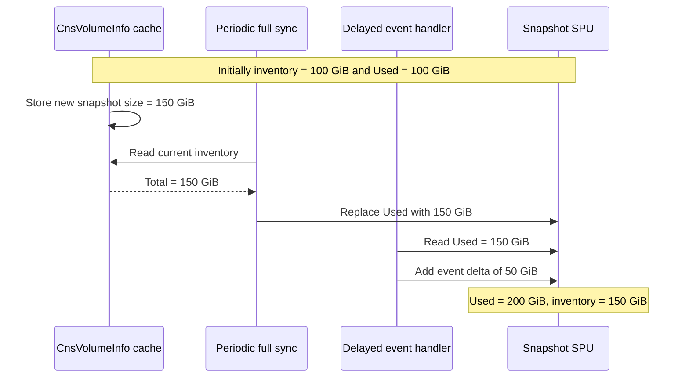
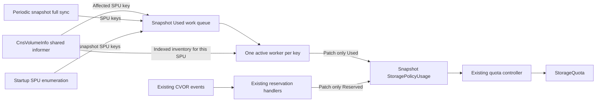
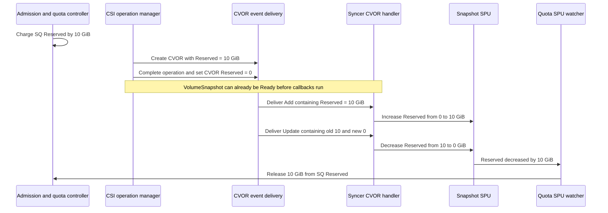
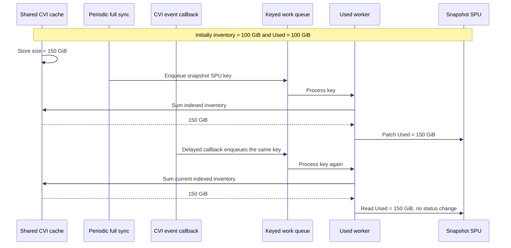

<!-- markdownlint-disable -->

# Snapshot quota: reconcile Used and preserve existing Reserved accounting

**Status:** implementation scope. This document specifies a change to snapshot `StoragePolicyUsage.Used` accounting in the CSI syncer. It preserves master's reservation protocol, including its existing limitations. It does not claim that the implementation branch already satisfies every requirement below.

The central rule is simple:

> A snapshot inventory event asks the syncer to recalculate `Used`. It never adds or subtracts bytes from `Used`.

One worker per SPU calculates the complete snapshot usage from the existing CnsVolumeInfo cache and writes that absolute value. Full sync uses the same worker. Existing CVOR handlers continue maintaining `Reserved` as in master, with a small field-isolation fix so reservation initialization cannot overwrite `Used`.

There are no new CRDs, API fields, reservation tokens, or changes required from VM operator. CSI continues writing SPUs; only the quota controller updates StorageQuota. A companion quota-controller fix protects its existing default-zero SPU initialization with optimistic locking, so a delayed initializer cannot overwrite usage already published by CSI.

## 1. The problem and the intended result

### 1.1 Snapshot inventory and quota reporting

A CnsVolumeInfo CR records the aggregate snapshot capacity for one volume. A snapshot StoragePolicyUsage CR reports the sum for one namespace and StorageClass or VolumeAttributesClass. Changes to snapshot capacity can come from CSI operations or from discovery of snapshots created or deleted outside CSI.

The existing implementation has two ways to update snapshot SPU `Used`:

1. An event handler applies the difference between the old and new CnsVolumeInfo snapshot sizes.
2. A periodic full sync sums the current inventory and replaces SPU `Used` with that total.

Both calculations are individually reasonable. They are incompatible when they write the same total without knowing which changes that total already includes. More frequent snapshot operations make this race more likely.

### 1.2 Absolute recomputation races with delta updates

Suppose there is one volume with 100 GiB of snapshots. Its CnsVolumeInfo changes to 150 GiB. The informer store can contain the new object before the event callback processes the change.



Step by step:

1. The cache receives the new size of 150 GiB.
2. Full sync reads the new inventory and correctly writes 150 GiB.
3. The delayed event callback still represents the change from 100 to 150 GiB.
4. It adds 50 GiB to a total that already includes those bytes.
5. SPU overreports by 50 GiB until another correction.

The reverse direction is worse. If inventory falls from 150 to 100 GiB, full sync writes 100 GiB, and a delayed callback then subtracts 50 GiB, SPU reports **50 GiB for 100 GiB of snapshots**.

A mutex around the SPU writes alone does not fix this. The example already has sequential writes. The second writer's arithmetic is wrong for the value it reads.

### 1.3 What this change fixes

This change removes the combination of absolute and delta writes to **snapshot SPU `Used`**. Every event, retry, startup pass, migration, and periodic pass uses the same absolute calculation.

It also avoids using a separate CnsVolumeInfo informer for snapshot event accounting and avoids constructing an unthrottled REST client for each snapshot usage event.

The intended result is:

- Snapshot `Used` cannot double-apply a change through the race in section 1.2.
- Once the inventory is valid and stable and reconciliation succeeds, snapshot `Used` equals the inventory sum.
- Snapshot reservations follow the existing master behavior and do not acquire a new dependency on observing a VolumeSnapshot while it is NotReady.

This is a contained improvement. It does **not** establish atomic accounting across `Used`, `Reserved`, SPU, and SQ. Section 8 describes the remaining gaps explicitly.

## 2. Existing resources and ownership

No resource schema changes are required.

| Resource or field | Meaning in this design | Writer |
|---|---|---|
| CnsVolumeInfo (CVI), including aggregate snapshot capacity | Existing per-volume inventory | Existing CSI inventory and operation paths |
| CnsVolumeOperationRequest (CVOR), including reservation details | Existing CSI operation record | Existing CSI operation manager |
| Snapshot SPU `status.quotaUsage.used` | Sum of matching CVI snapshot capacity | The CSI snapshot `Used` reconciler; the quota controller may conditionally initialize an absent field to zero |
| Snapshot SPU `status.quotaUsage.reserved` | Existing operation reservation accounting | Existing CVOR handlers; existing quota repair may also reset it |
| PVC SPU `Used` and `Reserved` | Existing PVC accounting | Existing master paths |
| StoragePolicyQuota (SPQ) and StorageQuota (SQ) accounting | Framework aggregation, admission reservations, and release | Existing quota controller |
| StorageQuotaPeriodicSync (SQPS) | Existing periodic reservation repair input | Existing producer and quota-controller consumer |

An SPU represents a resource kind and policy association within a workload namespace. This design applies to CSI snapshot SPUs, for both StorageClass and VolumeAttributesClass associations supported by the existing code. PVC SPUs are outside the new reconciler's scope.

Two framework details explain why `Used` and `Reserved` need different treatment:

- `Used` is a reported total. Replacing it with a complete inventory sum is meaningful.
- SQ reservations are charged at admission. The quota controller interprets a **decrease** in SPU `Reserved` as a release and subtracts that decrease from SQ `Reserved`. An increase in SPU `Reserved` does not charge SQ again.

Thus SPU `Reserved` also carries release information through transitions. Replacing it with a census of current pending objects can lose that information, even if the census itself is accurate.

CSI and VM operator do not write SQ. This design preserves that boundary. It also does not require an object UID during admission: it makes no changes to admission identity or reservation creation.

## 3. High-level approach



There are five rules:

1. **One calculation for snapshot `Used`.** Event handlers and full sync enqueue work; neither writes a delta or a separate absolute snapshot total.
2. **One shared CVI cache.** The worker reads the same informer store that generates the events.
3. **One active worker for a given SPU key.** Reading inventory, calculating the sum, and publishing it are serialized for that key. Different keys can run concurrently.
4. **Separate field ownership.** The new worker patches only `Used`; reservation handlers patch only `Reserved` for snapshot SPUs, including initialization.
5. **Keep reservation behavior from master.** CVOR lifecycle, reservation events, and independent periodic reservation repair remain in place. Existing quota-controller initialization is conditional on the resourceVersion it read, so defaults cannot overwrite a concurrent publication.

A CVI event is a notification that the total might need updating. It is not an instruction to apply the event's byte difference. Processing an old or duplicate notification therefore cannot apply an old delta again.

## 4. Detailed design for snapshot Used

### 4.1 Reuse the CVI informer and add an index

Use the informer exposed by the volume-info service. Register the snapshot SPU index before starting the informer, and attach the new reconciler's event handlers to that informer. Do not introduce a second CVI informer for this calculation.

The index key is:

```text
<workload namespace>/<snapshot SPU name>
```

The workload namespace comes from the CVI's workload-namespace field, `spec.namespace`. It is not the namespace containing the CVI CR itself.

Use the existing SPU naming rules:

- StorageClass association: `<storage-class-name>-snapshot-usage`.
- VolumeAttributesClass association: `vac-<volume-attributes-class-name>-snapshot-usage`.
- When a CVI has a VolumeAttributesClass association, use that association rather than also counting it under its StorageClass.

The worker additionally checks the CVI's storage policy ID against the SPU's policy ID. A CVI with a different valid policy ID does not contribute to that SPU.

The index contains references to existing cached objects. There is no list of volume IDs or per-volume accounting state in SPU status.

### 4.2 Route every snapshot Used trigger through the queue

| Trigger | Required action |
|---|---|
| Relevant CVI added | Enqueue its snapshot SPU key |
| CVI snapshot size, size validity, snapshot activity, or policy association changed | Enqueue both old and new affected keys |
| CVI deleted | Extract its old key and enqueue it; handle deletion tombstones |
| Periodic full sync reaches a snapshot SPU | Enqueue its key; do not write snapshot `Used` directly |
| Snapshot accounting moves between class associations | Enqueue old and new keys; remove direct snapshot usage arithmetic from migration paths |
| Syncer starts with its CVI cache synchronized | Enumerate and enqueue all existing CSI snapshot SPUs |
| A reconciliation fails | Requeue with backoff |

Updates that cannot affect the contribution or association need not enqueue work. Treat size validity and snapshot-activity fields as relevant, including a change from invalid to valid capacity.

Do not let an optimization for newly created, snapshot-free CVIs suppress reconciliation of existing snapshot contributors. Do not use VolumeSnapshot Ready state to decide whether CVI usage should be counted.

The existing full-sync behavior for PVC SPUs remains unchanged.

### 4.3 Startup and empty SPUs

Wait for the shared CVI informer to synchronize before any worker publishes `Used`. Publishing a sum from a partially populated startup cache could sharply underreport usage.

After synchronization, enumerate **all** existing CSI snapshot SPUs and enqueue them, even if there are no CVIs indexed under them. Retry a failed startup enumeration rather than making startup repair depend entirely on the next periodic full sync.

Example: an SPU reports 20 GiB. While the syncer is stopped, its last contributing CVI is deleted. On restart there is no CVI Add event capable of enqueueing that SPU. Explicit SPU enumeration is what schedules the empty sum and clears the stale 20 GiB.

This startup step is required in the `Used`-only design. It must not be conditional on enabling a reservation-recomputation component.

### 4.4 Worker algorithm

For one namespace/SPU key:

```text
reconcile(key):
    read the current SPU
    verify it is an in-scope CSI snapshot SPU
    obtain the CVIs for key from the shared informer index
    validate the relevant contributors
    if any relevant snapshot contribution is malformed:
        retain the existing Used
        report the invalid inventory and retry
    otherwise:
        total = sum of matching snapshot quantities, counting a CNS-reported
                unknown capacity at its last known size (zero if none)
        if Used is absent or differs from total:
            patch only status.quotaUsage.used = total
        set the missing-capacity diagnostic iff any contribution is CNS-reported unknown
```

The sum uses exact Kubernetes quantity arithmetic, without floating-point conversions. Cached objects and their quantities must not be mutated while summing.

A CVI with a deletion timestamp remains part of inventory until it is actually removed from the cache. A deletion timestamp alone does not establish that its storage has disappeared.

If the SPU has not yet been created, retry the key with backoff while the association remains relevant. The existing SPU-creation path remains responsible for creation; the worker does not create a replacement with guessed spec fields. A key for an association that has been removed can be discarded. SPU creation may also enqueue a retry if an existing informer makes that convenient.

If an SPU exists but is no longer an in-scope CSI snapshot SPU, stop processing that key. Validate ownership and resource kind rather than relying only on a name suffix.

### 4.5 Do not publish partial sums as complete totals

A malformed contributor must not simply be logged and omitted from the sum.

For validation, a CVI is snapshot-bearing if it has an aggregate snapshot-capacity field or a recorded snapshot-operation marker. A malformed or negative capacity is not a never-snapshot zero merely because its operation marker is absent.

| CVI state | Treatment |
|---|---|
| Valid positive snapshot capacity and matching association/policy | Include its capacity |
| Explicit valid snapshot capacity of zero | Include zero |
| CVI has never recorded snapshot activity and has no snapshot-capacity fields | It contributes zero under the existing inventory convention |
| Size validity is explicitly false (CNS reported the capacity as unknown) | Include its last known capacity, or zero if none; set the missing-capacity diagnostic |
| Snapshot activity is recorded, but its capacity or size-validity flag is missing, malformed, or negative | Do not publish a new total for the affected SPU; diagnose and retry |
| Valid association but a different valid storage policy ID | Exclude from this SPU |
| Required ownership or association fields are malformed or missing | Diagnose the inventory defect; if the affected SPU remains identifiable, do not publish a complete total for it |

For example, if a namespace has valid contributions of 30 GiB and 40 GiB plus a snapshot-bearing CVI whose capacity cannot be parsed, writing 70 GiB would disguise an incomplete sum as an authoritative value. Retain the previous SPU `Used` instead and expose the failure through logs and the existing missing-capacity diagnostic where applicable.

An explicitly invalid size is different: it is the driver's own record that CNS returned -1 for that volume, and master already kept that volume's last known contribution in `Used` while setting the missing-capacity diagnostic. Holding the whole SPU instead would stop `Used` from tracking every other volume on the policy for as long as CNS cannot compute the capacity, so the last known size is used for that volume alone.

This rule avoids creating a downward correction from a known incomplete sum. It does not make the retained value current: if physical usage grows while inventory is invalid, the retained value may itself underreport. Inventory repair is still necessary.

For example, a CVI with a valid SPU key but a missing policy ID has an identifiable affected SPU. A CVI whose key cannot be reconstructed may not be assignable to any SPU. Diagnose that defect and require inventory repair; this design adds no persisted quarantine or ownership-history map. Valid inventory associations are an explicit assumption of convergence.

### 4.6 Serialization, retries, and API requests

Use a keyed rate-limiting work queue. A key remains in progress until its entire calculation and patch attempt finishes. If an event enqueues that key while it is in progress, the queue schedules another pass after completion.

Four workers is a reasonable initial setting, consistent with the implementation already started. It permits work on different SPUs while preserving one active worker per key. It is a configuration choice, not a throughput guarantee.

Each retry must read the SPU and recompute the inventory sum again. Do not retry a previously computed absolute value after a failed write. The existing implementation's three short attempts can be retained, followed by rate-limited queue retries; shutdown should cancel further attempts.

Use one reusable client with its own configured rate limiter for the reconciler. Do not construct a client with rate limiting disabled for each CVI event.

A successful normal pass needs one SPU GET and, only if the value changed, one status PATCH. Maintaining an existing metadata diagnostic can require a separate metadata PATCH. Retry attempts add requests. There is no API GET per volume in the sum.

## 5. Preserve master's Reserved handling

### 5.1 Keep CVOR event accounting

Restore or retain the snapshot behavior in these existing handlers:

- `cnsvolumeoperationrequestCRAdded`
- `cnsvolumeoperationrequestCRUpdated`
- `cnsvolumeoperationrequestCRDeleted`

They continue deriving reservation changes from CVOR event payloads. Do not replace them with a sum of currently NotReady VolumeSnapshots. Remove branch changes that return early for snapshot CVORs to delegate their reservation accounting to the new absolute reconciler.

The CSI operation manager continues creating and updating CVORs, including its existing reservation amount, release-to-zero behavior, and cleanup. Do not add immutable reservation tokens, an acknowledgement field, or a syncer-owned CVOR release protocol.

Snapshot completion in the CVOR handler must continue skipping snapshot `Used` updates. Snapshot `Used` comes from CVI inventory through the new worker.

### 5.2 A fast completion does not require observing NotReady

The following example assumes a healthy continuous watch that delivers the CVOR transitions and a downstream SPU watch that observes the resulting reservation decrease. Those assumptions are important; restart and relist behavior is discussed in section 8.



Step by step:

1. Admission reserves 10 GiB in SQ using the existing framework.
2. CSI creates an operation record with a 10 GiB reservation.
3. CSI completes the operation and records zero remaining reservation.
4. The snapshot may already be Ready when the syncer processes either event.
5. The Add callback still carries the earlier 10 GiB value. The Update callback carries the transition from 10 GiB to zero. The handlers use those payloads, not the snapshot's latest Ready state.
6. The SPU decrease allows the quota controller to release the admission reservation.

Snapshot `Used` follows a separate CVI event path. This diagram does not assert that SQ `Used` is updated before the reservation is released.

For a 10 GiB reservation that produces 2 GiB of snapshot usage, the desired healthy end state remains 2 GiB `Used` and zero `Reserved`. The reservation and inventory events trigger processing immediately; neither waits intentionally for periodic full sync. The exact end-to-end delay depends on event delivery, queues, API latency, and downstream quota reconciliation. This design adds no fixed settlement timer and promises no fixed number of seconds.

### 5.3 Why not also recompute Reserved?

There are two independent problems with replacing the CVOR path with current-state reservation totals.

**Fast completion:** a snapshot becomes Ready before the first worker pass. Both the initial and final census are zero, so SPU `Reserved` never rises and cannot produce a release decrease.

**Overlapping operations:** even correctly observed pending operations can cancel each other's aggregate changes.

| Step | State | SQ Reserved | SPU Reserved under a current-state census |
|---|---|---:|---:|
| 1 | A is admitted and pending for 10 GiB | 10 GiB | 10 GiB |
| 2 | B is admitted for 10 GiB | 20 GiB | Still 10 GiB until the next census |
| 3 | A completes; B remains pending | 20 GiB | Still 10 GiB until the next census |
| 4 | Census runs and sees only B | 20 GiB | 10 GiB |

The census is correct about current pending reservations, but it publishes no decrease. SQ does not receive the release for A. A durable token or an "included once" marker alone does not fix this aggregate cancellation.

In healthy event accounting, the start and completion events produce observable increases and decreases instead of being collapsed into one net total. Preserving that behavior avoids introducing these new census-related failures. It does not make watch delivery across restarts durable.

### 5.4 Keep independent periodic reservation repair

Keep master's `syncStorageQuotaReserved` behavior, including `calculateVolumeSnapshotReservedForNamespace` for the snapshot contribution to the periodic repair calculation.

Do not replace this independent snapshot census with a sum of snapshot SPUs' current `Reserved` values. Reading back a leaked SPU reservation cannot independently establish that the reservation should have been released.

The existing PVC and extension-resource terms, including VM-related terms, remain unchanged. The existing quota-controller consumer remains the only component that applies this repair to SQ. Its existing behavior may also reset SPU reservations.

This periodic repair is best effort. Retaining it does not justify a guarantee that every reservation leak is repaired within an hour. In particular, active namespaces can repeatedly fail the existing quiet-period check.

## 6. Make separate field ownership real

### 6.1 Patch only the field being owned

The snapshot worker must send a status merge patch equivalent to:

```json
{"status":{"quotaUsage":{"used":"102Gi"}}}
```

A snapshot reservation handler must send a status merge patch equivalent to:

```json
{"status":{"quotaUsage":{"reserved":"10Gi"}}}
```

Each patch omits the sibling field entirely. Do not send the sibling as zero or null, and do not replace the whole `quotaUsage` object through a full status update assembled from an old GET.

With these merge patches, concurrent `Used` and `Reserved` writes preserve each other's fields. The new worker does not need to contend on resourceVersion just because an independent reservation changed. It must still serialize its own `Used` calculations.

This is not a distributed fencing protocol. It assumes the existing leader-election arrangement provides one active snapshot `Used` reconciler; section 8 covers overlapping leaders and delayed requests.

### 6.2 Initialization is a real race, not an exception

Master's snapshot CVOR Add path can initialize absent quota usage by writing both `Reserved` and `Used = 0`. That is unsafe once the `Used` worker operates independently.

| Step | Reservation handler | Used worker |
|---|---|---|
| 1 | Reads an SPU with no `quotaUsage` | |
| 2 | | Publishes `Used = 102 GiB` |
| 3 | Initializes from its old read, writing `Reserved = 10 GiB` and `Used = 0` | |

The final `Used = 0` would erase a correct usage report.

Therefore the minimal reservation-path change is: **for snapshot SPUs, initialize only `Reserved`, even when the status or `quotaUsage` was absent at the earlier GET.** The Used worker likewise initializes only `Used`.

The two merge patches in section 6.1 work in either order against an absent `quotaUsage` object and leave both fields present. Tests must inspect the actual generated patch, because a helper that serializes a whole struct may accidentally include the sibling field.

Existing SPU creation can retain its normal initial values. The rule concerns updates to an already existing SPU. PVC reservation/usage transitions remain on their existing paths.

### 6.3 Protect the quota controller's default initializer

The quota controller also writes SPU status: when `quotaUsage`, `Used`, or `Reserved` is absent, it initializes missing values to zero before normal aggregation. Field-isolated CSI patches alone do not protect against this other initializer.

For example:

1. The quota controller reads an SPU whose `Used` is absent.
2. CSI publishes `Used = 102 GiB`.
3. The quota controller's delayed default patch writes `Used = 0`.

No further CVI event is required after step 3, so waiting for CSI's next inventory event is not an adequate defense.

For both default-initialization branches in the quota SPU reconciler, construct the patch with `client.MergeFromWithOptions(oldSPU, client.MergeFromWithOptimisticLock{})`. The patch carries the resourceVersion from the read. If CSI publishes in between, the API server rejects the stale default patch with a conflict. The existing reconcile error path requeues, reads again, and leaves the now-present field alone.

This protects `Reserved` defaults in the same way. Apply it consistently to the existing default initializer; there is no new resource-kind protocol, admission behavior, or VM-operator change. The guard changes only the handling of a conflicting initialization. Ordinary reservation events and periodic reservation calculations remain unchanged.

The single-writer rule therefore means one CSI writer of the calculated snapshot total, with a guarded framework initializer for absent fields. The initializer must never replace an already-published total based on an obsolete read.

## 7. Examples and correctness boundary

### 7.1 The original race with the new writer



Step by step:

1. Inventory advances to 150 GiB before the callback executes, exactly as in the original failure.
2. Full sync enqueues a key instead of writing SPU itself.
3. The worker calculates and publishes 150 GiB.
4. The delayed event only requests another calculation.
5. The second calculation is also 150 GiB. It does not add 50 GiB.

For a decrease from 150 to 100 GiB, both calculations similarly produce 100 GiB. Neither subtracts a second 50 GiB.

### 7.2 Inventory changes while a worker is running

Suppose the worker has read a sum of 100 GiB, and inventory then becomes 150 GiB before the worker patches SPU.

1. The current pass can still publish 100 GiB.
2. The CVI callback enqueues the key. If the key is still running, the queue marks it for another pass.
3. The next pass reads the current inventory and publishes 150 GiB.

This is normal asynchronous propagation, not a claim that every published value is simultaneous with physical storage. A single cache and a single worker do not freeze inventory during a calculation.

The important property is that the next pass replaces the old total; it never applies a delta to an uncertain baseline. With stable valid inventory and successful processing, repeated reconciliation reaches the correct sum.

### 7.3 Failures and duplicate notifications

If a PATCH fails after the worker calculated 100 GiB, and inventory has since become 150 GiB, the retry recalculates and attempts 150 GiB. It does not blindly replay 100 GiB.

If the API server applied a PATCH but its response was lost, recalculation and another absolute write are safe. Duplicate notifications have the same property.

### 7.4 Moving a contribution between SPUs

A volume with 20 GiB of snapshots changes its class association from A to B. The update enqueues both keys. A's next sum excludes it, and B's next sum includes it.

These are separate SPU patches, so the move is not atomic. The order can temporarily double-count or omit those 20 GiB across the two SPUs. The design removes direct migration deltas but does not introduce a transaction across policies.

### 7.5 What is actually guaranteed

Subject to synchronized and valid inventory, correct association keys, one active writer per SPU key, eventual event/retry processing, and successful API requests:

- Every snapshot `Used` value published by the CSI reconciler is computed as an absolute inventory sum. The quota controller only supplies guarded defaults for absent fields.
- A delayed event cannot double-apply its old/new byte difference.
- Repeating reconciliation against unchanged inventory is idempotent.
- After inventory becomes stable, successful reconciliation converges to that inventory's total.
- A snapshot reservation patch cannot overwrite `Used`, and a Used patch cannot overwrite `Reserved`.
- A quota-controller default patch based on an obsolete read conflicts rather than overwriting a concurrently published value.

The guarantee is about the reported inventory and the removed mixed-writer race. It is not a guarantee of uninterrupted, conservative end-to-end accounting of physical storage.

## 8. Known limitations retained by this scope

The following are not fixed by this proposal. Some can underreport temporarily; some can leak reservations. They must not be hidden behind a general claim that the quota system is now correct.

| Situation | Remaining behavior or limitation |
|---|---|
| Reservation admitted but no CVOR is ever observed, such as deletion before CSI records an operation | SPU may never rise and fall; SQ reservation can leak until independent repair succeeds |
| Restart, leader change, or relist misses intermediate CVOR states | The master event protocol can miss reservation transitions; this design does not add durable replay |
| Downstream quota watcher misses an intermediate SPU reservation transition | A corresponding SQ release can be missed |
| Failure to persist CVOR release, or failure of asynchronous SQ release processing | Existing reservation error handling remains; a release is not made transactional or durably retried by this change |
| Reservation release reaches SQ before new snapshot Used has propagated through SPU/SPQ | There can be a temporary undercount; the two paths are not ordered by this design |
| Existing periodic reservation repair skips an active namespace, or races with admission and subsequent SPU resets | Existing repair timing and race limitations remain; there is no hard one-hour bound |
| Reservation amount or class selection differs between admission and CSI's view | Existing amount and policy-selection rules remain; this proposal does not reconcile those definitions |
| CVI capacity is stale, unknown, or incorrectly associated | Used cannot be more authoritative than its inventory; retaining a previous value does not guarantee it exceeds current physical usage |
| Inventory changes during a Used pass | A stale absolute total can be visible until a subsequent pass |
| Policy/class migration updates two SPUs | The move can temporarily double-count or omit usage across the pair |
| An old leader's already-issued request completes after a new leader's write | In-process queue serialization does not fence the old request; later reconciliation repairs the stale total when processing succeeds |
| PVC accounting has its own mixed-writer or reservation race | PVC behavior remains as in master; this is a snapshot Used change |

The practical acceptance criterion is therefore: **remove the snapshot absolute-plus-delta race and preserve the master reservation protocol, without adding readiness-based reservation failures.**

If a requirement is instead “never underreport under any ordering” or “every reservation must recover within one hour,” this scope is insufficient. Those requirements need separate changes to reservation delivery, ordering, and repair. They are not prerequisites for eliminating the specific Used race.

## 9. Scale, responsiveness, and operations

### 9.1 Bounded resource size

At 120,000 volumes, the API still contains the existing per-volume CVIs and the existing per-policy SPUs. No SPU contains a list of those volumes, their resourceVersions, or their completion acknowledgements. No additional per-operation CR is introduced.

The additional state is an in-memory index over existing CVIs and a queue of SPU keys. A pass costs O(number of CVIs associated with that SPU), using local cache reads.

A single SPU containing all 120,000 volumes still requires 120,000 local additions per pass. The index narrows the scope; it does not make that case constant-time. Measure that case before choosing worker counts or claiming an event-rate limit.

Workqueue coalescing reduces repeated work when many events target the same queued key. It does not guarantee that 5,000 events produce exactly one or two passes: a sustained stream can repeatedly dirty a running key.

This change adds no VolumeSnapshot, VolumeSnapshotContent, or StorageClass informer solely for reservation census. Informers independently needed by existing master functionality remain.

### 9.2 Normal processing remains event-driven

CVI changes enqueue Used reconciliation immediately. CVOR events continue initiating reservation updates immediately. There is no intentional wait for the periodic full-sync interval and no new settlement grace period.

Normal Used propagation is approximately:

```text
CVI watch delivery
+ queue wait
+ local indexed sum
+ SPU GET/PATCH latency
+ existing downstream quota propagation
```

Reservation propagation follows the existing CVOR and quota-controller event paths. The two timings can differ.

The periodic full sync is a recovery trigger for Used, using the existing configured schedule. Its interval is not the normal update latency. API unavailability, invalid inventory, prolonged queue pressure, or missing inventory updates can extend convergence beyond a scheduled pass.

### 9.3 Observe the actual bottlenecks

Use existing logging and metrics facilities to expose reconciliation duration, queue depth/age, retries, invalid inventory, and API throttling. Log the reusable client's rate-limit configuration at startup. Measure cache/index memory and per-SPU sum cost under representative scale.

Distinguish failure to compute a complete total from failure to publish one. Operators need to know whether to investigate CVI inventory or API/reconciliation progress.

## 10. Implementation scope and commit plan

This section describes the intended implementation after design approval. It is not a claim that code has already been changed.

### 10.1 Changes to retain or make

| Area | Required result |
|---|---|
| Volume-info service and snapshot SPU index | Reuse the shared informer; register the index before start; map workload namespace and SC/VAC association correctly |
| `spu_snapshot_reconciler.go` | Used-only keyed reconciliation, valid complete sums, retries that recompute, field-only patches, cache synchronization, and unconditional startup SPU enumeration |
| CVI callbacks | Enqueue affected keys; remove direct snapshot Used deltas |
| `storagePolicyUsageCRSync` | Enqueue snapshot SPUs; preserve PVC full-sync behavior |
| Snapshot migration helpers | Enqueue old/new snapshot SPU keys; remove direct snapshot Used writes |
| Snapshot CVOR Add/Update/Delete handlers | Restore master reservation processing; ensure snapshot initialization patches only Reserved |
| CSI CVOR production and cleanup | Preserve master lifecycle and reservation semantics |
| `syncStorageQuotaReserved` | Restore master's independent snapshot calculation and retain other existing terms |
| Branch-specific pending-snapshot reservation machinery | Remove it from this change; do not enable it from the Used reconciler |
| Feature gating | Preserve the existing Supervisor/Workload and `StorageQuotaM2` boundaries; do not change nonparticipating cluster behavior |
| Quota controller SPU default initialization | Add optimistic locking to both existing default-zero patch branches; retain the existing conflict/reconcile retry path |
| Quota extension service and VM operator | No changes required |

Do not leave reservation-recomputation code activated simply because a `Used` reconciler is present. If existing branch code represents “Used only” with a nil reservation component, startup repair must still work in that mode. A clean final implementation can remove the unused reservation component entirely.

### 10.2 Existing implementation work that can be reused

The implementation branch has already separated much of the work into commits. The following are candidates for extraction, subject to review against the chosen master base:

| Commit | Existing purpose | Treatment for this scope |
|---|---|---|
| `a1dc41fd` | Shared CVI informer and SPU index | Reuse and review |
| `8c1972e7` | Absolute snapshot Used reconciler | Reuse; complete field isolation, startup, invalid-input, and retry behavior specified here |
| `413f87c3` | Route snapshot Used writers through the reconciler | Reuse; audit all snapshot paths for remaining direct writes |
| `3dca9182` | Pending-VolumeSnapshot Reserved recomputation | Exclude |
| `14a3b18d` | Enable new Reserved path, disable snapshot CVOR handling, and use SPU Reserved readback for repair | Exclude those changes; preserve master's reservation paths |
| `bcec5bd4` | StorageClass informer work | Include only if independently needed by retained functionality; the Used calculation does not require a new StorageClass informer |

These are extraction candidates, not instructions to cherry-pick blindly. Their dependencies, exact contents, and the current branch/base must be rechecked before implementation. Existing fixes unrelated to reservation redesign must not be lost while restoring master behavior.

The quota-controller initialization guard is a small companion change in its own repository. It does not depend on the CSI commit candidates above.

A fresh branch from the agreed master base with selected commits may produce a clearer history than reverting the full reservation design in place. Alternatively, the topic branch can be edited. Before rewriting existing history, preserve its original tip. Do not infer authorization to force-push a remote branch from permission to reorganize local commits.

The final commits should describe the final Used-only behavior, with obsolete reservation claims and tests removed. A reviewer should not need the history of the broader design to understand the change.

### 10.3 Delivery and compatibility

Deliver the CSI Used change and the quota-controller initialization guard as separate commits in their respective repositories. No CRD migration or coordinated API-version change is needed, and either binary can be upgraded first.

The CSI change alone removes the mixed absolute/delta race in section 1.2. To also guarantee that default initialization cannot erase newly published fields, deploy the quota-controller guard. With an older quota controller, the pre-existing stale-zero initialization race remains until another successful CSI reconciliation repairs it; no immediate inventory event is guaranteed.

The original topic branch can be retained while the Used-only branch is reviewed. Reservation-redesign commits are not deployment prerequisites.

## 11. Validation and acceptance criteria

### 11.1 Focused correctness tests

| Case | Expected result |
|---|---|
| Inventory 100 to 150; full-sync trigger processed before delayed event callback | Final Used 150, never an added second delta to 200 |
| Inventory 150 to 100 with the same ordering | Final Used 100, never a subtracted second delta to 50 |
| Duplicate event or repeated full-sync trigger | Same absolute total; no double counting |
| Inventory changes while a pass is running | Key is processed again and converges after inventory stabilizes |
| PATCH failure followed by inventory change | Retry recomputes the new total rather than replaying the old one |
| CVI Add, relevant Update, Delete, and deletion tombstone | Correct affected key is enqueued |
| SC/VAC, workload namespace, or policy association changes | Both old and new affected totals are reconciled |
| Informer not synchronized | No Used publication |
| Restart with an existing SPU and no remaining CVIs | Startup enumeration schedules a zero total |
| Startup SPU List fails | Enumeration is retried |
| CVI arrives before its SPU exists | Reconciliation retries and succeeds after normal SPU creation |
| Explicit valid zero or never-snapshot CVI | Zero contribution under the documented inventory convention |
| Relevant snapshot-bearing CVI has invalid or missing capacity | No partial total is published; previous Used remains and work retries |
| CVI has a different valid policy ID | It is excluded from this SPU |
| Multiple workers receive events for one key | No concurrent Used calculations/publications for that key |
| Reserved changes while Used is being reconciled | Both fields survive the independent patches |
| Status or quotaUsage is absent and both CSI writers initialize concurrently | Both patch orders preserve Used and Reserved; neither sends the sibling field |
| Quota controller reads absent fields, then CSI publishes before the default patch | The stale default patch conflicts; a fresh retry preserves published values and initializes only remaining absent fields |
| Snapshot becomes Ready before healthy queued CVOR callbacks run | Existing CVOR reservation transitions still execute from event payloads |
| Two overlapping snapshot operations | CVOR event processing is retained; it is not collapsed into a net pending-object census |
| Snapshot CVOR completes or is deleted | It affects reservation accounting according to master, not snapshot Used |
| Periodic snapshot reservation repair | Uses the independent master snapshot calculation, not SPU readback |
| PVC, VM-related periodic terms, disabled quota feature, or unsupported cluster flavor | Existing behavior is preserved |

Tests of reservation transitions must state their watch-delivery assumptions. They must not imply that restarting between transitions has acquired a durable replay guarantee.

### 11.2 Integration and scale checks

1. Generate snapshot capacity increases and decreases while repeatedly triggering full sync. After activity quiesces, compare every in-scope SPU with a fresh sum of valid CVIs. Include unmanaged snapshot discovery.
2. Restart the syncer after deleting the last contributor to an SPU. Verify startup clears stale Used without waiting for periodic full sync. Assess reservations separately under the retained master behavior.
3. Force concurrent initialization and reservation updates while Used is published. Inspect status patches and resulting objects, not just helper return values.
4. Compare reservation handling and periodic-repair inputs with the selected master baseline. Any behavioral difference must be explained; a change to Used alone must not silently replace the reservation protocol.
5. Exercise 120,000 CVIs, including a heavily concentrated single-SPU case. Measure reconciliation latency, queue age, memory, and API request rate under burst and sustained changes.

Acceptance requires elimination of the mixed absolute/delta snapshot Used writes, correct field isolation, recovery after cache synchronization, and preservation of master reservation behavior. The initialization guarantee additionally requires the small quota-controller guard. There is no new CRD, reservation-protocol rollout, or change from VM operator.

## 12. Code navigation

The following names identify the implementation areas a reviewer should inspect. They are not additional specifications required to understand this design.

| Repository area | Relevant files or functions |
|---|---|
| CSI shared CVI inventory | `pkg/internalapis/cnsvolumeinfo`, volume-info service informer accessor, snapshot SPU index/key helpers |
| CSI Used reconciler | `pkg/syncer/spu_snapshot_reconciler.go` |
| CSI event routing and full sync | `pkg/syncer/metadatasyncer.go`, `storagePolicyUsageCRSync`, CVI and CVOR callbacks, snapshot reconciler startup |
| CSI migration | `pkg/syncer/util.go`, snapshot SPU migration/update helpers |
| Branch reservation redesign excluded here | `pkg/syncer/spu_snapshot_reserved.go`, `pkg/syncer/spu_snapshot_reservation.go`, and their startup wiring |
| CSI reservation record lifecycle | CSI volume manager and `pkg/internalapis/cnsvolumeoperationrequest` |
| Quota default initialization | `storage-policy-quota/pkg/app/controllers/storagepolicyusage/storagepolicyusage_controller.go` |
| Quota reservation release | `storage-policy-quota/pkg/app/informers/storagepolicyusage_informer.go` |
| Quota Used propagation | `storage-policy-quota/pkg/app/controllers/storagepolicyquota` |
| Quota periodic reservation repair | `storage-policy-quota/pkg/app/controllers/storagequotaperiodicsync` |
