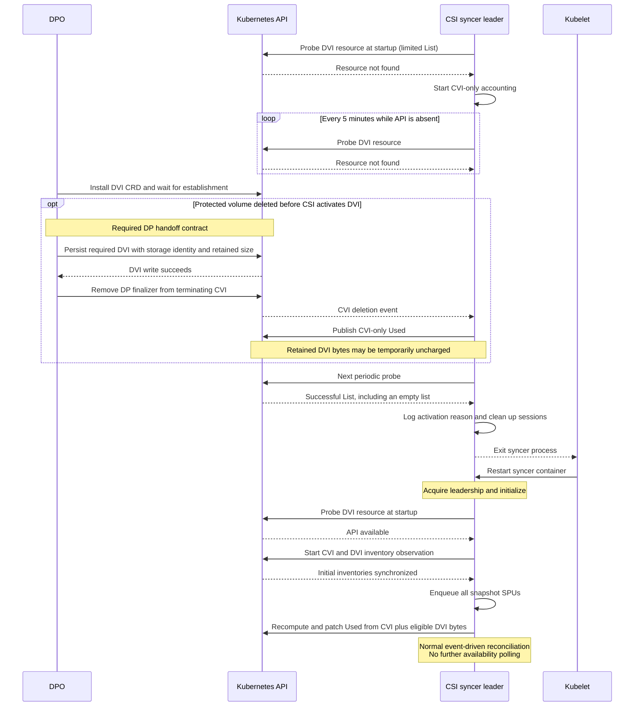
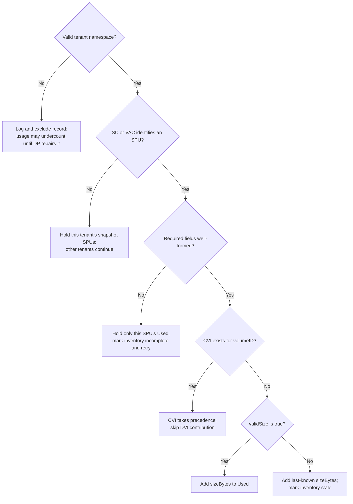
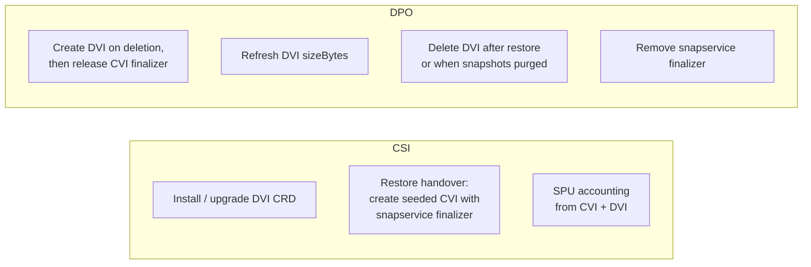
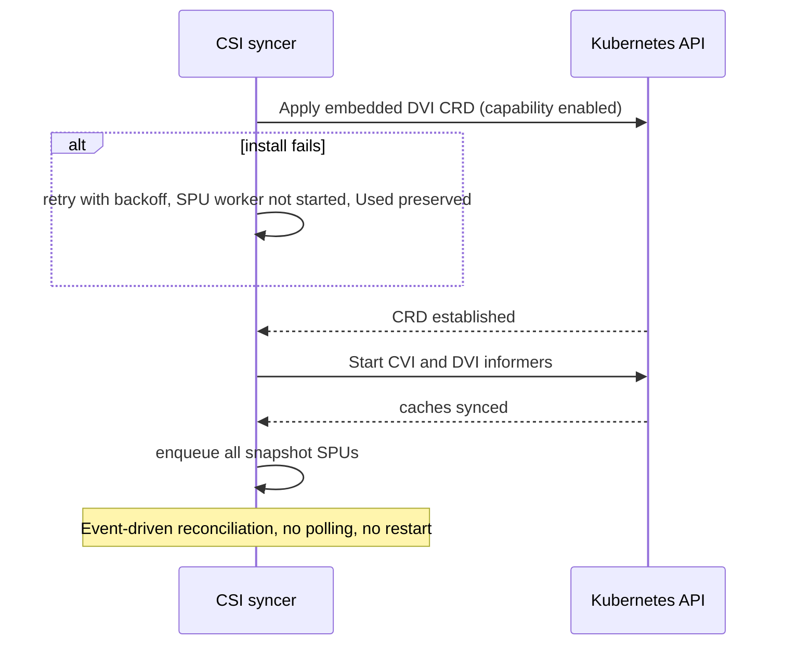
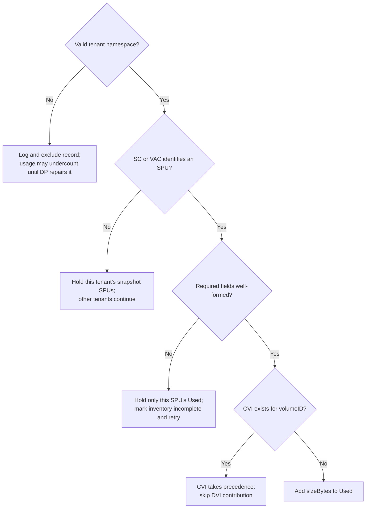

<!-- markdownlint-disable -->
# Deleted-volume snapshot quota accounting

> **This design will change with [CNAS-12485](../CNAS-12485/spec.md).** The DVI kind is renamed
> `CnsDeletedVolumeInfo` and moves to `cns.vmware.com/v1alpha1`, CSI installs its CRD, DVIs move
> from tenant system namespaces to
> `vmware-system-csi`, `validSize` is removed, API discovery and
> the syncer restart are removed, and on restore CSI creates the CVI seeded from the DVI, after
> which DPO deletes the DVI. The affected sections are *Scope and ownership*, *Provisional API
> contract*, *Required contract with DP*, *Optional API discovery and restart*, *Reconciliation and
> failures*, *DVI validation and failure scope* and *Delivery and validation*. The text below is
> the original design; see [Update: CNAS-12485](#update-cnas-12485) at the end for what changes.

Extends [UBMCNS-2572: snapshot Used reconciliation](../UBMCNS-2572/design-no-reserve-fix.md)
with DeletedVolumeInfo (DVI) as an additional inventory source. SnapService can retain
snapshot bytes after CnsVolumeInfo (CVI) disappears; those bytes must remain charged
to the tenant's snapshot StoragePolicyUsage (SPU).

## Scope and ownership

Enable DVI observation only when `supports_snap_service_local_protection` is enabled,
within the existing Supervisor and `StorageQuotaM2` boundaries. Reuse the existing
snapshot SPU worker and its field-only `Used` patches. Reservation accounting and
PVC SPUs retain the behavior specified by UBMCNS-2572.

DPO owns CRD installation/upgrades and the full DVI record lifecycle: creation,
sizing, finalizers, restore handoff, and deletion. CSI consumes the agreed API and
owns its contribution to the existing CSI snapshot SPU. CSI does not create DVIs
or manage DP finalizers. This differs from the separate MM-owned `DeletedPVC` SPU in the
[deleted-volume design](https://vmw-confluence.broadcom.net/spaces/SABU/pages/2880115822/Deleted+Volume+Quota+Mgmt+Design):
that writer must not also charge these bytes.

## Provisional API contract

Consume `protectionandrecovery.vmware.com/v1alpha1`, kind `DeletedVolumeInfo`, resource
`deletedvolumeinfos`, through a dynamic informer and a private Go read model. Keep
the GVR and decoding in one adapter so the external API can evolve without generated
client dependencies. Capability support does not imply that DPO or its CRD is installed.

DVI lives in a tenant system namespace. Its `spec` supplies:

| Field | Accounting use |
|---|---|
| `volumeID` | Handoff identity; one DVI per deleted volume. |
| `namespace` | Tenant user namespace charged by the SPU. |
| `storageClassName` | Required storage association. |
| `volumeAttributeClassName` | Optional; when set, selects `vac-<name>-snapshot-usage` instead of `<storageClassName>-snapshot-usage`. |
| `storagePolicyID` | Must match the target SPU's policy. |
| `sizeBytes` | Required nonnegative integer snapshot bytes. |
| `validSize` | Required boolean; false means the size is last-known. |

## Required contract with DP

**These are integration requirements to agree with DP, not verified guarantees of
the future CRD or DPO implementation. CSI correctness depends on this contract.**

- The schema requires nonempty, correctly typed `volumeID`, `namespace`,
  `storageClassName`, and `storagePolicyID`; namespace and SC/VAC names must be valid
  Kubernetes names. Require integer `sizeBytes >= 0` and boolean `validSize`.
- Establish the DVI API before protected-volume deletion proceeds. Persist any
  required DVI, with the CVI's storage identity, **before releasing DP's CVI
  finalizer**. DP owns adding/removing this finalizer with protection membership.
- DP decides whether retained bytes require a DVI and owns sizing/repair. A stale
  zero in CVI is not proof that no snapshots remain; copying CVI is not sufficient
  to establish sizing correctness. `validSize=false` reports uncertainty but does
  not prevent under-accounting.
- On restore, make the replacement CVI authoritative before removing the DVI.
- Keep the CRD installed while outstanding DVI charges exist. After a CSI restart,
  API absence cannot distinguish a never-installed CRD from one improperly removed
  with accounting records outstanding.
- No other writer may charge these same bytes through a separate SPU. DP may evolve
  the CRD independently while preserving the fields and semantics CSI consumes.

Schema validation cannot enforce the cross-resource handoff ordering.

## Optional API discovery and restart

When the capability is enabled, probe the DVI resource with a limited list at
startup. A successful list, including an empty one, establishes API availability.
A resource-not-found response selects CVI-only accounting for this process. Forbidden,
timeout, and server errors leave the startup decision unresolved: preserve snapshot
`Used` and retry before starting reconciliation.

If initially absent, the active syncer leader polls every **five minutes**. A
successful list triggers a logged syncer exit; Kubernetes restarts the syncer
container. Probe errors are logged and retried while CVI-only accounting continues.
Customers without DPO incur one small discovery request per interval. CVI deletion
does not trigger discovery, and CSI does not inspect DP finalizer names.

On startup with the API available, start the DVI informer, wait for initial CVI and
DVI cache synchronization, and enqueue all snapshot SPUs. Continue ordinary
event-driven observation without availability polling. This also covers restarts
with only DVIs present. Capability-disabled processes perform no DVI discovery.

**Accepted tradeoff:** DVI bytes can remain uncharged until the polling delay,
restart/leadership recovery, and initial synchronization complete. Failures can
extend this window beyond five minutes. Persisting DVI before releasing CVI's
finalizer does not eliminate it. The restart also interrupts other syncer controllers.

### Sequence: DPO installed after CSI startup

The capability is enabled in this example. If the API is already served at startup,
CSI proceeds directly to informer startup and synchronization.



Only the syncer container restarts. If the API is already available at startup,
initialization proceeds directly to inventory synchronization without an extra restart.

## Accounting and handoff

For each SPU, with DVI enabled:

```text
Used = sum(matching CVI snapshot capacity)
     + sum(matching DVI.sizeBytes where no CVI exists for volumeID)
```

CVI takes precedence even while terminating, without snapshot information, or
associated with another SPU. CVI events also enqueue the matching DVI's SPU,
including when its namespace or policy association differs.

As in UBMCNS-2572, independent watches and SPU patches provide eventual convergence;
the handoff and policy moves are not atomic. Persisting DVI first does not guarantee
its watch event arrives before the CVI deletion event, so transient undercounts
remain possible after activation. Initial cache synchronization is not a continuous
freshness guarantee during subsequent list/watch failures.

## Reconciliation and failures

Index DVI and CVI inventory by SPU association and volume ID using their informer
caches. DVI accounting is fixed at startup; no private CVI accounting view,
deletion-triggered discovery, or activation-specific publication lock is needed.

DVI add/update/delete events enqueue affected keys, including both keys when an
association changes. Workers recompute absolute totals. Startup enumeration and
periodic full sync use the same queue, including SPUs with no remaining contributors.
Full sync uses the startup-selected inventory sources.

| Condition | Behavior |
|---|---|
| Capability disabled | No DVI client/informer or contribution. |
| API confirmed absent at startup | Publish CVI-only totals; poll every five minutes and restart syncer when the API becomes available. |
| Startup discovery unresolved or initial inventory incomplete | Preserve snapshot `Used`; retry discovery errors and wait for required cache synchronization. |
| Periodic probe fails | Log and retry at the next interval; continue CVI-only accounting. |
| `validSize=false` | Count last-known `sizeBytes`; set the existing missing-snapshot-capacity annotation. |
| Malformed DVI with identifiable SPU | Retain only that SPU's `Used`, mark incomplete inventory, and retry. |
| Valid tenant namespace but no determinable SC/VAC association | Retain that tenant's snapshot SPUs; unrelated tenants continue. A valid VAC still identifies its SPU when SC is malformed. |
| Missing, invalid, or mistyped tenant namespace | Log and quarantine the record from accounting; do not block other tenants. Its owner's usage may be underreported until DP repairs it. |
| Contributor exists before its SPU | Retry until the SPU is created. |

### DVI validation and failure scope

Known policy mismatches are ignored. For matching records, a valid VAC can identify
the SPU even if the required SC field is malformed; validation then holds that SPU.



## Delivery and validation

Grant CSI `get/list/watch` on DVI across tenant system namespaces in Supervisor
manifests **1.33–1.35**. Runtime DVI accounting requires the external CRD and producer
lifecycle above; supervisors without DPO continue CVI-only accounting.

[Accounting tests](../../pkg/syncer/spu_deleted_volume_info_test.go),
[activation tests](../../pkg/syncer/spu_deleted_volume_info_activation_test.go), and
[isolation tests](../../pkg/syncer/spu_deleted_volume_info_scope_test.go) cover gating,
startup discovery, periodic probes and restart signaling, attribution, malformed
records, and handoffs. Validate the syncer tests, race checks, and repository lint;
unit tests cannot establish the external DP lifecycle contract.

Implementation: [DVI adapter](../../pkg/syncer/spu_deleted_volume_info.go) and
[snapshot SPU reconciler](../../pkg/syncer/spu_snapshot_reconciler.go).

## Update: CNAS-12485

**Date:** 2026-10-28. **Spec:** [CNAS-12485: seed the snapshot aggregate into a restored CnsVolumeInfo](../CNAS-12485/spec.md).

CNAS-12485 moves the DVI CRD into CSI and makes CSI seed the restored CVI from the DVI. DPO
still creates DVIs on deletion, keeps their size up to date, deletes them (on restore, once the
seeded CVI exists; otherwise when SnapService purges the snapshots), and removes the CVI
finalizer. CSI only reads DVIs. Where this section and the text above disagree, this
section wins.

### Ownership



| Responsibility | Before | After |
|---|---|---|
| Install / upgrade the DVI CRD | DPO | **CSI** |
| Create DVI, size it, delete it when snapshots are purged | DPO | DPO |
| Mark a CnsRegisterVolume as a restore | — | **MM**, with the annotation `protectionandrecovery.vmware.com/snapservice-restore: "true"` |
| Restore handoff: make the CVI authoritative | DPO | **CSI**, for annotated registrations only, by creating the CVI seeded from the DVI ([CNAS-12485 §6](../CNAS-12485/spec.md#6-restore-handover)) |
| Restore handoff: delete the DVI | DPO | DPO, only after the seeded CVI exists ([CNAS-12485 §6.5](../CNAS-12485/spec.md#65-dpo-deletes-the-dvi)) |
| Add the snapservice finalizer to a **restored** CVI | DP | **CSI**, at CVI create |
| Add the finalizer to other protected CVIs; remove any finalizer | DP | DP |

"CSI does not create DVIs or manage DP finalizers" becomes: CSI does not create DVIs and never
removes DP finalizers. It adds `protectionandrecovery.vmware.com/snapservice-finalizer` only to the
CVI it creates on restore.

### API contract

| Item | Before | After |
|---|---|---|
| Kind / resource | `DeletedVolumeInfo` / `deletedvolumeinfos` | **`CnsDeletedVolumeInfo` / `cnsdeletedvolumeinfoes`** |
| Group / version | `protectionandrecovery.vmware.com/v1alpha1` | **`cns.vmware.com/v1alpha1`** |
| Namespace | tenant system namespace | **`vmware-system-csi`**, the same namespace as CVIs |
| Name | volume ID | volume ID, using the CVI naming rule; the API server now guarantees one DVI per volume |
| Go types | private read model only | typed API in this repo, plus the existing unstructured decoder |
| CRD | external, may be absent | embedded in CSI, installed at syncer startup when `supports_snap_service_local_protection` is enabled |
| `validSize` | required boolean | **removed**. Every DVI size is treated as valid. |
| Other `spec` fields | as in the table above | unchanged |

### Required contract with DP

- "Require integer `sizeBytes >= 0` and boolean `validSize`" becomes "require integer
  `sizeBytes >= 0`". The CRD schema enforces it.
- "`validSize=false` reports uncertainty" no longer applies. DP must not publish an unknown size
  into a DVI.
- "On restore, make the replacement CVI authoritative before removing the DVI" is split. CSI
  makes the CVI authoritative by creating it seeded from the DVI (CNAS-12485 §6). DPO still
  removes the DVI, but only once the restored CVI is live (CNAS-12485 §6.5). DPO must never delete
  a restored volume's DVI before its CVI exists.
- New: every restore that MM annotates must have a DVI whose `spec.namespace` is the
  CnsRegisterVolume's namespace. Otherwise CSI rejects the CnsRegisterVolume before registering
  anything (CNAS-12485 §6.2). Any valid `sizeBytes`, including 0, is accepted.
- "Keep the CRD installed while outstanding DVI charges exist" is now CSI's job. CSI never
  removes the CRD.
- New: DP must not recreate a DVI for a volume whose CVI is live.

### Optional API discovery and restart: removed

The startup probe, the five-minute poll, the syncer restart, the "DPO installed after CSI
startup" sequence and the accepted trade-off are removed. Instead:



Capability-disabled processes install no CRD and start no DVI informer, as before.

### Reconciliation and failures

| Row | Change |
|---|---|
| API confirmed absent at startup | **Removed.** CSI installs the API. |
| Startup discovery unresolved or initial inventory incomplete | Becomes: **CRD install unresolved** or initial inventory incomplete. Preserve snapshot `Used` and retry. |
| Periodic probe fails | **Removed.** |
| `validSize=false` | **Removed.** A DVI never sets the missing-snapshot-capacity annotation. |
| Other rows | Unchanged |

New rows, from CNAS-12485 §10:

| Condition | Behavior |
|---|---|
| Restore of a volume with a DVI | CSI creates the seeded CVI; DPO then deletes the DVI. `Used` unchanged across the handover. |
| DVI still present after the restore (DPO down) | CVI hides it; DPO deletes it once it sees the live CVI. |

### DVI validation and failure scope

The validation flowchart loses its `validSize` branch. A DVI that is not hidden by a CVI always
adds `sizeBytes`:



DVI change detection compares six fields; `validSize` is dropped.

Because all DVIs are in one namespace and named by volume ID, two DVIs for the same volume
cannot exist. The "multiple DeletedVolumeInfo records for volume" error in the DVI sum becomes
unreachable; it may stay as a defensive check. `spec.namespace` remains the only tenant reference,
so the tenant-namespace validation and quarantine rules above are unchanged.

The DVI informer watches only `vmware-system-csi` instead of all namespaces.

### Delivery and validation

- RBAC in Supervisor manifests 1.33–1.35: remove `get/list/watch` on
  `protectionandrecovery.vmware.com/deletedvolumeinfos` across tenant system namespaces; add
  `get/list/watch` on `cns.vmware.com/cnsdeletedvolumeinfoes`. Only `vmware-system-csi` needs it. CSI
  never writes or deletes DVIs.
- DPO creates DVIs in `vmware-system-csi`, not in tenant system namespaces.
- The activation tests are rewritten for install-at-startup: the CRD is installed when the capability
  is enabled, the worker waits for establishment and cache sync, and no probe, poll or restart happens.
- The accounting tests drop the `validSize` cases and gain the handover cases in CNAS-12485 §11.
