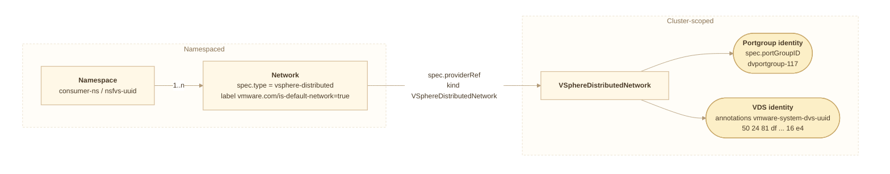
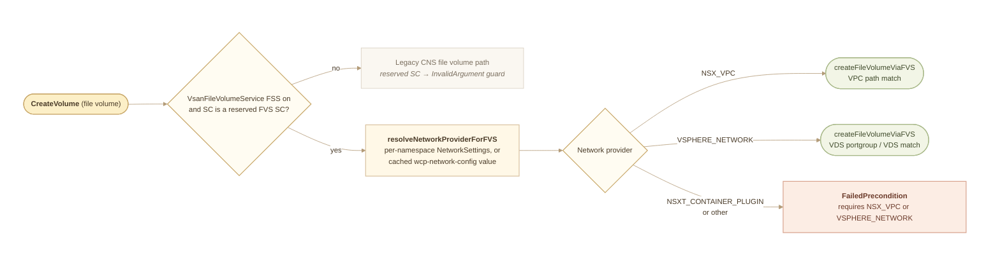
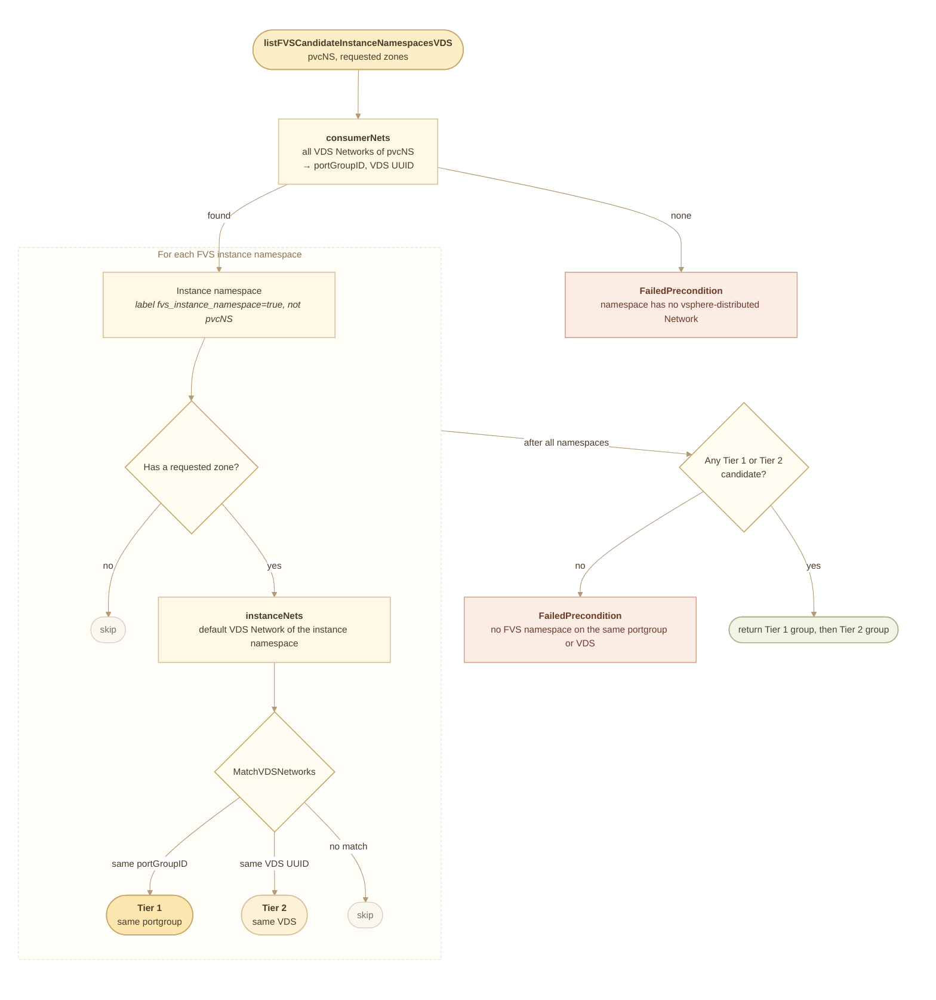
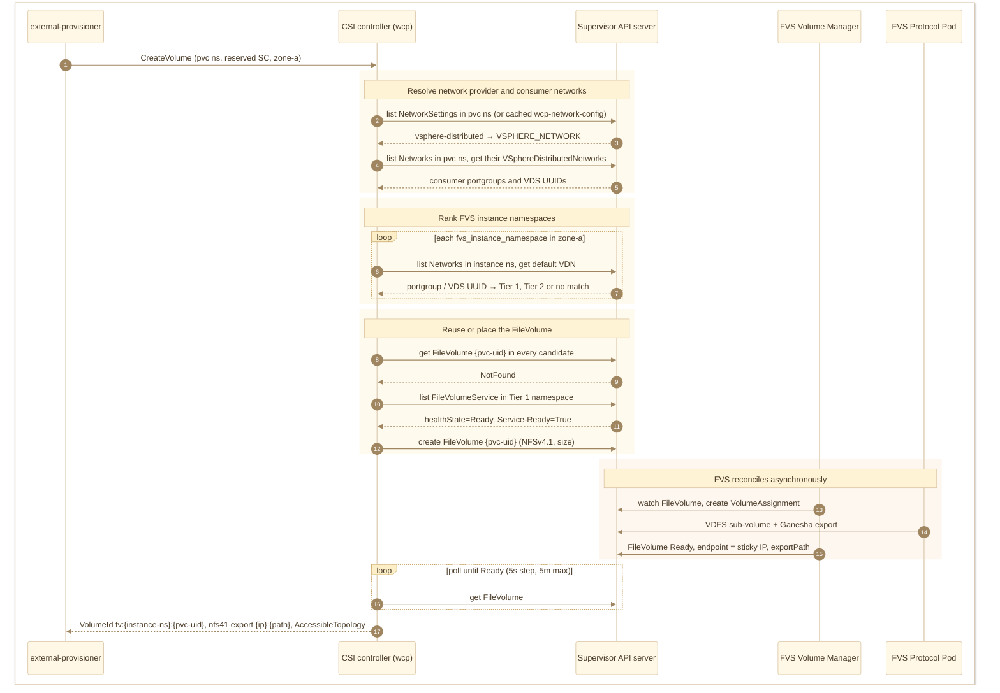

<!-- markdownlint-disable -->
# CSI support for FileVolumeService (FVS) file volumes on VDS networking

Status: implemented in CSI, not yet run on a testbed. The FVS backend does not support VDS yet.

## 1. Context

On a vSphere Supervisor, a PersistentVolumeClaim (PVC) on one of the reserved vSAN File Service
marker storage classes is provisioned through FileVolumeService (FVS). The two classes are
`vsan-file-service-policy` (immediate binding) and `vsan-file-service-policy-latebinding`.

The provisioning flow is:

1. The CSI controller creates a `FileVolume` CR (`fvs.vcf.broadcom.com/v1alpha1`) in an FVS
   **instance namespace**. This is a Supervisor namespace labeled `fvs_instance_namespace=true`.
2. FVS (Volume Manager and the Protocol Pods) serves the volume as an NFS v4.1 export on the
   sticky IP of a Protocol Pod.
3. Clients mount `endpoint:/exportPath` directly. The clients are VKS worker nodes and Supervisor
   workloads.

Until now this flow supported only Supervisors that use **NSX VPC** networking. VCFALite also runs
Supervisors on **vSphere Distributed Switch (VDS)** networking. There, workloads sit on
VLAN-backed distributed portgroups and there is no VPC. This change lets the CSI driver provision
FVS file volumes on VDS Supervisors.

The main problem is **choosing the instance namespace**. On VPC, CSI picks an instance namespace
in the same VPC as the consumer. On VDS there is no VPC. CSI must instead choose an instance
namespace whose Protocol Pods the consumer can reach over the network.

## 2. Behaviour before this change

| Step | Location | VPC-only behaviour |
|---|---|---|
| Routing | `shouldProvisionVsanFileVolumeViaFVS`, [fvs_filevolume.go](../../pkg/csi/service/wcp/fvs_filevolume.go) | Reserved SC + provider `NSX_VPC` → FVS. Any other provider, **including `VSPHERE_NETWORK`**, → `FailedPrecondition` "requires NSX_VPC network provider". |
| Instance selection | `listFVSCandidateInstanceNamespaces` | Read the consumer namespace annotation `nsx.vmware.com/vpc_network_config`. Look up the `VPCNetworkConfiguration`. Keep instance namespaces with the same `status.vpcs[0].vpcPath` and an overlapping zone. Fail if the annotation is missing. |
| Cluster-wide marker zones (InfraStoragePolicyInfo) | `GetZonesForvSANFileServiceMarkerPolicy`, [markerzones.go](../../pkg/syncer/cnsoperator/util/markerzones.go) | Union of zones of instance namespaces that **have the VPC annotation**. VDS instances are skipped, so the result is empty. |
| Per-namespace marker zones (StoragePolicyInfo) | `GetZonesForvSANFileServiceMarkerPolicyByNamespace` | Error when the consumer namespace has no VPC annotation. |

So on a VDS Supervisor, CreateVolume for a reserved SC was rejected outright, and the marker
policy advertised no zones.

## 3. Goals and non-goals

**Goals**

- Route reserved-SC CreateVolume to FVS when the PVC namespace's network provider is
  `VSPHERE_NETWORK`, as it already does for `NSX_VPC`.
- On VDS, select the instance namespace by **portgroup** and **VDS** identity:
  - Tier 1: same portgroup.
  - Tier 2: same VDS.
  - Fail when neither matches.
- Make the marker-policy zones (cluster-wide and per-namespace) correct on VDS. They must use the
  same reachability rule as CreateVolume.
- Leave NSX VPC behaviour unchanged.
- Use no new capability or feature switch. The existing `supports_vsan_fileservice` capability
  (the `VsanFileVolumeService` feature state) gates VDS as well.

**Non-goals**

- IP-based NFS export ACLs in NFS Ganesha, and `CnsFileAccessConfig` for FVS volumes on VDS.
  Section 13 explains why these are deferred.
- `NSXT_CONTAINER_PLUGIN` (NCP) Supervisors. These are still rejected.
- Migration from legacy vSAN File Service.
- Changes to the FVS operator, Volume Manager, Protocol Pods or Sticky IP.

## 4. Object model: a namespace's VDS identity

On a VDS Supervisor, net-operator (`netoperator.vmware.com/v1alpha1`) models networking with two
resources:

- a namespaced **`Network`** per attached network;
- a cluster-scoped **`VSphereDistributedNetwork`** (VDN) per distributed portgroup.



Example objects, taken from a VDS Supervisor:

```yaml
apiVersion: netoperator.vmware.com/v1alpha1
kind: Network
metadata:
  name: workload-0276c9d4-dda1-11f1-a63b-02003a2354d4
  namespace: consumer-ns
  labels:
    vmware.com/is-default-network: "true"
spec:
  type: vsphere-distributed
  providerRef:
    apiGroup: netoperator.vmware.com
    apiVersion: v1alpha1
    kind: VSphereDistributedNetwork
    name: workload-0276c9d4-dda1-11f1-a63b-02003a2354d4
---
apiVersion: netoperator.vmware.com/v1alpha1
kind: VSphereDistributedNetwork
metadata:
  name: workload-0276c9d4-dda1-11f1-a63b-02003a2354d4
  annotations:
    vmware-system-dvs-uuid: "50 24 81 df 8a 5a 0a 1d-54 0b 76 18 90 6f 16 e4"
  labels:
    vmware.com/is-default-network: "true"
spec:
  portGroupID: dvportgroup-117
  gateway: 166.168.31.253
  subnetMask: 255.255.0.0
  ipPools:
  - name: workload-0276c9d4-dda1-11f1-a63b-02003a2354d4-166-168-16-0
```

Comparing `Network` names alone is not enough: two namespaces can reach the same portgroup through
differently named `Network` objects. CSI therefore follows the chain down to `portGroupID` and the
VDS UUID.

### 4.1 Which networks are compared

| Side | Networks considered | Why |
|---|---|---|
| Consumer (PVC namespace) | **All** `vsphere-distributed` Networks in the namespace | A VKS cluster or VM in the namespace may be attached to a network other than the default. If any of its networks can reach FVS, the volume is usable. |
| FVS instance namespace | Only the **default** Network (`vmware.com/is-default-network=true`). If no Network is labeled default and there is exactly one VDS Network, that one is used. | FVS Protocol Pods (Supervisor pods) attach to the namespace's default network, so their sticky IPs live on its portgroup. |

### 4.2 Implementation: shared helpers

File: [pkg/syncer/cnsoperator/util/fvsvdsnetwork.go](../../pkg/syncer/cnsoperator/util/fvsvdsnetwork.go).
Both the CSI controller and the syncer use these helpers.

- **`GetVDSNetworksForNamespace(ctx, dc, namespace, defaultOnly) ([]VDSNetworkInfo, error)`**
  1. Lists the `Network` objects in the namespace.
  2. Keeps those with `spec.type == vsphere-distributed` and
     `spec.providerRef.kind == VSphereDistributedNetwork`.
  3. Applies the default-only rule from 4.1 when `defaultOnly` is set.
  4. Gets each referenced VDN once per call.
  5. Returns `{NetworkName, VDNName, PortGroupID, DVSUUID}` for each network.

  Details:
  - The DVS UUID is trimmed and lower-cased.
  - A VDN that is missing (NotFound) or has no `portGroupID` is skipped.
  - Any other API error is returned, so the RPC fails and the caller retries.
- **`MatchVDSNetworks(consumer, instance) FVSNetworkMatchTier`**: returns the best tier over all
  (consumer, instance) pairs.
  - `FVSNetworkTierPortgroup` (Tier 1): the `PortGroupID` values are equal. A portgroup moref is
    unique within a vCenter.
  - `FVSNetworkTierVDS` (Tier 2): the `DVSUUID` values are equal.
  - `FVSNetworkNoMatch`: otherwise.

  Empty identifiers never match.

## 5. Routing



Code changes:

- `shouldProvisionVsanFileVolumeViaFVS` now returns `(useFVS, networkProvider, err)`. It accepts
  both `NSX_VPC` and `VSPHERE_NETWORK` (`isFVSSupportedNetworkProvider`).
- The CreateVolume path in [controller.go](../../pkg/csi/service/wcp/controller.go) passes the
  resolved provider to `createFileVolumeViaFVS`. The provider is resolved once per RPC.
- When per-namespace network providers are enabled, the provider comes from the PVC namespace. A
  Supervisor can then have VPC and VDS namespaces side by side. Each PVC follows its own namespace's
  provider.

## 6. Choosing the instance namespace on VDS

`listFVSCandidateInstanceNamespaces(ctx, pvcNamespace, requestedZones, networkProvider)` now returns
**candidate groups in priority order** (`[][]string`):

- `NSX_VPC` → a single group from the existing VPC-path logic, now in
  `listFVSCandidateInstanceNamespacesVPC`, unchanged.
- `VSPHERE_NETWORK` → `[Tier 1, Tier 2]` from `listFVSCandidateInstanceNamespacesVDS`. Empty tiers
  are left out.



`createFileVolumeViaFVS` uses the groups like this:

- **Phase 1, reuse.** Look for an existing `FileVolume` named after the PVC UID in **every**
  candidate namespace, ignoring tier. A retried CreateVolume therefore returns the volume it already
  created, even if tiers or health changed in between.
- **Phase 2, place.** Walk the groups in priority order and shuffle the namespaces *within* each
  group to spread load. Pick the first namespace that has a ready `FileVolumeService`
  (`instanceNamespaceHasReadyFileVolumeService`: `healthState=Ready` and `Service-Ready=True`).
  If every Tier 1 namespace is unhealthy, selection falls through to Tier 2.
- If no namespace in any group is healthy, return `FailedPrecondition` "no instance namespace with a
  healthy FileVolumeService".

### 6.1 Example topologies

| Consumer network(s) | FVS instance default network | Result |
|---|---|---|
| `dvportgroup-1` on VDS-A | `dvportgroup-1` on VDS-A | **Tier 1**: preferred. L2-adjacent, same subnet. |
| `dvportgroup-1` on VDS-A | `dvportgroup-2` on VDS-A | **Tier 2**: used if no healthy Tier 1 exists. |
| `dvportgroup-1` on VDS-A, plus `dvportgroup-9` on VDS-B | `dvportgroup-10` on VDS-B | **Tier 2** through the consumer's secondary network. |
| `dvportgroup-1` on VDS-A | `dvportgroup-3` on VDS-C | **Rejected.** Never used, even if it is the only instance in the zone. |
| (none: the namespace has no VDS Network) | any | **Error**: `FailedPrecondition`. |
| any | instance has no zone in the requested topology | **Skipped** before any network lookup. |

### 6.2 Design choices

- **No fallback when nothing matches.** CSI does not fall back to "the only instance in the zone",
  nor to an annotation listing allowed networks. A volume placed on a network the consumer cannot
  reach would bind successfully and then fail at mount time, which is much harder to diagnose. A
  clear `FailedPrecondition` on the PVC is better.
- **Tier 2 assumes routing between portgroups on one VDS.** Portgroups on the same VDS are
  usually routable to each other in VCFALite deployments, but nothing guarantees it. Section 13
  records this as an open item.
- **Zones come before networks.** The zone check uses the zone informer and needs no API call, so
  running it first avoids Network and VDN lookups for namespaces in other zones.

## 7. CreateVolume sequence on VDS



These steps are the same for VPC and VDS:

- the volume ID format `fv:<instance-ns>:<fv-name>`;
- the NFS v4.1 export attribute;
- `AccessibleTopology` (`fvsAccessibleTopology`);
- DeleteVolume and ControllerExpandVolume, which parse the instance namespace from the volume ID
  and never redo selection.

## 8. Marker policy zones

The syncer publishes zones for the marker policy so the scheduler and storage class topology
know where FVS volumes can be placed. These functions are in
[markerzones.go](../../pkg/syncer/cnsoperator/util/markerzones.go).

| Function | Used by | VDS behaviour |
|---|---|---|
| `GetZonesForvSANFileServiceMarkerPolicy` | ClusterStoragePolicyInfo → InfraStoragePolicyInfo (cluster-wide) | Union of zones of **all** `fvs_instance_namespace=true` namespaces, whatever their network type. It no longer requires the VPC annotation. VPC results are unchanged, because VPC instance namespaces always carry the annotation. |
| `GetZonesForvSANFileServiceMarkerPolicyByNamespace` | StoragePolicyInfo (per consumer namespace) | If the consumer has the VPC annotation, the existing VPC-path filter applies. Otherwise the VDS branch (`getZonesForvSANFileServiceMarkerPolicyByVDSNamespace`) takes the union of zones of instance namespaces whose default network matches the consumer at Tier 1 or Tier 2. It returns an error when the consumer has neither the VPC annotation nor a VDS Network. |

The per-namespace zones therefore use the same reachability rule as CreateVolume. A zone is
advertised for a namespace only if CreateVolume could place a volume for that namespace in that
zone.

## 9. Guest cluster and node path

No code changes. Only the comment in
[wcpguest/fvs_publish.go](../../pkg/csi/service/wcpguest/fvs_publish.go) is updated.

- Guest CSI identifies FVS volumes from the Supervisor PVC (reserved SC). ControllerPublish and
  ControllerUnpublish do not create or delete a `CnsFileAccessConfig` for them.
- NodeStage and NodePublish mount `endpoint:/exportPath`, which comes from the
  `csi.vsphere.exportpath.nfs41` attribute. On VDS the endpoint is the Protocol Pod's sticky IP on
  the instance namespace's portgroup.

## 10. RBAC

The CSI controller and the syncer use the `vsphere-csi-controller-role` ClusterRole. They now need
read access to the net-operator network resources. Added to
`manifests/supervisorcluster/{1.32,1.33,1.34,1.35,1.36}/cns-csi.yaml`:

```yaml
- apiGroups: ["netoperator.vmware.com"]
  resources: ["networks", "vspheredistributednetworks"]
  verbs: ["get", "list", "watch"]
```

> The Supervisor product manifests that ship the CSI ClusterRole need the same rule. Without it,
> CreateVolume on VDS fails with a `forbidden` error from the Network list.

## 11. Failure modes

All errors surface as events on the consuming PVC through external-provisioner. Retries follow
external-provisioner's backoff.

| Condition | gRPC code | Message (abridged) |
|---|---|---|
| Reserved SC, provider not `NSX_VPC` or `VSPHERE_NETWORK` | `FailedPrecondition` (returned as InvalidArgument fault) | `storage class "vsan-file-service-policy" requires NSX_VPC or VSPHERE_NETWORK network provider (current network provider: "NSXT_CONTAINER_PLUGIN")` |
| PVC namespace has no VDS Network | `FailedPrecondition` | `namespace "x" has no vsphere-distributed Network backed by a VSphereDistributedNetwork` |
| No instance namespace on the same portgroup or VDS in the requested zones | `FailedPrecondition` | `no FVS candidate namespace on the same portgroup or VDS as namespace "x" (networks [...]) for zones [...]` |
| Candidates exist but none has a ready FileVolumeService | `FailedPrecondition` | `no instance namespace with a healthy FileVolumeService for requested zones [...]` |
| API error listing Networks or getting a VDN (not NotFound) | `FailedPrecondition` | `failed to resolve VDS network(s) for ... : <api error>` |
| FileVolume enters Error, or does not become Ready within 5 minutes | `DeadlineExceeded` | unchanged |

Operator-facing logs, at Info level in `listFVSCandidateInstanceNamespacesVDS`:

- the consumer networks and requested zones;
- every instance namespace skipped, with the reason (zone or network);
- every candidate added, with its tier and network.

## 12. Test plan

### 12.1 Unit tests (implemented)

**[fvsvdsnetwork_test.go](../../pkg/syncer/cnsoperator/util/fvsvdsnetwork_test.go)**

- Network → VDN resolution and DVS UUID normalization.
- The default-only filter, and its fallback to the only VDS Network.
- Non-VDS Network types, missing VDNs, and VDNs without a `portGroupID` are skipped.
- Namespace scoping.
- A table of `MatchVDSNetworks` cases:
  - same portgroup;
  - same VDS;
  - different VDS;
  - empty UUIDs;
  - several consumer networks.

**[markerzones_test.go](../../pkg/syncer/cnsoperator/util/markerzones_test.go)**

- Cluster-wide zones include VDS instance namespaces.
- Per-namespace VDS zones include Tier 1 and Tier 2 and exclude other switches.
- A VDS namespace with no reachable instance gets empty zones.
- A namespace with neither the VPC annotation nor a VDS Network gets an error.

**[fvs_filevolume_vds_test.go](../../pkg/csi/service/wcp/fvs_filevolume_vds_test.go)**

- `listFVSCandidateInstanceNamespacesVDS`:
  - Tier 1 is ordered before Tier 2, and a different VDS is excluded;
  - a Tier 2-only result;
  - a Tier 2 match through a secondary consumer network;
  - no match → error;
  - the zone filter is applied first;
  - a consumer without a VDS Network → error;
  - the PVC namespace is excluded;
  - an instance with a dangling VDN is skipped.
- `createFileVolumeViaFVS` on VDS, end to end, against fake API objects and a fake Volume Manager
  that marks a FileVolume Ready when it is created:
  - the volume is created in the healthy Tier 1 namespace (volume ID, NFS v4.1 export, topology and
    FileVolume spec are checked);
  - it falls back to Tier 2 when Tier 1 is unhealthy;
  - an existing FileVolume in a Tier 2 namespace is reused;
  - an unreachable instance → `FailedPrecondition`;
  - no healthy service → `FailedPrecondition`.

**[fvs_filevolume_test.go](../../pkg/csi/service/wcp/fvs_filevolume_test.go)**

- Routing now accepts `VSPHERE_NETWORK`, both from the global cache and per namespace.
- NSX-T and an empty provider are still rejected.
- The VPC selection tests are adapted to the new grouped return type.

### 12.2 Testbed scenarios (not yet run: waiting for FVS backend VDS support)

1. On a VDS Supervisor with FVS enabled, the marker-policy StoragePolicyInfo in a consumer namespace
   lists the zone of the FVS instance.
2. An RWX PVC on `vsan-file-service-policy` in a consumer namespace on the same portgroup as FVS
   becomes Bound. The `FileVolume` is in `nsfvs-*`, and the CSI log shows the `Tier1(same-portgroup)`
   decision.
3. A pod in a VKS cluster in that namespace mounts the volume and reads and writes data.
4. A consumer on a different portgroup of the same VDS gets a Tier 2 placement, provided routing
   between the portgroups exists.
5. A consumer on a different VDS gets the `FailedPrecondition` event, and the PVC stays Pending.
6. Expand and delete work for a VDS-placed volume.
7. Mixed Supervisor (per-namespace network providers): a VPC namespace and a VDS namespace each
   provision through their own path.
8. If RBAC is missing, a `forbidden` error appears in the PVC event (negative check).

## 13. Open items

- **Export ACLs on shared VDS networks.** On VDS, any client that can route to a Protocol Pod's
  sticky IP and knows an export path can mount the volume. Per-client IP ACLs in NFS Ganesha, driven
  by CSI (for example through `CnsFileAccessConfig` from guest ControllerPublish), are deferred.
  Until they exist, isolation on VDS rests only on network segmentation.
- **Tier 2 reachability.** Matching on the same VDS assumes the portgroups are routed to each
  other. If deployments with isolated portgroups on one VDS must be supported, FVS or the platform
  needs to publish an explicit reachability signal for CSI to consume.
- **Supervisor product RBAC.** The ClusterRole change in section 10 must also land in the Supervisor
  product manifests.
- **Default network of the instance namespace.** The design relies on Protocol Pods attaching to
  the instance namespace's default network. If FVS later attaches Protocol Pods to a dedicated
  storage network, it should mark that network so CSI can select it instead of the default.
