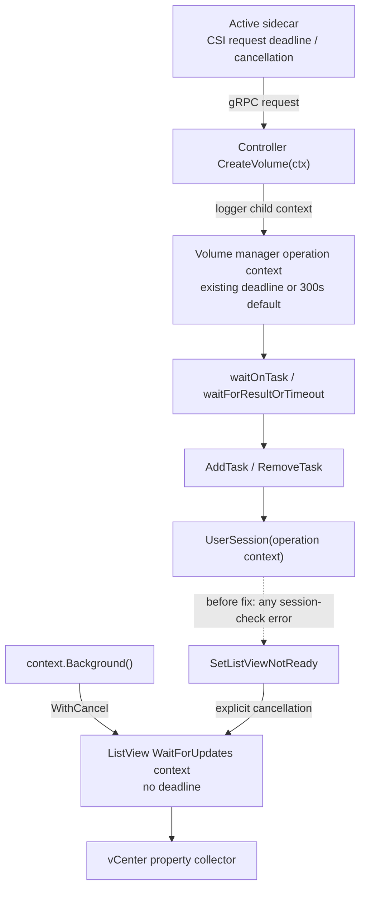
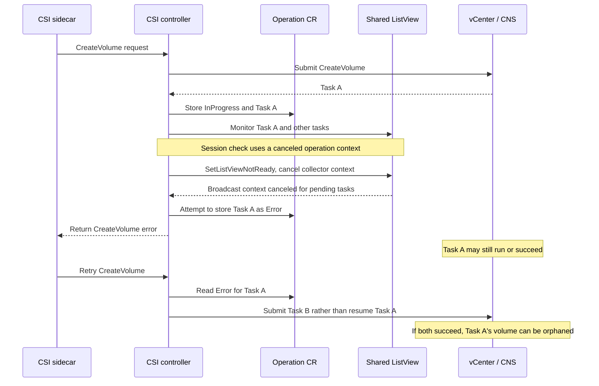
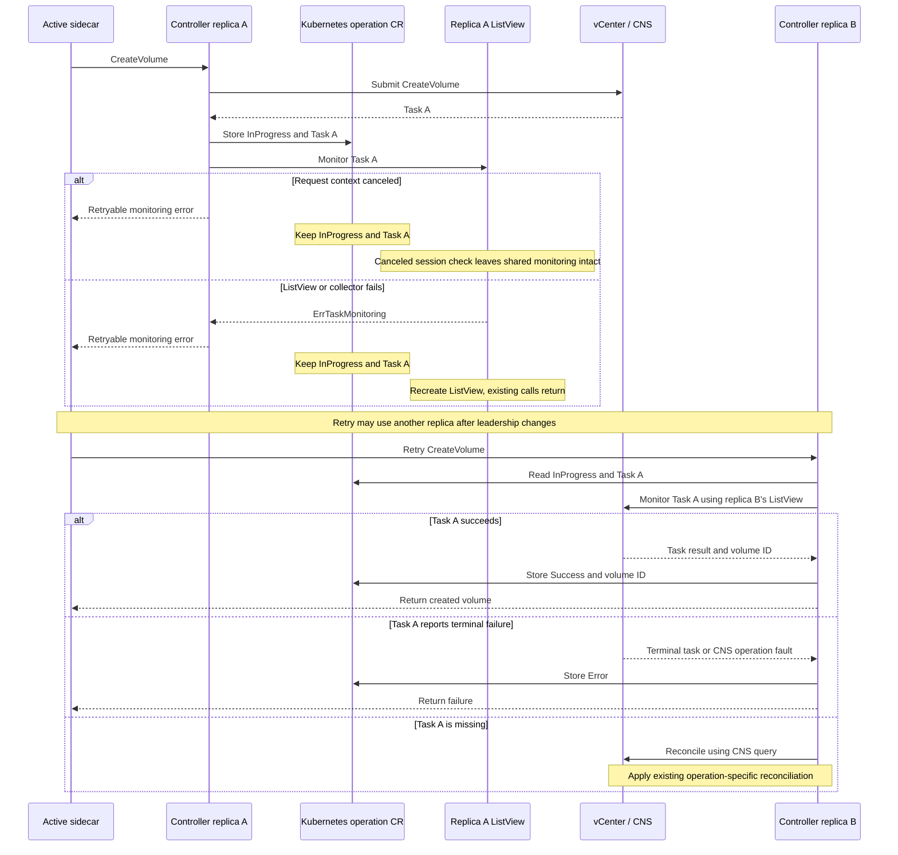

# Preserve CNS task state when ListView monitoring fails

## Problem

A CSI operation can be canceled while checking the vCenter session. The driver
currently treats every session-check error as an invalid session, cancels the
shared ListView property collector, and broadcasts its error to all pending
tasks. CreateVolume then records that monitoring error as a failed CNS task.
Without transaction support, a retry can submit another CreateVolume while the
original task is still running or has succeeded, leaving an orphan volume.

The incoming CSI request context can carry a sidecar deadline or cancellation.
The ListView collector uses a separate context without a deadline, explicitly
canceled when the view is invalidated. Each controller replica owns its own
ListView; the Kubernetes operation record is shared across replicas.

The observed sequence is: a task cleanup session check receives a canceled
request context; the driver declares the session invalid and cancels the
collector; the collector broadcasts the cancellation to unrelated task
waiters; CreateVolume stores an Error; a retry can issue a new CNS task. The
logs alone do not establish why the first context was canceled or prove that
the original vCenter task failed.

### Context ownership and propagation

The external-provisioner issues a CSI gRPC request. Its configured deadline
and cancellation propagate to the server-side request context. The controller
adds logging, then the volume manager derives an operation context: it keeps an
existing deadline or supplies a 300-second deadline if none exists. Another
caller, a lost connection, or an internal parent context can also cause
cancellation. The customer logs do not identify which source initiated it.

The ListView collector context is created separately from
`context.Background()` using `context.WithCancel`. It has no deadline, but
`SetListViewNotReady` explicitly cancels it. The request context does not
directly cancel the collector: the session-check and invalidation logic links
the two.

`RemoveTask` uses a separate, bounded cleanup context so cleanup can still be
attempted after the request is canceled. If a request context is canceled
during a session check, the driver checks `ctx.Err()` before invalidating the
shared view. A session-check transport error can still initiate recovery; it
does not prove that the CNS task failed. If cancellation interrupts an Add
call after it was sent, the view is recreated because the server may have
accepted the registration; other tasks receive a retryable monitoring error.

### Failure sequence before the fix

The CR write, later retry, and Task A's outcome are conditional; the customer
log excerpt does not prove they occurred. The driver may retain Task A's ID in
an Error record, but the retry path generally treats that status as non-pending.

## Design

Distinguish unknown monitoring outcomes from vCenter task failures. Caller
cancellation, failed ListView registration, and property collector errors
must preserve the persisted InProgress record and task reference. Return an
error to the caller so a retry, potentially on another replica, monitors the
same task. Terminal task and CNS faults retain their existing failure handling;
missing tasks retain operation-specific reconciliation. A canceled session
check must not invalidate monitoring for unrelated operations.

Tests exercise context cancellation, monitoring interruption, task failures,
retries, concurrent waiters, and simulated replica handoff.

Monitoring failures are wrapped with `ErrTaskMonitoring`; terminal task
updates use `ErrTaskFailed`. The wait is serialized per task and manager so a
later waiter cannot replace an earlier channel or remove its registration.
Collector errors are broadcast only after marking the view not ready.
ListView serialization is context-aware. Registration and the serialized
vCenter calls are bounded to 30 seconds or the earlier caller deadline;
cleanup uses a separate 30-second context. This keeps a stalled call from
holding the shared view lock indefinitely, though it can still delay unrelated
tasks until the bound expires. CR persistence and task-attempt ordering retain
their existing behavior; this change does not add generic stale-write fencing.

Cleanup after a result runs detached from the request. A bound on cleanup is
not a bound on the caller: the deferred removal ran before the wait returned,
so a stalled removal spent what was left of the request deadline and the
placement lookup that follows the task result then failed on an expired
context. The detached goroutine keeps the per-task wait lock, so a retry for
the same task still queues behind cleanup rather than racing it.

A task result that arrives but cannot be fully interpreted is not a task
failure. If the datastore lookup after a successful CreateVolume runs out of
context, the record stays InProgress with its task ID: the volume exists, and
recording Error would drop the only reference to it and let the retry create a
second one. A lookup that fails on its own is still recorded as Error, now
carrying the volume ID. The retry re-registers the same task, receives its
terminal update, and re-derives the placement.

### Lock chain and the authentication cooldown

Bounding a call with a context bounds nothing if the locks it waits on do not
take one. `VirtualCenter.Connect` acquires `ClientMutex`, a plain mutex, and a
login holds it for as long as the login takes. The ListView therefore keeps
every lock it holds off that path: `connect` does not hold the ListView state
lock, the vim25 client is cached on the ListView and read under that lock
without reaching through `ClientMutex`, and view recreation reuses the
connection the listen loop already established instead of logging in again
while holding both locks.

vCenter SSO locks an account after five failed logins in 180 seconds. Connect
used to wait out that window in-process, which both pinned `ClientMutex` for
three minutes and bounded nothing -- a caller with a shorter deadline, such as
the ListView's 30-second connect, returned early and the next caller began a
fresh attempt. An InvalidLogin now stamps a wall-clock cooldown on the
VirtualCenter and returns; every Connect during that window replays the stored
rejection without a round trip, so the attempt rate is independent of how many
callers arrive or how short their deadlines are. A successful connect clears
the cooldown.

### Task identity across vCenters

A task ID is meaningful only on the vCenter that issued it, and the operation
record is keyed by volume name alone. Preserving an InProgress record therefore
has to be paired with a check that the record belongs to this vCenter: the
vanilla multi-vCenter create loops advance to the next vCenter when a create
fails, which would otherwise hand one vCenter's task ID to another vCenter's
manager -- losing a still-running create if the task is missing there, or
reading an unrelated task if the ID collides.

Both are closed. The create loops stop rather than fall back when the outcome
is unknown (`ErrTaskMonitoring`), so the retry reaches the recorded vCenter.
Independently, the volume manager refuses to monitor a pending task whose
recorded vCenter is not its own, and leaves the record untouched; an empty
recorded vCenter (single-vCenter deployments) keeps the previous behavior.

The new controller replica obtains the task ID from the CR and registers it
with its own ListView; process-local channels are never shared between replicas.

### Recovery sequence

Replica B is an example: the retry may instead run on replica A. Each replica
owns its ListView and in-memory task channels, while the CR is shared. Sidecar
leadership is separate for each sidecar, and controller processes can serve
other requests concurrently.

### Verification

Unit tests cover canceled and expired request contexts, stalled ListView calls,
collector-error broadcasts, preservation of pending task IDs, terminal task
errors, serialized waiters, and simulated manager handoff. A regression test
starts with a pending task, broadcasts a collector error, and has a second
manager monitor the same task to success. The test uses a fake operation store
and ListView registration; it does not exercise collector recreation or actual
sidecar leadership handoff against Kubernetes and vCenter.

Supervisor WCP uses the same non-transactional volume-manager path. Workload
flavor tests cover monitoring interruption and retry with the original task,
both with and without the Supervisor quota feature. With quota enabled they
check that reservation remains in place during the interruption and is
released only on task success or confirmed terminal failure. The WCP controller
package tests also run as part of validation.

## Limitations

A persistent placement-lookup failure that is context-shaped keeps the record
InProgress, so the request retries until the lookup succeeds or vCenter reaps
the task, at which point the existing query-by-name reconciliation resolves it.

Refusing to monitor a task recorded against another vCenter fails the request
until a retry reaches that vCenter. If the recorded vCenter has been removed
from the configuration, the record needs operator intervention.

This does not repair historical records already marked Error. If CNS accepts a
create request but the task reference cannot be persisted, the task outcome is
unknown and this change alone cannot provide exactly-once creation without CNS
transaction support or separate reconciliation.

Concurrent CNS submissions before either replica persists a task ID are not
serialized by the CR store. This change does not add attempt identity or
fencing, and does not alter transaction-support CR ordering.
ListView recovery returns errors to existing requests; monitoring resumes on a
subsequent retry, not by transferring in-flight channels to the recreated
collector. The monitoring-error behavior of other CR-backed operations remains
outside this CreateVolume fix and requires separate review.
