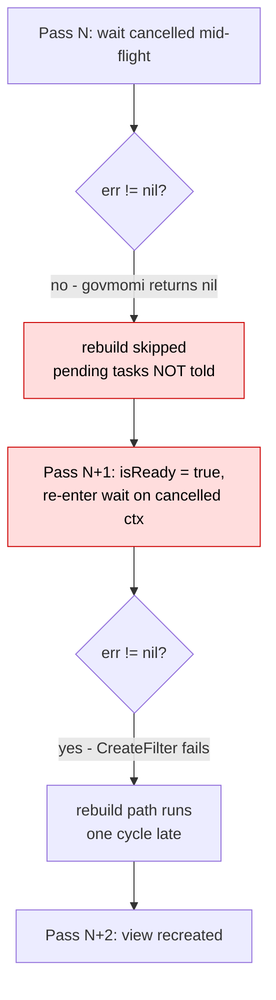
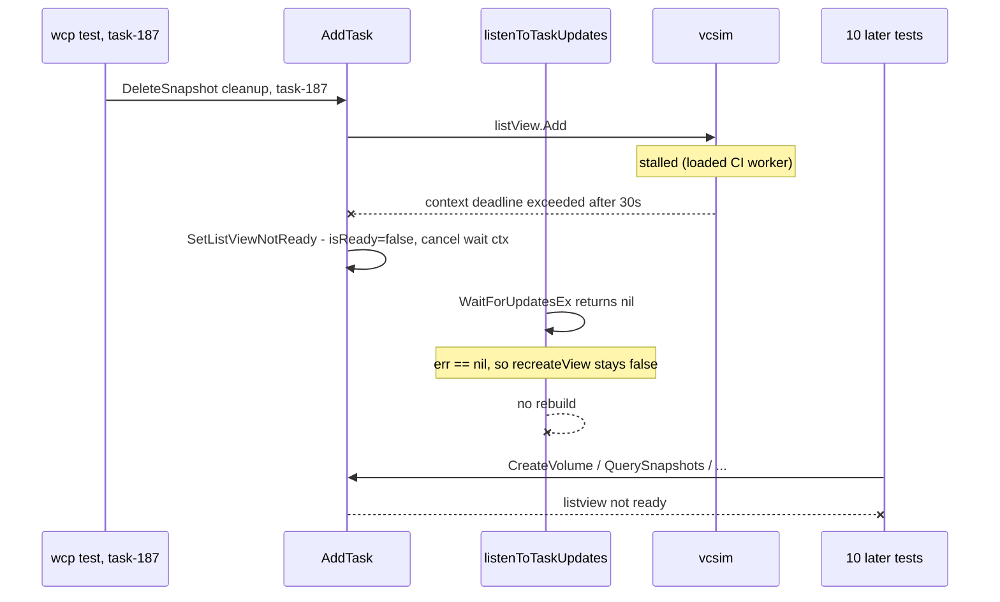

# Rebuild the ListView when a wait is cancelled

Follow-up to [#4409](https://github.com/kubernetes-sigs/vsphere-csi-driver/pull/4409)
(merged as `beef2594`), whose design is in [design.md](design.md). That change
made `AddTask` and `RemoveTask` ask for a new ListView generation when their own
vCenter call ends ambiguously. This document describes why the ask was never
honoured, and what it cost.

## 1. Summary

`SetListViewNotReady` signals "rebuild the view" by cancelling
`waitForUpdatesContext`. The listen loop decided whether to rebuild by looking
only at the error returned from `property.WaitForUpdatesEx`, and govmomi reports
a cancelled context as a clean, `nil` return. The loop therefore read the
teardown request as a healthy exit, skipped the rebuild, and re-entered the wait
on the context that had just been cancelled.

The view does still recover, but only by accident and one cycle late: the next
pass fails its `CreateFilter` against the cancelled context, and *that* error is
what finally triggers the rebuild.

The practical cost is modest and worth stating plainly up front: no caller
hangs, no operation outcome changes, and recovery always completes. What the
defect costs is a wasted cycle, a window in which the view advertises itself as
ready while it is about to be destroyed, and a reliance on a govmomi call
ordering that nothing guarantees. See
[section 3.3](#33-what-it-costs-if-left-unfixed).

## 2. Background: the two ways a wait ends

`listenToTaskUpdates` is one long-running goroutine per ListView. Each pass
connects, builds a property collector, publishes `isReady`, and then blocks in
`property.WaitForUpdatesEx` until something ends the wait. Two unrelated events
do that, and they need opposite responses only in their reporting, not in their
recovery -- both invalidate the current generation.

| Event | How it reaches the loop | Required response |
|---|---|---|
| Property collector or session failure | non-`nil` error from `WaitForUpdatesEx` | rebuild the view, fail pending tasks |
| `SetListViewNotReady` from `AddTask` / `RemoveTask` | `waitForUpdatesContext` cancelled | rebuild the view, fail pending tasks |

The second row is the contract #4409 wrote down. From `design.md` §Context
ownership and propagation:

> If cancellation interrupts an Add call after it was sent, the view is
> recreated because the server may have accepted the registration; other tasks
> receive a retryable monitoring error.

and from its recovery sequence diagram:

> Note over View: Recreate ListView, existing calls return

The code in `AddTask` says the same thing at the call site:

```go
response, err := l.listView.Add(ctx, []types.ManagedObjectReference{taskMoRef})
if err != nil {
    l.taskMap.Delete(taskMoRef)
    // An interrupted Add has an ambiguous remote outcome. Recreate the
    // view to remove any registration accepted before cancellation.
    l.SetListViewNotReady(ctx)
    return fmt.Errorf("%w. task: %v, err: %v", ErrListViewTaskAddition, taskMoRef, err)
}
```

The recreation never happened.

## 3. The defect

`SetListViewNotReady` clears readiness and cancels the wait context. Cancelling
is the whole signal; it carries no other state:

```go
func (l *ListViewImpl) SetListViewNotReady(ctx context.Context) {
    l.mu.Lock()
    defer l.mu.Unlock()
    l.isReady = false
    if l.waitForUpdatesCancelFunc != nil {
        l.waitForUpdatesCancelFunc()
    }
}
```

The loop read that signal out of the error alone:

```go
err := property.WaitForUpdatesEx(l.waitForUpdatesContext, pc, filter, ...)
...
if err != nil {
    recreateView = true     // the ONLY assignment of true in the function
    ...
    l.isReady = false
    l.reportErrorOnAllPendingTasks(err)
}
```

### 3.1 Why the error is nil

In govmomi, `Collector.WaitForUpdatesEx` maps a cancelled context onto a
cancel call and returns *that* call's result:

```go
res, err := methods.WaitForUpdatesEx(ctx, p.roundTripper, &req)
if err != nil {
    if ctx.Err() == context.Canceled {
        return p.CancelWaitForUpdates(context.Background())
    }
    return err
}
```

`CancelWaitForUpdates` returns `nil` when it succeeds. The wrapper's deferred
property-filter destroy runs on `context.Background()`, so it does not
contribute an error either. A cancelled wait is reported as a clean stop.

So `err == nil`, `recreateView` stays `false`, and the request is dropped.

### 3.2 What actually happens, pass by pass

The dropped signal does not strand the loop, because the *next* pass trips over
the same cancelled context in a place that does report an error.
`property.WaitForUpdatesEx` begins with `pc.CreateFilter(ctx, ...)`, and that
SOAP round trip fails immediately on an already-cancelled context:

```go
pf, err := pc.CreateFilter(ctx, filter.CreateFilter)
if err != nil {
    return err
}
```

So recovery arrives one cycle late, by accident rather than by design:

| Pass | What the loop does | `WaitForUpdatesEx` returns | Effect |
|---|---|---|---|
| N | blocked in the wait when `SetListViewNotReady` cancels the context | `nil` (via `CancelWaitForUpdates`) | **rebuild skipped, pending tasks not told** |
| N+1 | reconnect, new property collector, `isReady = true`, re-enter the wait on the *same cancelled* context | `context canceled` (from `CreateFilter`) | rebuild path finally runs: `recreateView = true`, `isReady = false`, tasks broadcast |
| N+2 | `recreateView` is true: destroy, `newListView(nil)`, fresh context | -- | recovered |



### 3.3 What it costs if left unfixed

**No caller hangs, and no outcome changes.** This bound comes first because it
limits everything else. `waitForResultOrTimeout` selects on the task channel
*and* on the caller's own operation context, and every caller has a deadline --
the sidecar's, or a 300s default supplied by
`ensureOperationContextHasATimeout` when none was set:

```go
select {
case <-csiOpContext.Done():
    err = fmt.Errorf("%w: time out for task %v before response from CNS: %w",
        ErrTaskMonitoring, taskMoRef, csiOpContext.Err())
case result := <-ch:
    err = result.Err
    taskInfo = result.TaskInfo
}
```

Both branches produce `ErrTaskMonitoring`. So the broadcast is a shortcut out
of that wait, not the only exit: a caller that misses it is released on its own
deadline, with the same error class and the same preserve-the-task-and-retry
semantics. Reporting early does not change what any caller concludes, and
during a vCenter outage it does not let the operation make progress either --
the retry meets the same outage.

What the defect actually costs is therefore narrower than "operations stall":

- **Occupancy.** A caller that has to burn its own deadline holds a goroutine
  for that long, and on the operator paths a `MaxConcurrentReconciles` worker
  slot with it. Callers that arrive without a sidecar deadline take the 300s
  default, so they occupy a slot for up to five minutes where the broadcast
  would have freed them at once. This is the same class of problem #4401
  addressed for `CnsRegisterVolume`, at a much smaller scale.
- **A bogus ready window.** Line 497 republishes `isReady = true` at the top of
  pass N+1, before the wait fails. `AddTask` passes its `IsListViewReady()`
  guard during that window and admits a task into a generation that is about to
  be destroyed. The task is still caught by the broadcast at the end of the same
  pass -- `isReady` is cleared before the broadcast and `AddTask` holds `viewMu`
  throughout -- so the result is a spurious retryable error, not a lost task.
  The view should simply never claim to be ready between invalidation and
  rebuild.
- **Reliance on an accident.** Recovery works only because
  `property.WaitForUpdatesEx` happens to call `CreateFilter`, which fails on a
  cancelled context, before it reaches any wait. That ordering is a govmomi
  implementation detail, not a documented contract. If it ever changed -- a
  cached or lazily created filter, an internal retry -- the dropped signal would
  become a genuine hang with nothing behind it, because the loop would once
  again see `nil` and once again not rebuild. The loop should act on the request
  it was given rather than on a side effect that currently happens to follow it.

**It is not a permanent outage, and not a spin.** The view always recovers once
vCenter is reachable; `isReady` flaps to `true` for one pass, which would hide
the state from the `restartContainer` watchdog -- that only fires while
`!IsListViewReady()` -- but recovery completes well inside the watchdog's
two-minute window, so the watchdog is not a factor either way.

The accurate summary is a correctness and robustness fix with a modest runtime
benefit, not a fix for an outage-severity defect.

## 4. Worked example: the CI failure that exposed it

Build [2121277986928857088](https://storage.googleapis.com/kubernetes-ci-logs/logs/post-vsphere-csi-driver-push-images/2121277986928857088/build-log.txt)
of `post-vsphere-csi-driver-push-images` failed in `make unit`, in
`pkg/csi/service/wcp`. Eleven tests failed; ten of them reported the identical
error. The timeline from the log:

| Time | Event |
|---|---|
| `16:33:20.567` | `listview ready state is true` -- the only generation this process ever had |
| `16:33:25.724` | `AddTask` for `Task:task-187`, logs "trying to add task to listview object", calls `listView.Add` |
| `16:33:55.728` | the call is cut off at exactly 30.004s -- `listViewCallTimeout` -- with `Post "https://127.0.0.1:39775/sdk": context deadline exceeded` |
| `16:33:55.728` | `AddTask` error path: "setting listview to not ready", then "cancelled context" |
| `16:33:55.731` onwards | every later CNS call fails instantly: `task: Task:task-188, err: listview not ready`, then 189, 191, 195, 198, 201, 204, 207, 210, 213, 216 |
| -- | no `re-creating the listView object` and no further `listview ready state` line appears for the rest of the run |



The subtest accounting makes the stall visible on its own: the parent test
reported `30.19s` while its five subtests summed to about `0.08s`. All of the
time was spent in the cleanup call, not in any assertion.

Three points of scope on this example:

- The 30-second stall itself is an environment problem -- an in-process vcsim
  that did not answer on a loaded GCB worker. It is not caused by the ListView
  code and is not fixed here. `pkg/csi/service/wcp` passes at the same commit
  locally.
- **The absent rebuild is mostly not this defect.** Per section 3.2 the loop
  should have reached the rebuild within two passes, well inside the ~1.7s the
  process had left. It did not, because the cleanup path was itself blocked on
  the same unresponsive vcsim: `pc.Destroy` gets a 30s budget, and govmomi's
  deferred property-filter destroy inside `WaitForUpdatesEx` runs on
  `context.Background()` with **no timeout at all**:

```go
defer func() {
    if err := pf.Destroy(context.Background()); err != nil {
```

- Consequently the log cannot be used as evidence for the loop's logic. What
  this defect contributed to the failure was the one skipped cycle; what
  produced the eleven test failures was the stalled simulator plus an unbounded
  cleanup call. An unbounded destroy against a hung vCenter is a real exposure
  in its own right, but it is a separate finding and is not addressed here.

What the example does legitimately show is the blast radius of an invalidated
view: a single interrupted registration starved every subsequent CNS operation
in the process, which is the outcome #4409's recreation step exists to cut
short.

## 5. The fix

Classify the exit from the error *and* the wait context together, and capture
the context under `mu` so the check inspects the generation the call actually
ran on rather than whatever the field holds by the time it is read.

```go
// waitExitError reports why a WaitForUpdatesEx call ended, or nil when it
// ended cleanly and the ListView generation it ran on is still usable.
func waitExitError(waitCtx context.Context, err error) error {
    if err != nil {
        return err
    }
    if ctxErr := waitCtx.Err(); ctxErr != nil {
        return fmt.Errorf("task monitoring was stopped to rebuild the listview: %w", ctxErr)
    }
    return nil
}
```

In the loop:

```go
waitCtx := l.waitForUpdatesContext   // captured while mu is held
l.mu.Unlock()
l.viewMu.Unlock()
waitErr := property.WaitForUpdatesEx(waitCtx, pc, filter, ...)
...
if err := waitExitError(waitCtx, waitErr); err != nil {
    // unchanged body: recreateView = true, isReady = false,
    // reportErrorOnAllPendingTasks(err)
}
```

A cancelled wait now takes the identical path a collector failure already took.

### 5.1 Why failing the pending tasks is required, not merely tidy

The rebuild calls `newListView(setupCtx, vimClient, nil)` -- **nil** tasks. The
replacement view starts empty, and nothing re-registers the entries still in
`taskMap`:

```go
listView, err := view.NewManager(client).CreateListView(ctx, tasks)
```

So every task registered against the destroyed generation has lost its
subscription, and the broadcast is the only thing that will ever tell those
callers. Without it they are released only by their own deadline, which is the
slow path described in section 3.3 rather than a hang, but it is the whole
reason `reportErrorOnAllPendingTasks` exists on the collector-failure path
already.

`reportErrorOnAllPendingTasks` wraps the cause in `ErrTaskMonitoring`, which
callers in `manager.go` and `vanilla/controller.go` already treat as *outcome
unknown -- preserve the task and retry*, never as a task failure. That is the
"other tasks receive a retryable monitoring error" half of the #4409 contract.

The timing is what changes here, not the eventual outcome. Before the fix the
other pending tasks were still broadcast to -- just at pass N+1, once the
cancelled context produced an error of its own. Now they are told at pass N,
when the view is actually invalidated.

### 5.2 Scope of the condition

`waitForUpdatesContext` is built with `context.WithCancel(context.Background())`
and has no deadline, and the only caller of its cancel function is
`SetListViewNotReady`. So `waitCtx.Err() != nil` means exactly "someone asked
for a new generation" and cannot fire spuriously. The unit-test stop path
(`shouldStopListening`) returns from the callback with the context still live,
so it continues to exit cleanly without forcing a rebuild.

## 6. Verification

Four tests in `listview_recovery_test.go`:

| Test | Asserts |
|---|---|
| `TestNotReadyCancellationRequestsViewRecreation` | real `SetListViewNotReady`, then a `nil`-error exit still demands a rebuild |
| `TestInterruptedAddRequestsViewRecreation` | the same, driven end to end through production `AddTask` over a transport whose `ModifyListView` fails |
| `TestCleanWaitExitKeepsCurrentListView` | a healthy exit does **not** rebuild |
| `TestCollectorFailureWaitExitKeepsOriginalError` | a collector error is still reported unchanged |

The first two fail against the previous behaviour and pass with the fix; the
last two pin the paths that must not change.

`pkg/common/cns-lib/volume` passes with and without `-race`, as do
`./pkg/csi/service/...` and `./pkg/syncer/cnsoperator/...`.

This closes a gap #4409 recorded against itself in its own verification
section, which noted that the tests "[do] not exercise collector recreation".

## 7. Out of scope

Recovery still returns errors to in-flight requests and resumes monitoring on a
subsequent retry; in-flight channels are not transferred to the rebuilt
collector. That limitation is stated in `design.md` and is unchanged here.

The vcsim stall that surfaced this in CI is an environment issue and is not
addressed by this change.
