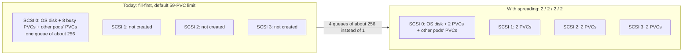
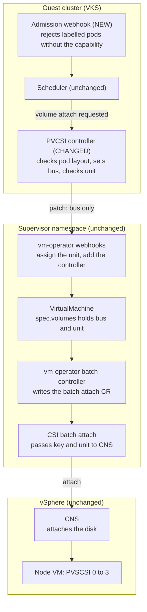
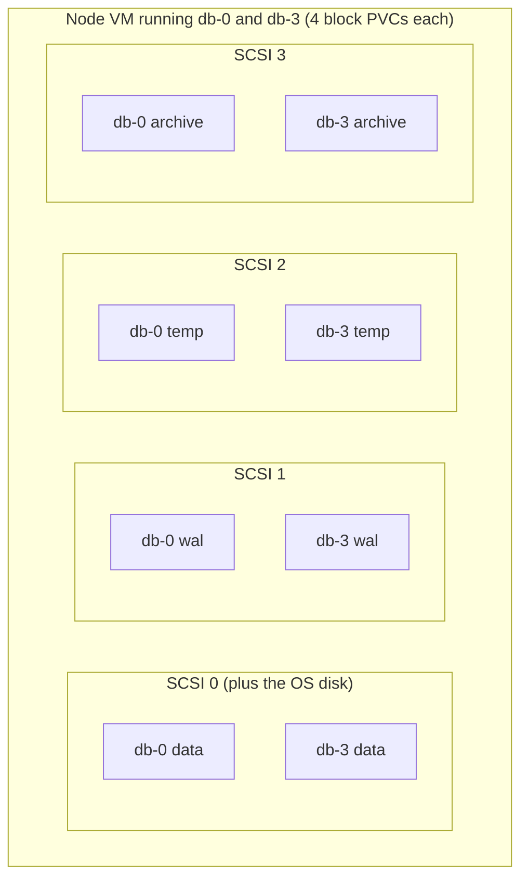
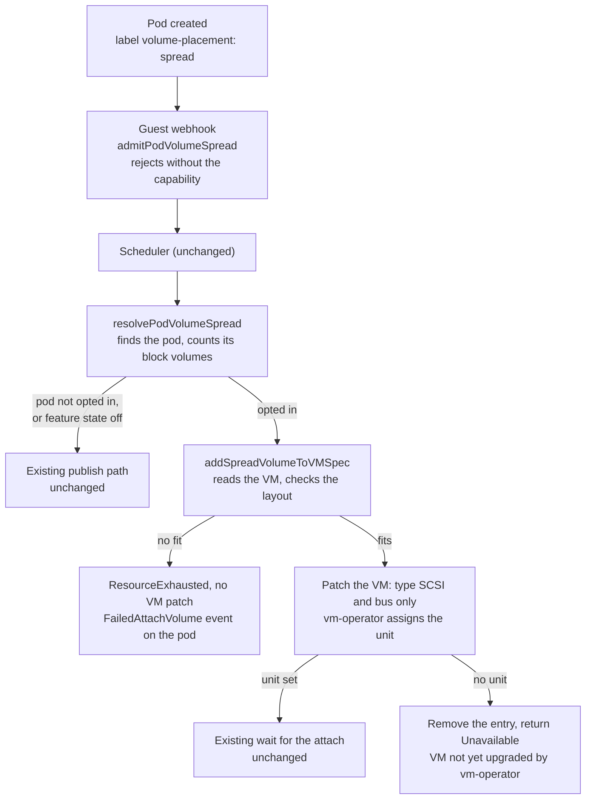

# Design Spec: Spreading Pod Volumes Across Storage Controllers on VKS Node VMs (Phase 1)

Author: Divyen Patel

**Scope of this document.** Phase 1: the opt-in pod label, the guest admission check, and the layout check and bus choice in `ControllerPublishVolume`, all behind the `pod-volume-spread` pvCSI feature state. Phase 2 (a node capacity label and webhook-added node affinity, so the scheduler avoids nodes that can't fit a pod) is a follow-up and is only mentioned here where it changes what DevOps do.

## Problem statement

On VKS today, every PVC attached to a node shares a single storage controller's I/O queue, so pods with several busy PVCs see high disk latency inside the guest even when the storage itself is healthy. No setting exists for a pod to ask for its volumes to be spread out.

### How volumes attach today

1. A pod is scheduled to a VKS node. PVCSI's `ControllerPublishVolume` adds each PVC to the node VM's `spec.volumes` without naming a controller.
2. vm-operator places the disk on the lowest-numbered controller with a free slot, creating a new controller only when every existing one is full.
3. By default PVCSI limits a node to 59 PVCs. SCSI 0 already holds the OS disk and has 64 slots, so it never fills and SCSI 1–3 are never created. With the high-pv-node-density feature enabled, the limit rises to 255 per node, so SCSI 1–3 do get created, but only after SCSI 0 is full. Fill-first still packs disks onto one controller at a time instead of spreading them.

The result: at the default limit, every PVC of every pod on the node sits on SCSI 0, next to the OS disk. At high density, a pod's PVCs land on whichever controller is currently filling, so they usually still share one controller's queue.

### Why that hurts

Each PVSCSI controller has one adapter queue, shared by all of its disks. With Linux defaults on VKS nodes:

| Queue | Default | Maximum |
| --- | --- | --- |
| Per disk (`vmw_pvscsi.cmd_per_lun`) | about 254 I/Os | 254 |
| Per controller (`vmw_pvscsi.ring_pages=8`) | about 256 I/Os | about 1024 (`ring_pages=32`) |

One busy disk can nearly fill its controller's queue by itself. When a pod's 8 busy PVCs share SCSI 0, their I/O queues inside the guest before it ever reaches ESXi. Broadcom KB 392848 describes exactly this: high guest latency on VMs with several disks on one controller, with no matching latency at the array. Spreading the same disks across 4 controllers gives the node about 4 × 256 I/Os in flight instead of 256.

### Who is affected

Pods with several I/O-heavy volumes on one node: databases with separate data, log and temp volumes, message queues, search indexes. Most pods have one or two quiet PVCs and gain nothing, so the change must apply only to pods that ask for it.

### What we are solving

Let a specific pod ask for its PVCs to be spread **evenly** across the node VM's 4 PVSCSI controllers, and either guarantee that layout or fail clearly so the pod can run on another node, without changing placement for any other pod.



The same 8 PVCs move from one shared queue to four; other pods' PVCs keep default placement on SCSI 0.

## Solution at a glance

Pods opt in with a label, PVCSI spreads their PVCs evenly across the node VM's 4 PVSCSI controllers, and if the node can't hold that layout the pod fails on that node before any volume attaches. vm-operator, CNS and the scheduler are reused unchanged.

- **Phase 1:** opt-in label, a guest webhook that rejects pods when the supervisor can't do placement, and a whole-pod layout check plus bus choice in `ControllerPublishVolume`. vm-operator still assigns the unit and creates controllers.
- **Phase 2 (follow-up, not in this change):** a PVCSI syncer controller publishes each node's spare controller capacity as a Node label, and the webhook adds node affinity so the scheduler skips nodes that can't fit the pod.

This change implements phase 1, with **PVCSI** choosing the controller for each volume. The Decision section explains why PVCSI and not vm-operator, and the Implementation section walks through the code.



All new and changed parts run in the guest cluster as PVCSI; everything in the supervisor and vSphere is reused unchanged.

## Goals and requirements

The feature changes placement only for pods that opt in, and either achieves the even layout or fails clearly.

### Requirements

1. **Opt-in per pod.** Pods without the opt-in keep today's placement unchanged.
2. **Even spread.** A pod's N spread PVCs are split across buses 0–3 so no controller holds more than ceil(N/4) of them. 8 PVCs give 2/2/2/2.
3. **Bus 0 is included**, shared with the OS disk and volumes that didn't opt in.
4. **Strict (Rule A).** If the node can't hold the even layout, the pod fails on that node and none of its volumes attach. DevOps can then move it to another node.
5. **Clear failure.** `ControllerPublishVolume` fails with a message starting `VolumeSpreadNotSatisfiable:` that names the needed layout and the bus that can't take its share. Kubernetes shows it on the pod as a `FailedAttachVolume` event.
6. **Unsupported supervisor = rejected at creation.** If the supervisor doesn't have the `supports_shared_disks_with_VM_service_VMs` capability, opted-in pods are rejected by the guest admission webhook.
7. **Phase 2: avoid unsuitable nodes.** The scheduler only places opted-in pods on nodes whose label shows enough free slots per controller.
8. **Never silently default.** If PVCSI can't tell whether a volume belongs to an opted-in pod, publish fails and retries; it never falls back to default placement.

### Non-goals

- Rebalancing volumes that are already attached. Placement can't change after attach.
- Spreading across NVMe or SATA controllers.
- Isolating opted-in pods from each other. Two pods may share a controller.
- A scheduler extension or custom scheduler.
- Raising PVSCSI queue depths inside the node image. That is a separate tuning decision.
- Spreading file volumes (`ReadWriteMany` PVCs). They are mounted over NFS and never attached to the node VM.

## How DevOps use it

DevOps add one label to the pod template, and PVCSI spreads every block PVC of each pod across the node VM's controllers. Nothing changes on the PVCs, the StorageClass or the cluster.

### Requesting spread

- **Label:** `csi.vsphere.vmware.com/volume-placement: spread`, set on the pod. For a StatefulSet or Deployment it goes in `spec.template.metadata.labels`. The same label on the StatefulSet's own `metadata` does nothing.
- **Scope is the whole pod.** Every block PVC the pod uses is spread. There is no per-PVC choice.
- **PVCs stay as they are.** Use the same StorageClass and `ReadWriteOnce` claims as today; no annotation or parameter is needed on them.
- **It pays off from 2 PVCs up.** A pod with one block PVC uses one controller either way.

### StatefulSet example

A database with four busy volumes per replica. The only line added for this feature is the label in the pod template.

```yaml
apiVersion: apps/v1
kind: StatefulSet
metadata:
  name: db
spec:
  serviceName: db
  replicas: 3
  selector:
    matchLabels:
      app: db
  template:
    metadata:
      labels:
        app: db
        csi.vsphere.vmware.com/volume-placement: spread   # opt in
    spec:
      containers:
      - name: db
        image: example.com/db:1.0
        volumeMounts:
        - {name: data, mountPath: /var/lib/db/data}
        - {name: wal, mountPath: /var/lib/db/wal}
        - {name: temp, mountPath: /var/lib/db/temp}
        - {name: archive, mountPath: /var/lib/db/archive}
  volumeClaimTemplates:
  - metadata: {name: data}
    spec:
      accessModes: ["ReadWriteOnce"]
      storageClassName: vks-storage-policy
      resources: {requests: {storage: 200Gi}}
  - metadata: {name: wal}
    spec:
      accessModes: ["ReadWriteOnce"]
      storageClassName: vks-storage-policy
      resources: {requests: {storage: 50Gi}}
  - metadata: {name: temp}
    spec:
      accessModes: ["ReadWriteOnce"]
      storageClassName: vks-storage-policy
      resources: {requests: {storage: 50Gi}}
  - metadata: {name: archive}
    spec:
      accessModes: ["ReadWriteOnce"]
      storageClassName: vks-storage-policy
      resources: {requests: {storage: 100Gi}}
```

- **Each replica is spread on its own node.** `db-0` has 4 block PVCs, so each lands on a different controller (1/1/1/1) of the node running `db-0`. `db-1` and `db-2` get the same on their nodes.
- **The label doesn't need to be in `spec.selector`.** It only has to be on the pods.
- **Adding the label to a running StatefulSet** restarts its pods, but placement is fixed at attach: a volume that stays attached across the restart keeps its controller. To get the even layout for an existing workload, scale it to 0, wait for the pods' VolumeAttachments to go away, add the label, then scale back up.
- **Deployments and bare pods** work the same way: put the label on the pod template or the pod.

### Scaling up: two replicas on one node

If a StatefulSet is scaled up and two of its replicas land on the same node, each replica is still spread evenly by itself, and the two share the controllers.



Each pod is spread 1/1/1/1 by itself. The pods share controllers, so each controller holds 2 of these PVCs. Which PVC lands on which controller can differ; the count per controller is what is guaranteed.

- **Scaling up doesn't touch running replicas.** Adding replicas only creates new pods; the volumes of existing pods stay where they are.
- **The layout is per pod.** Each replica has its own PVCs from `volumeClaimTemplates`, and PVCSI counts and spreads each pod's PVCs separately. With 4 PVCs each, `db-0` and `db-3` are both 1/1/1/1, so each controller holds 2 of their PVCs.
- **Pods are not isolated from each other.** Two pods may share a controller's queue; that is a stated non-goal. Each pod still has its I/O across four queues instead of one.
- **Uneven counts balance out.** With 5 PVCs per pod (2/1/1/1), the extra volume goes to the controller with the most free slots, so the second replica's extra usually lands on a different controller from the first's.
- **The second replica fails only if a controller has no room for its share.** It then gets the usual `VolumeSpreadNotSatisfiable` error and none of its volumes attach; the first replica is not affected. In phase 2 the scheduler avoids that node up front.
- **To keep replicas on separate nodes,** use pod anti-affinity or topology spread constraints as usual. They work together with the node affinity the webhook adds in phase 2.
- **One case does fail:** two labelled pods on the same node that mount the same `ReadWriteOnce` PVC, for example Deployment replicas sharing one claim. A single volume can't satisfy two pods' layouts. StatefulSet replicas never hit this, because each has its own PVCs.

### What DevOps see

| Situation | What shows up | What to do |
| --- | --- | --- |
| The layout fits | The pod starts as usual, with no extra events | Nothing |
| The supervisor can't do placement | Pod creation is rejected by the webhook. For a StatefulSet or Deployment no pod exists, so the rejection appears as a `FailedCreate` event on the StatefulSet or ReplicaSet | Remove the label, or ask the vSphere admin to upgrade the supervisor |
| The node can't hold the layout | The pod stays in `ContainerCreating`. `kubectl describe pod` shows `FailedAttachVolume` events whose message starts with `VolumeSpreadNotSatisfiable:` and names the bus that is short. None of the pod's volumes attach | Phase 1: cordon the node and delete the pod. Phase 2: delete the pod |

To confirm the layout, a user with access to the supervisor namespace can list the bus of each volume on the node VM. Volume names are the supervisor PVC names, which are the guest PVs' `volumeHandle` values.

```sh
kubectl get vm <node-name> -n <supervisor-namespace> \
  -o jsonpath='{range .spec.volumes[*]}{.name}{"\t"}{.controllerBusNumber}{"\n"}{end}'
```

### Volumes that are skipped

Only volumes that are attached to the node VM as disks sit on a storage controller, so only those are spread.

- **File volumes are skipped.** A PVC with access mode `ReadWriteMany` (or `ReadOnlyMany`) is a file volume in VKS. It is a file share mounted inside the node over NFS; it is never attached to the node VM as a disk, so it has no controller to choose. PVCSI doesn't count it, doesn't place it, and it can never cause a `VolumeSpreadNotSatisfiable` failure.
- **Mixed pods are fine.** A labelled pod with 4 `ReadWriteOnce` PVCs and 1 `ReadWriteMany` PVC is spread as 4 volumes (1/1/1/1), and the file volume mounts as it does today.
- **A labelled pod with only file volumes** is admitted and runs normally; the label has no effect.
- **Other volume types are ignored too:** `emptyDir`, `configMap`, `secret`, `hostPath`, and PVCs from other CSI drivers.

## Current behaviour

vm-operator already lets a client choose the controller and assigns the unit itself; PVCSI just doesn't use it yet. All references below were read from the `vsphere-csi-driver` and `vm-operator` repos.

| Component | What it does today | Reference |
| --- | --- | --- |
| PVCSI `ControllerPublishVolume` | Appends a volume with only `name` and `claimName`; patches the VM with an optimistic lock and retries on conflict | `pkg/csi/service/wcpguest/controller.go:1201-1262`, `pkg/common/utils/utils.go:403` |
| PVCSI VM API version | Uses **v1alpha2**, which has no placement fields (`controllerType`, `controllerBusNumber`, `unitNumber` arrived in v1alpha5). The shared helpers are also used by fullsync, csinodetopology, cnsfileaccessconfig and the admission handler | `wcpguest/controller.go:42`, `pkg/common/utils/utils.go:382` |
| PVCSI VM watcher | A `ListWatch` used for a one-off watch on one VM per attach or detach; not a shared informer | `wcpguest/controller.go:272, 1272`, `pkg/kubernetes/kubernetes.go:354` |
| PVCSI attach wait | Watches the VM until `status.volumes[].diskUUID` is set; returns `status.volumes[].error` right away | `wcpguest/controller.go:1344-1357` |
| PVCSI pod and PVC caches | The controller process has PV and PVC listers; only the syncer has a pod lister | `k8sorchestrator.go:1005-1020`, `pkg/syncer/metadatasyncer.go:801` |
| Attach errors on the pod | The attach-detach controller copies `VolumeAttachment.status.attachError` into a `FailedAttachVolume` Warning on each scheduled pod | Kubernetes `pkg/volume/util/operationexecutor/operation_generator.go:317`, `pkg/volume/csi/csi_attacher.go:641` |
| vm-operator mutating webhook | No bus given: lowest controller with a free slot (fill-first). Bus given: uses that controller or **creates it**. No unit given: picks the next free unit and writes it into the spec | `webhooks/virtualmachine/mutation/virtualmachine_mutator_hardware_controllers.go:23-290` |
| vm-operator validating webhook | On update, bus, type and unit are all required; unit must be unused; bus and type are immutable | `webhooks/virtualmachine/validation/virtualmachine_validator.go:1636-1670, 1808-1830` |
| Controller sharing mode | Sharing-mode rules are enforced only for OracleRAC and MicrosoftWSFC volumes; a plain volume can be placed on a shared controller without error | `validation/virtualmachine_validator.go:1942-1947` |
| VM not yet upgraded by vm-operator | Until vm-operator re-processes a VM after its own upgrade, the mutator skips placement and the validator skips volume checks, so a bus-only volume is stored with no unit | `mutation/virtualmachine_mutator.go:369-395`, `validation/virtualmachine_validator.go:1537-1544` |
| Hot-add controllers | Adding or removing a controller on a powered-on VM is allowed; editing one isn't | `validation/virtualmachine_validator_hardware_controllers.go:92-140` |
| Feature gates | Placement webhooks run with `VMSharedDisks` or `AllDisksArePVCs`, but only `VMSharedDisks` runs the batch attach controller that passes bus and unit to CNS. With `AllDisksArePVCs` alone, the legacy controller attaches with no placement | `mutation/virtualmachine_mutator.go:369-395`, `controllers/virtualmachine/controllers.go:29`, `cnsnodevmattachment_controller.go:448` |
| Supervisor capability | `supports_shared_disks_with_VM_service_VMs` turns on `VMSharedDisks`. PVCSI knows it as `SharedDiskFss`, but no PVCSI switch maps to it yet | `vm-operator/pkg/config/capabilities/capabilities.go:81, 319`, `pkg/csi/service/common/constants.go:642, 812` |
| Conversion | Older API versions keep newer volume fields: bus, type, unit and sharing mode are restored by volume name | `vm-operator/api/v1alpha2/virtualmachine_conversion.go:511-528` |
| Image disks | The boot disk and other image disks are backfilled into `spec.volumes` with bus and unit, so the spec lists every device | `pkg/providers/vsphere/upgrade/virtualmachine/vm_schema_upgrade.go:137-153` |
| CSI batch attach reconciler | Passes vm-operator's `controllerKey` and `unitNumber` straight to CNS `AttachVolume` | `pkg/syncer/cnsoperator/controller/cnsnodevmbatchattachment/cnsnodevmbatchattachment_helper.go:666-674`, `pkg/common/cns-lib/volume/manager.go:4170-4176` |
| PVCSI node volume limit | Guest nodes report 59 volumes per node (255 on the high-density path) | `pkg/csi/service/node.go:40-46` |

VKS node VMs have no CD-ROMs, so `spec.volumes` is a complete list of everything on the controllers; controller sharing modes come from `spec.hardware.scsiControllers`. Setting only `controllerType` and `controllerBusNumber` is supported once vm-operator has upgraded the VM: vm-operator fills in the unit, or rejects the whole patch if the controller is full.

## Decision: who picks the controller, PVCSI or vm-operator

Two components could decide which controller each volume lands on: PVCSI in the guest cluster, which knows the pod, or vm-operator in the supervisor, which owns the VM's hardware. Both approaches are described first, then compared, and the choice follows.

### Approach 1: PVCSI-driven placement

PVCSI decides the controller for every volume and tells vm-operator which one to use. vm-operator is not changed.

#### How PVCSI-driven placement works

1. On `ControllerPublishVolume`, PVCSI finds the pod that uses the volume and counts that pod's block PVCs (N).
2. PVCSI reads the node VM's spec, sees how many devices each of SCSI 0–3 holds, and computes the even layout for the whole pod.
3. If any controller can't take its share, PVCSI fails the attach before writing anything to the VM.
4. Otherwise it adds the volume to the VM spec with `controllerType` and `controllerBusNumber` set.
5. vm-operator does what it already does today when a client names a controller: it picks the unit, creates the controller if it doesn't exist, and attaches the disk.

**What has to change:** PVCSI only. A guest admission webhook, the layout logic in `ControllerPublishVolume`, and a move of PVCSI's guest controller to a VM API version that has the placement fields. No new API and no vm-operator code.

#### Strengths of PVCSI-driven placement

- PVCSI sees the whole pod, so it can refuse the pod before the first volume attaches. That is what the strict rule needs.
- It works on any supervisor that already has the `supports_shared_disks_with_VM_service_VMs` capability.
- It ships and changes with PVCSI on the VKS release cadence.

#### Costs of PVCSI-driven placement

- PVCSI has to repeat a few hardware rules that vm-operator owns: 4 controllers per type, 64 slots each, unit 7 reserved, shared controllers skipped. vm-operator still enforces slots and units, so a mistake fails the patch and can't corrupt the VM.
- Only VKS pods benefit. Other VM Service users get nothing.
- It relies on vm-operator continuing to accept a volume with only the bus set.

### Approach 2: vm-operator-driven placement

PVCSI only says that a volume wants to be spread and which pod it belongs to. vm-operator decides the controller.

#### How vm-operator-driven placement works

1. The vm-operator VM API gains per-volume fields, for example `placementPolicy: Spread | SpreadRequired` and `placementGroup: <namespace>/<pod-name>`.
2. On `ControllerPublishVolume`, PVCSI finds the pod and adds the volume to the VM spec with those two fields. It doesn't choose a bus.
3. vm-operator's webhook picks the bus for that volume: the controller with the fewest volumes of the same group, then the lowest total, then the lowest bus number.
4. If the policy is `SpreadRequired` and no controller keeps the group even, the webhook rejects the patch with a reason code.
5. PVCSI turns that rejection into the attach error the pod sees.

**What has to change:** vm-operator and PVCSI. New API fields with conversion, validation and immutability rules, new webhook logic, an API review, and version gating so PVCSI only uses the fields on supervisors that have them.

#### Strengths of vm-operator-driven placement

- Every hardware placement rule lives in one place, the component that owns VM hardware.
- The webhook decides on the admitted VM state directly.
- Any VM Service user can use it, not just VKS.

#### Costs of vm-operator-driven placement

- The webhook decides one volume at a time. It sees the whole VM spec but not the pod, so it doesn't know how many more of the pod's PVCs are still to come. A pod can attach 6 of 8 volumes and then fail on the 7th; those `ReadWriteOnce` volumes must detach before the pod can move.
- It is only available on supervisors released after the new API ships.
- Two components on two release trains must stay in step.
- Each later policy change (leave out bus 0, data versus log roles, NVMe) becomes a vm-operator API change.

### Comparison

| Criterion | PVCSI-driven placement | vm-operator-driven placement |
| --- | --- | --- |
| Works on existing supervisors | **Yes**, any supervisor with the `supports_shared_disks_with_VM_service_VMs` capability | Only supervisors released after the new API ships |
| Release dependency | PVCSI only, on the VKS cadence | PVCSI and vm-operator, plus version gating between them |
| API change | None beyond moving PVCSI's guest controller to v1alpha5 or later | New vm-operator fields with conversion, API review, immutability rules |
| Pod-wide strict check (Rule A) | **Exact before the first attach**: PVCSI knows N and checks the whole layout | Per-volume only: the webhook sees the whole VM spec but not the pod or its unbound siblings, so a pod can half-attach before failing |
| Accuracy of the slot view | Exact: `spec.volumes` lists every device (no CD-ROMs, image disks backfilled), sharing modes come from `spec.hardware`, and the optimistic lock makes PVCSI's read the admitted state | Exact: the webhook sees the admitted state directly |
| Where hardware rules live | Duplicated in PVCSI: 4 controllers per type, 64 slots, unit 7 reserved, skip shared controllers. vm-operator still enforces slots and units | One place, vm-operator |
| Policy changes later (exclude bus 0, roles like data vs log, NVMe) | An implementation change in any PVCSI release | Each one becomes a vm-operator API change |
| Error reporting | PVCSI writes the error; Kubernetes shows it on the pod as `FailedAttachVolume` | Needs a reason-code contract between the webhook and PVCSI |
| Reuse by VM Service users outside VKS | No | **Yes** |
| Testing | One repo, fake VM objects | Two repos, cross-team end-to-end tests |

### Chosen: PVCSI-driven placement

Phase 1 is built as PVCSI-driven placement. Three reasons decided it.

- **The strict requirement needs pod-wide knowledge.** Rule A has to know the pod's total spread PVC count to reject the pod before any of its volumes attach. Only the guest cluster has that. With vm-operator-driven placement a pod can half-attach and then fail.
- **Availability.** PVCSI-driven placement works on every supervisor that already has the shared-disks capability. vm-operator-driven placement leaves VKS users without the feature until their supervisor upgrades.
- **Policy belongs where the pod is.** Bus 0 handling, strictness and future per-PVC roles are Kubernetes policy. Putting them in a generic VM API makes each change a long-term contract.

vm-operator-driven placement becomes the better choice if any of these turn out to be true:

- Non-VKS VM Service workloads need the same spreading.
- The vm-operator team wants to own every hardware placement rule and can ship the API on our timeline.
- The requirement relaxes to best-effort spreading, where a per-volume decision in vm-operator is enough.

The choice is not a dead end. The opt-in label DevOps use stays the same in both approaches, so PVCSI's bus choice could later be swapped for setting vm-operator's new fields without users changing anything.

## Implementation

Phase 1 is one new file in the guest CSI controller, one new file in the guest webhook, and small hooks into existing code. Everything is behind the `pod-volume-spread` feature state.

| File | Change |
| --- | --- |
| `pkg/csi/service/common/constants.go` | New `PodVolumeSpreadFSS`, the pod label key and value, and the mapping of the feature state to the `supports_shared_disks_with_VM_service_VMs` capability |
| `pkg/csi/service/wcpguest/volume_spread.go` | New. Pod lookup, volume count, VM state, layout computation, and the VM patch for a spread volume |
| `pkg/csi/service/wcpguest/controller.go` | `controllerPublishForBlockVolume` calls the spread path first; `Init` starts the capability watcher |
| `pkg/syncer/admissionhandler/pvcsi_podvolumespread.go` | New. Feature state lookup and the pod admission check |
| `pkg/syncer/admissionhandler/pvcsi_admissionhandler.go`, `admissionhandler.go` | The guest mutation handler routes pod `CREATE` to the check; start-up reads the feature state |
| `manifests/guestcluster/1.37/pvcsi.yaml` | `"pod-volume-spread": "false"` in the internal feature states ConfigMap |

### Request flow



Every volume enters through `resolvePodVolumeSpread`. It returns nothing for volumes that keep default placement, and the existing code runs exactly as before.

### Feature state and capability

Two checks are used everywhere, and both are package variables so tests can replace them.

| Check | Meaning | Source |
| --- | --- | --- |
| Feature state on | The feature exists in this pvCSI build and is turned on | `IsPVCSIFSSEnabled(pod-volume-spread)` |
| Supported | Feature state on **and** the supervisor has `supports_shared_disks_with_VM_service_VMs` | `IsFSSEnabled(pod-volume-spread)`, through `WCPFeatureStateAssociatedWithPVCSI` |

| State | Webhook | `ControllerPublishVolume` |
| --- | --- | --- |
| Feature state off | Admits every pod; the label is ignored | No extra API calls; existing path for every volume |
| Feature state on, capability missing | Rejects labelled pods | A labelled pod that still reaches attach fails with `FailedPrecondition`; other pods use the existing path |
| Feature state on, capability present | Admits every pod | Labelled pods are spread; other pods use the existing path |

The capability is what makes vm-operator both assign a unit for a bus chosen by pvCSI and pass the placement to CNS. When the feature state is on and the capability is missing, the controller (`Init`) and the webhook start the existing `HandleLateEnablementOfCapability` watcher, which restarts the container once the supervisor gains the capability.

### Guest admission webhook

`CSIGuestMutationWebhook.Handle` sends pod `CREATE` requests to `admitPodVolumeSpread` when the feature state is on.

- A pod without the label, or with another value for it, is allowed.
- A labelled pod is allowed when the feature is supported and denied when it is not. The message names the label and the missing capability.
- The pod is never changed in phase 1. Updates and deletes are not checked.

The handler is only called if the cluster has a `MutatingWebhookConfiguration` entry for pods. That entry ships with the VKS add-on, not in this repository:

```yaml
kind: MutatingWebhookConfiguration
webhooks:
- name: pod-volume-spread.csi.vsphere.vmware.com
  rules:
  - operations: ["CREATE"]
    apiGroups: [""]
    apiVersions: ["v1"]
    resources: ["pods"]
  objectSelector:
    matchLabels:
      csi.vsphere.vmware.com/volume-placement: spread
  failurePolicy: Fail
  timeoutSeconds: 10
  sideEffects: None
```

The `objectSelector` keeps pods without the label away from the webhook, so a webhook outage only blocks opted-in pods.

### Finding the pod: `resolvePodVolumeSpread`

`ControllerPublishVolume` receives a volume ID and a node ID, not a pod. The pod is found with live guest API calls.

1. **VolumeAttachment.** Its name is derived from the volume ID and node ID (the existing `volumeAttachmentName`). It names the PersistentVolume.
2. **PersistentVolume.** Its `claimRef` names the claim.
3. **Pods.** List pods in the claim's namespace with `spec.nodeName` equal to the node ID. Keep pods that use the claim and are not `Succeeded` or `Failed`.
4. **Decide.**

| What is found | Result |
| --- | --- |
| VolumeAttachment is gone | `FailedPrecondition`: the attach is no longer requested |
| VolumeAttachment has no PersistentVolume, or the PersistentVolume has no claim | Default placement: no pod can reach the volume through a claim |
| No pod on the node uses the claim yet | `Unavailable`, so the attach is retried |
| Pods use the claim, none is labelled | Default placement |
| Exactly one labelled pod (unlabelled pods may share the claim) | Spread for that pod |
| Two or more labelled pods share the claim | `FailedPrecondition` with `VolumeSpreadNotSatisfiable:` |
| Any API call fails | `Unavailable` |

The rule behind the table: if pvCSI can't tell whether the volume belongs to an opted-in pod, it fails and retries. It never falls back to default placement, because that would silently give an opted-in pod the wrong layout.

### Counting the pod's volumes: `spreadVolumeOfClaim`

For the labelled pod, every claim it uses is inspected, including claims created for generic ephemeral volumes (named `<pod>-<volume>`). The count is N. The volume handles of bound claims are collected as the pod's siblings; they are the volume names in the VM spec.

| Claim | Counted |
| --- | --- |
| Bound, PersistentVolume of this driver, access mode not `ReadWriteMany` or `ReadOnlyMany` | Yes |
| Not bound yet (`WaitForFirstConsumer`), StorageClass uses this driver | Yes, without a handle |
| Access mode `ReadWriteMany` or `ReadOnlyMany` (file volume) | No |
| Guest-local NFS volume (`guestnfs:` handle, or StorageClass with a `server` parameter) | No |
| Another driver's volume, or an unbound claim without a StorageClass | No |
| Claim, PersistentVolume or StorageClass can't be read | `Unavailable` |

### Reading the VM: `spreadStateFromVM`

The VirtualMachine is read as v1alpha5, the first API version with placement fields. For each SCSI bus 0 to 3 the function returns three numbers.

- **Capacity.** A bus with no controller yet counts as an empty ParaVirtual controller (64 devices), because vm-operator creates it on demand. For an existing controller the capacity comes from its type. A controller whose sharing mode is not `None` has capacity 0: vm-operator doesn't stop a plain volume from landing on a shared controller, so pvCSI excludes it.
- **Used.** The number of volumes in `spec.volumes` on that SCSI bus. Volumes on other controller types are ignored.
- **Pod volumes.** How many of those are the pod's siblings.

If any volume in the spec has no controller bus, the function returns an error and the publish returns `Unavailable`: vm-operator hasn't recorded the VM's layout yet, so nothing can be counted.

### Computing the layout: `computeSpreadShares` and `chooseSpreadBus`

These two functions are pure: they take N and the per-bus state and touch nothing else.

`computeSpreadShares` returns how many of the pod's volumes each bus must end up with.

1. Every bus gets floor(N/4). The remaining N mod 4 buses get one more.
2. A bus that already holds the larger share keeps it.
3. The other larger shares go to the buses with the most room left after taking the smaller share; ties go to the lowest bus.
4. Every bus must have free slots for the part of its share that isn't attached yet. If one doesn't, the function fails and names that bus.

It also fails when the pod's attached volumes are already uneven, for example when the pod was labelled after its volumes were attached. Those volumes must be detached first (scale to 0, then back up).

`chooseSpreadBus` picks the bus for the volume being published: the bus furthest from its share, then the one with the fewest devices, then the lowest number.

| Pod block volumes (N) | Shares across the 4 buses |
| --- | --- |
| 3 | 1 / 1 / 1 / 0 |
| 4 | 1 / 1 / 1 / 1 |
| 5 | 2 / 1 / 1 / 1 |
| 8 | 2 / 2 / 2 / 2 |
| 10 | 3 / 3 / 2 / 2 |

Which bus gets which share depends on free slots, so bus 0, which holds the OS disk and default-placed volumes, usually gets the smaller share.

### Writing to the VM: `addSpreadVolumeToVMSpec`

1. Read the VM. If the volume is already in the spec, skip to the attach wait; this makes a retried call idempotent.
2. Compute the layout and the bus as above. If the layout doesn't fit, return `ResourceExhausted` without patching. Every sibling fails the same way, so none of the pod's volumes attaches on this node.
3. Check the attach is still requested (the existing `isAttachStillRequested`).
4. Append the volume with `controllerType: SCSI` and `controllerBusNumber` set, and never `unitNumber`. Patch with a merge patch and the optimistic lock.
5. Check the VM returned by the patch (`ensureSpreadVolumeHasUnit`). vm-operator assigns the unit in the same admission step that stores the volume. If the volume has no unit, vm-operator skipped placement because it hasn't upgraded this VM yet; the entry is removed again and the call returns `Unavailable`.
6. Return to the existing code, which waits for the disk UUID in the VM status.

**Concurrent attaches.** Siblings are published in parallel. The optimistic lock admits one patch per VM version; the others get a conflict, back off with the existing `vmPatchRetryBackoff`, read the VM again and recompute. Each retry sees the siblings placed before it, so the layout stays even.

**vm-operator rejects the patch.** `Invalid`, `Forbidden` and `BadRequest` mean vm-operator refused the placement, for example because the bus filled up after the read. The call fails with `VolumeSpreadNotSatisfiable` and doesn't try another bus, which would break the even layout. Any other error is retried until the attacher timeout, like the existing path.

### Errors the publish path returns

| Situation | gRPC code | Message starts with `VolumeSpreadNotSatisfiable:` | Attacher retries |
| --- | --- | --- | --- |
| Layout doesn't fit, or attached volumes are uneven | `ResourceExhausted` | Yes | Yes, fails the same way until the pod is deleted |
| vm-operator rejects the placement | `ResourceExhausted` | Yes | Yes |
| Claim shared by two labelled pods | `FailedPrecondition` | Yes | Yes |
| Labelled pod, capability missing | `FailedPrecondition` | Yes | Yes |
| Attach no longer requested | `FailedPrecondition` | No | No VolumeAttachment is left to retry |
| Pod or its volumes can't be determined | `Unavailable` | No | Yes, succeeds once the lookup works |
| VM has a volume with no bus, or the new volume got no unit | `Unavailable` | No | Yes, succeeds after vm-operator upgrades the VM |
| VM can't be read, or the unit-less entry can't be removed | `Internal` | No | Yes |
| Patch keeps failing until the attacher timeout | `DeadlineExceeded` | No | Yes |

Kubernetes copies the error into `VolumeAttachment.status.attachError` and from there into a `FailedAttachVolume` event on the pod. An example message: `VolumeSpreadNotSatisfiable: pod needs 2/2/2/2 across SCSI 0-3; bus 3 has 0 free slots, needs 2 (pod app/db-0, virtualmachine "node-1")`.

### Changes to existing code

- **`controllerPublishForBlockVolume`.** The existing get-and-patch loop now runs only when `resolvePodVolumeSpread` returns nothing (`for spread == nil`). For a spread volume `addSpreadVolumeToVMSpec` replaces that loop. Everything after it, the wait for the disk UUID and the stale-attach cleanup, is shared and unchanged.
- **VM API version.** Only the spread path uses v1alpha5. The existing path, detach, and the other callers of `pkg/common/utils` stay on v1alpha2. A v1alpha2 patch of the same VM keeps the placement of existing volumes, because vm-operator's conversion restores bus, type and unit by volume name.
- **Detach.** Unchanged. `ControllerUnpublishVolume` removes the volume from the VM spec by name.

### Moving a failed pod

The scheduler doesn't know why the pod failed and may pick the same node again. DevOps cordon or taint the node, then delete the pod. Until then each of its volumes keeps failing to attach, so repeated `FailedAttachVolume` events are expected.

### Failure modes

| Case | What happens | Recovery |
| --- | --- | --- |
| Layout doesn't fit at first publish | Every sibling fails with `VolumeSpreadNotSatisfiable:`; nothing attaches | Cordon the node and delete the pod |
| Another pod takes the last slots between two sibling patches | The later sibling fails; earlier siblings stay attached | Delete the pod; detach removes its volumes from the VM spec |
| VM not yet upgraded by vm-operator | `Unavailable`; an entry stored without a unit is removed | Automatic, once vm-operator has processed the VM |
| Pod lookup fails | `Unavailable`; never default placement | Automatic retry |
| vSphere attach fails after the spec is written | Unchanged from today: the VM status error is returned | Delete the pod |
| Supervisor without the capability | Labelled pods are rejected at creation | Upgrade the supervisor |
| Webhook down | Labelled pods are rejected (`failurePolicy: Fail`); other pods are unaffected | Automatic once it is back |
| Claim shared by two labelled pods on one node | Fails | Don't share a spread claim between pods |

### Tests

| Test file | Covers |
| --- | --- |
| `pkg/csi/service/wcpguest/volume_spread_test.go` | Layout tables for `computeSpreadShares` and `chooseSpreadBus`; a sequence test that places 1 to 13 volumes one at a time and checks the result is even; `spreadStateFromVM`; every row of the pod lookup and claim tables above; `addSpreadVolumeToVMSpec` including conflict retry, rejection, missing unit and stale attach; and `controllerPublishForBlockVolume` end to end with the feature state on and off |
| `pkg/syncer/admissionhandler/pvcsi_podvolumespread_test.go` | The feature state lookup, the webhook decision for every state and operation, a malformed pod, and the mapping of the feature state to the capability |

The tests use the fake guest clientset and the controller-runtime fake client. A patch interceptor stands in for vm-operator's mutating webhook by assigning unit numbers; tests of the not-yet-upgraded VM leave it out.

Not unit-tested: the few lines in `Init` and in the webhook server start-up that call the tested helpers, since those functions create real clients.

### Points for reviewers

- **Extra API calls.** With the feature state on, every block publish makes three extra guest API calls (VolumeAttachment, PersistentVolume, pod list), and an opted-in pod adds two per claim. An informer would remove them; live calls were chosen because they are authoritative and need no cache warm-up.
- **Strict on uneven volumes.** A pod labelled after its volumes were attached fails until those volumes are detached. Spreading only the remaining volumes around them would be the lenient alternative.
- **Two API versions on one VM.** Spread volumes are patched as v1alpha5 and everything else as v1alpha2. This relies on vm-operator's conversion keeping placement fields.
- **No reservation.** Slots are not reserved between sibling patches, so on a nearly full node another pod can take the last slots and leave a pod partly attached.

### Not in this change

- The `MutatingWebhookConfiguration` entry for pods. Without it the webhook check is never called.
- Metrics for spread attempts.
- Phase 2: the node capacity label and the node affinity that keeps the scheduler away from nodes that can't fit a pod.
