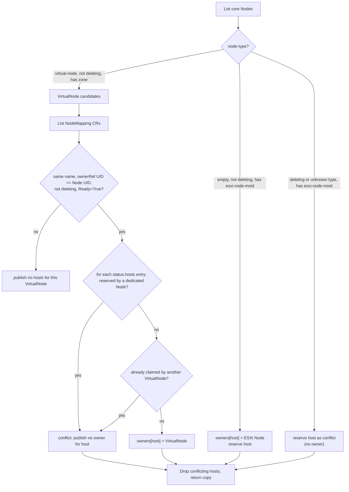
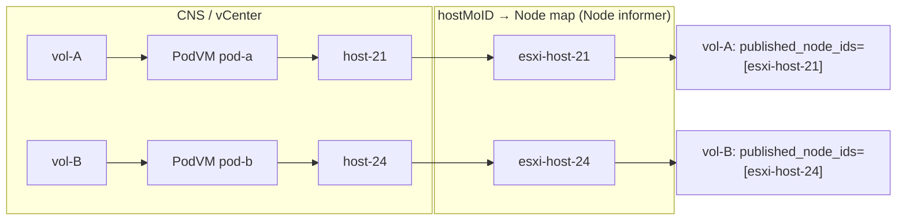
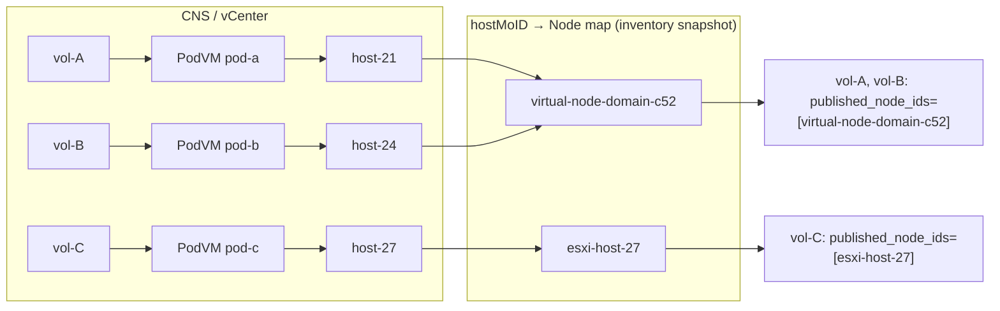
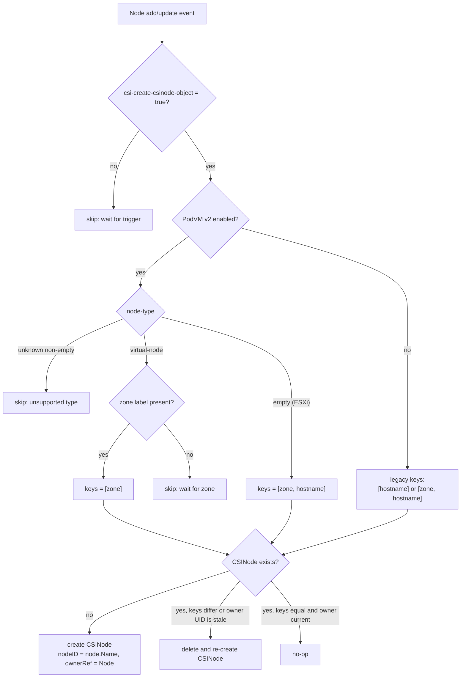
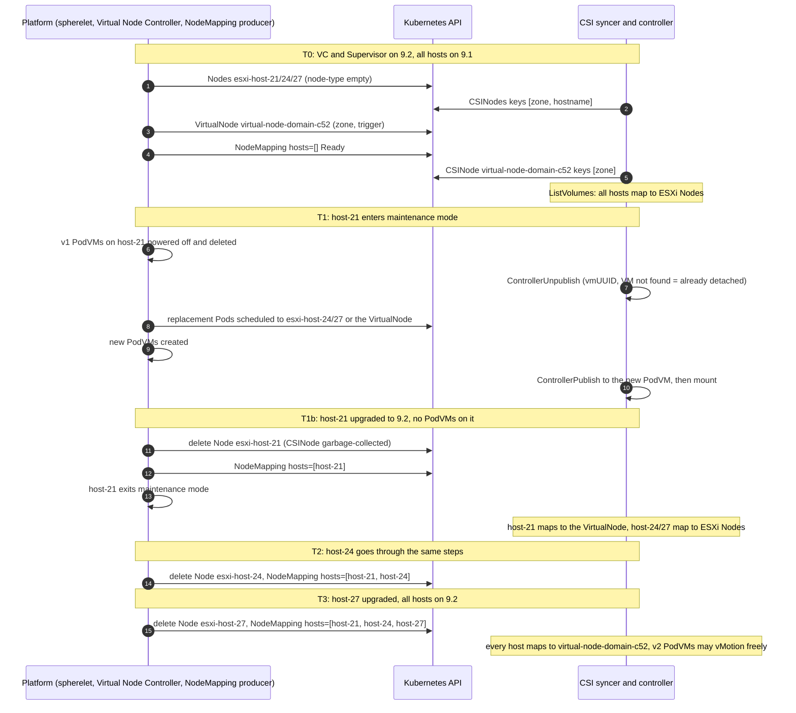

# PodVM v2: vSphere CSI changes for zonal (shared) volumes

Status: Draft, Milestone 1 (M1)
Branches: `podvmv2-csi-changes-m1-tasks` in vSphere CSI Driver and in the Supervisor external-provisioner
Scope: Supervisor CSI (WCP flavor), the CSI syncer/orchestrator, and the Supervisor external-provisioner

## 1. Summary

PodVM v2 changes how a Supervisor represents compute in Kubernetes. Today every ESXi host is its own
Kubernetes `Node`. With PodVM v2 a single **VirtualNode** represents a whole vSphere compute cluster.
A PodVM scheduled to a VirtualNode may run on any ESXi host in that cluster, and DRS picks the host.

The provisioning contract for zonal volumes stays the same. A PVC that uses a zonal StorageClass gets
a PV with zone affinity, and that volume is accessible from every host in the namespace's active
cluster. What does change is how CSI maps between physical hosts and Kubernetes Nodes. Three
CSI-facing areas are affected:

1. **ListVolumes**: `published_node_ids` must report the VirtualNode name for volumes attached to
   PodVMs on upgraded hosts, not a per-host Node name that no longer exists.
2. **CSINode registration**: a VirtualNode has no single hostname, so its CSINode must advertise
   **zone only**.
3. **Mixed hosts during upgrade**: while some ESXi hosts are still on 9.1 and others are on 9.2,
   dedicated ESXi Nodes and VirtualNodes coexist in one Supervisor. Every component has to handle
   both kinds of Node at the same time. Each host is handed over while it is in maintenance mode,
   with no PodVMs running on it. After the hand-off, v2 PodVMs can vMotion between 9.2 hosts
   without changing their Node.

This document covers only shared/zonal volumes. Host-local storage is out of scope.

## 2. Background: the Supervisor today (PodVM v1)

```text
                         Supervisor Kubernetes API
 ┌─────────────────────────────────────────────────────────────────────┐
 │  Node esxi-host-21       Node esxi-host-24       Node esxi-host-27  │
 │  esxi-node-moid=host-21  esxi-node-moid=host-24  esxi-node-moid=... │
 │  CSINode esxi-host-21    CSINode esxi-host-24    CSINode esxi-...   │
 │  keys [zone, hostname] on a zonal Supervisor                        │
 └─────────────────────────────────────────────────────────────────────┘
        │ 1:1                    │ 1:1                    │ 1:1
   ESXi host-21             ESXi host-24             ESXi host-27
   (spherelet)              (spherelet)              (spherelet)
   └──────────────── vSphere cluster domain-c52 (zone-1) ───────────┘
```

- Spherelet registers each ESXi host as a Kubernetes Node. The Node carries the host MoID in the
  annotation `vmware-system-esxi-node-moid`.
- Spherelet sets `vmware-system/csi-create-csinode-object: "true"`, and the CSI syncer creates the
  CSINode (`createCSINode` in `pkg/csi/service/common/commonco/k8sorchestrator/wcp_node.go`).
- CSINode topology keys are `[hostname]` on a single-cluster Supervisor. They are
  `[topology.kubernetes.io/zone, kubernetes.io/hostname]` on stretched or zonal Supervisors.
- The orchestrator builds a `hostMoID → Node name` map from the Node annotation through a Node
  informer (`nodeIDToNameMap`).
- `ListVolumes` resolves `volume → attached PodVM → runtime ESXi host MoID → Node name` and returns
  the Node name in `published_node_ids`. The external-attacher uses that list to reconcile
  `VolumeAttachment.status.attached`.

## 3. Problem

PodVM v2 retires the one-Node-per-host model. Each upgraded ESXi host stops being a Kubernetes Node,
and its cluster is represented by a single VirtualNode. Without CSI changes:

| Area | What breaks |
|---|---|
| ListVolumes | The host-to-Node map is built from the per-host annotation. A VirtualNode has no single host, and an upgraded host has no dedicated Node. Volumes attached to PodVMs on upgraded hosts therefore map to no Node, or to a stale one. The external-attacher would then report a mounted volume as detached and keep trying to re-attach it. |
| CSINode | Registration advertises `kubernetes.io/hostname`. A VirtualNode is not a host. A hostname key would make the provisioner build host-scoped topology for a Node that spans many hosts, and would make the CSINode depend on a hostname label that the VirtualNode does not need to carry. |
| Mixed upgrade | ESXi hosts are upgraded one at a time. For hours or days a cluster has some hosts still represented by dedicated 9.1 Nodes and some represented by the VirtualNode. A host must never be claimed by both kinds of Node, and topology must remain consistent across both kinds. |
| Node classification | CSI has no way to tell a VirtualNode from an ESXi Node except by name, which is not a contract. |

## 4. VirtualNode

### 4.1 Definition

A VirtualNode is a **core Kubernetes `Node` object** that represents one vSphere compute cluster. It
is not a separate custom resource. PodVMs are scheduled to it, and the platform (DRS) places each
PodVM on an ESXi host inside that cluster.

```text
                       Supervisor Kubernetes API
 ┌──────────────────────────────────────────────────────────────────────┐
 │  Node virtual-node-domain-c52                                          │
 │    annot pod.vmware.com/node-type: virtual-node                        │
 │    annot vmware-system/csi-create-csinode-object: "true"               │
 │    label topology.kubernetes.io/zone: zone-1                           │
 │                                                                        │
 │  NodeMapping virtual-node-domain-c52   (ownerRef → the Node above)     │
 │    spec: {}                                                            │
 │    status.hosts: [host-21, host-24, host-27]                           │
 │    status.conditions: Ready=True                                       │
 └──────────────────────────────────────────────────────────────────────┘
                 │ 1 : N  (DRS chooses the host for each PodVM)
      ┌──────────┼───────────────┐
  ESXi host-21  ESXi host-24  ESXi host-27      vSphere cluster domain-c52 (zone-1)
```

### 4.2 Metadata consumed by CSI

| Information | Source | CSI use |
|---|---|---|
| Node type | Annotation `pod.vmware.com/node-type: virtual-node` (proposed; final key pending) | Exact value `virtual-node` means a VirtualNode. An absent or empty value means a dedicated ESXi Node, the existing behavior. Any other non-empty value is unsupported and is never treated as ESXi. |
| Zone | Label `topology.kubernetes.io/zone` | CSINode topology and zonal provisioning. CSI requires it before registering the Node. |
| Registration trigger | Annotation `vmware-system/csi-create-csinode-object: "true"` | Same trigger spherelet already uses. |
| Represented hosts | `NodeMapping` CR (`nodemappings.virtualnode.vmware.com/v1alpha1`), same name as the Node, owned by it | `hostMoID → VirtualNode` ownership for ListVolumes. |
| Dedicated host identity | Existing annotation `vmware-system-esxi-node-moid` on ESXi Nodes | `hostMoID → ESXi Node` ownership. |

The CSI NodeId of a VirtualNode is its actual `node.Name`. CSI never infers the Node type or the
cluster from the name.

### 4.3 NodeMapping CR

The platform publishes one cluster-scoped `NodeMapping` (`nodemappings.virtualnode.vmware.com`,
version `v1alpha1`, with a status subresource) per VirtualNode. The CRD is defined in the Supervisor
controller-managers APIs (`apis/public/virtual-node/v1alpha1/nodemapping_types.go`).

| Field | Meaning |
|---|---|
| `metadata.name` | Equals the VirtualNode name. A controller `ownerReference` points at that Node's UID, so the CR is garbage-collected with the Node. |
| `spec` | Empty; reserved for future fields. |
| `status.hosts[]` | Up to 128 `{moid, name}` entries: the ESXi hosts the Node represents. The list contains **only hosts that have no dedicated Kubernetes Node**, so it describes ownership rather than raw cluster membership. |
| `status.conditions[Ready]` | `status.hosts` reflects the current set of hosts represented by the Node. |

NodeMapping objects exist only for VirtualNodes. The platform, which creates and deletes the
dedicated Nodes, publishes the ownership hand-off, so CSI does not infer it. The CRD is registered
only when the PodVM v2 FSS and capability are enabled.

The mapping does not identify a vCenter or a compute cluster. Host MoIDs are unique only within one
vCenter, which is unambiguous here because a Supervisor is backed by a single vCenter
(section 6.1).

## 5. Feature gating

| Component | Gate | Behavior when disabled |
|---|---|---|
| Supervisor CSI driver and syncer | WCP capability `supports_podvm_v2` (`common.PodVMV2Support`), latched at orchestrator startup and read through `IsPodVMV2EnabledAtStartup` | Existing informer-based dedicated-Node map and existing CSINode keys. |
| Supervisor external-provisioner | `supervisor-capabilities` CR entry `status.supervisor["supports_podvm_v2"].activated`, read at startup and passed into the controller, matching `supports_host_local_storage` | Existing topology handling. An absent entry means false. If the capability is enabled later, the provisioner restarts (see Late enablement below). |

The capability means that the Supervisor *can* have VirtualNodes. It does not mean that any exist.
Every code path must behave correctly when the feature is enabled and all hosts still have dedicated
Nodes.

**No-regression rule.** With the capability absent or disabled, every M1 code path behaves as it
did before:

| Path | Behavior without `supports_podvm_v2` |
|---|---|
| `GetNodeIDtoNameMap` | A copy of the existing Node-informer map, and never an error. No Node list and no NodeMapping read. |
| `GetNodeNameToHostMoIDMap` | The existing Node-informer map in every capability state; host-local provisioning is untouched by this milestone. |
| Node informer handlers (`nodeAdd`/`nodeUpdate`/`nodeRemove`) | Unchanged. |
| `createCSINode` | Existing key selection, and the existing Workload Domain Isolation "add missing zone" reconcile. |
| CSINode Node-update handler | No-op. Registration stays Add-only. |
| Provisioner | Hostname filtering for zonal classes is unchanged. |

**Late enablement.** Every component reads `supports_podvm_v2` once at startup. The Supervisor CSI
driver and syncer latch that first read (`IsPodVMV2EnabledAtStartup`) and use the latched value for
every per-process decision: the host-ownership inventory, CSINode registration and the restart
watcher below. `IsFSSEnabled` re-reads the capabilities CR whenever a late-enablement capability
reads false, so two calls can disagree; keying the watcher on a fresh read could see the capability
already enabled, skip the watcher, and leave the process running with the inventory it chose while
the capability was still disabled. If the capability is off at startup, each component watches for
it and restarts when it turns on:

| Component | Mechanism |
|---|---|
| CSI controller (`wcp/controller.go`) | `HandleLateEnablementOfCapability(supports_podvm_v2)`; restart re-selects the ListVolumes host map. |
| Syncer (`metadatasyncer.go`) | `HandleLateEnablementOfCapability(supports_podvm_v2)`; restart re-runs `InitializeCSINodes`, whose Add events reconcile every CSINode's keys. The syncer starts that watcher for PodVM v2 as well as for `PodVMOnStretchedSupervisor`: a VirtualNode has no spherelet to register it, so gating on the older capability alone would create no VirtualNode CSINode at all. |
| Supervisor external-provisioner | The existing capability-restart goroutine now watches `supports_podvm_v2` as well as Workload Domain Isolation. |

The provisioner restart is required. Restarting the CSI container does not restart its provisioner
sidecar, and the two must agree. Otherwise CSI would register VirtualNodes with `[zone]` while the
provisioner still treated `hostname` as a zonal topology key.

## 6. Design changes

### 6.1 Host-ownership inventory (M1.3)

`GetNodeIDtoNameMap` is the single producer of the `hostMoID → Node name` map. When PodVM v2 is
enabled, it is backed by a fresh inventory snapshot (`hostInventory.snapshot` in
`k8sorchestrator/virtual_node.go`) instead of the informer map:



Rules:

- **Fail closed.** Missing, not-Ready, deleting or foreign-owner mappings produce no owner, and a
  host listed by two VirtualNodes gets no owner.
  CSI never reuses an earlier snapshot and never falls back to a masqueraded host annotation on a
  VirtualNode.
- **A failed lookup fails the snapshot.** A Node-list failure or a NodeMapping-list failure returns
  an error, and `GetNodeIDtoNameMap` propagates it. Answering from the dedicated Nodes alone would
  be a plausible-looking view of a mixed cluster in which every VirtualNode has silently lost its
  volumes (section 6.2).
- **An empty `status.hosts` is normal** before the first host upgrade. The VirtualNode owns nothing
  yet.
- **Single vCenter assumed, not enforced.** NodeMapping carries bare host MoIDs and no vCenter
  identity, and MoIDs are unique only within one vCenter. The Supervisor is backed by a single
  vCenter — `GetVirtualCenterConfig` takes the first configured entry and `wcp/controller.go`
  registers only that one — so CSI resolves every MoID against it and there is nothing to
  disambiguate. There is no runtime check: on this flavor it could never fire. If the Supervisor
  ever supports several vCenters, host identity has to become vCenter-qualified before this code
  can be trusted (D1.h).
- **No generation check.** The spec is empty, so `metadata.generation` never changes and the Ready
  condition's `observedGeneration` carries no information. CSI requires only `Ready=True`.
- **RBAC:** `get`, `list` and `watch` on `nodemappings` in group `virtualnode.vmware.com` in the
  Supervisor CSI role (`manifests/supervisorcluster/*/cns-csi.yaml`).
- **Host-local provisioning is untouched.** `GetNodeNameToHostMoIDMap` keeps returning the
  Node-informer map in every capability state. It is built from the `vmware-system-esxi-node-moid`
  annotation, which only a dedicated ESXi Node carries, so its host-local callers resolve dedicated
  Nodes only and fail closed on a host a VirtualNode owns. Placing a host-local disk on a Node that
  names a whole cluster is a Milestone 3 problem.

### 6.2 ListVolumes (M1.3)

The RPC body and response format do not change. Only the map behind `GetNodeIDtoNameMap` changes, so
each runtime host now resolves to whichever Node currently owns it.

**Before (PodVM v1): one Node per host:**



**After (PodVM v2): mixed cluster, host-21 and host-24 upgraded, host-27 still on 9.1:**



Call chain, unchanged except for the map source:

```text
ListVolumes (pkg/csi/service/wcp/controller.go)
  └─ getVolumeIDToVMMap (controller_helper.go)
       ├─ fake-attached volumes  → GetNodesForVolumes (Kubernetes VolumeAttachments)   [unchanged]
       ├─ GetVolumeToNodeMapping → volume → PodVM → runtime host MoID (vCenter)        [unchanged]
       └─ GetNodeIDtoNameMap     → host MoID → owning Node name                         [CHANGED]
            PodVM v2 disabled: Node-informer map
            PodVM v2 enabled:  hostInventory.snapshot (section 6.1)
            either: an error here fails the RPC
```

| Runtime host of the attached PodVM | `published_node_ids` |
|---|---|
| Host still has a dedicated (9.1) ESXi Node | That ESXi Node name |
| Host listed in a Ready NodeMapping | The VirtualNode name |
| Host has no resolved owner (hand-off gap, conflict, CR not Ready) | Entry skipped. No owner is fabricated. |
| Ownership could not be resolved (the Node list or the NodeMapping list failed) | The RPC fails. The caller retries on the next sync. |
| Ownership map empty | Existing error path. The caller retries on the next sync. |

The RPC fails rather than answering from a partial map. A host missing from the map drops every
volume attached on it from the response, and a consumer reading `published_node_ids` cannot tell
that apart from those volumes having been detached, which it may act on by reattaching them.

A v2 PodVM that DRS moves between hosts inside one VirtualNode, by vMotion or HA restart, still
reports the same Node ID. That is the expected behavior for a cluster-backed Node. CSI does not
cache runtime hosts: each ListVolumes call reads them from vCenter (section 7.4).

### 6.3 CSINode registration (M1.4)

`createCSINode` now chooses topology keys from the Node type when PodVM v2 is enabled:

| Supervisor state | Node kind | CSINode `topologyKeys` |
|---|---|---|
| PodVM v2 disabled, single-cluster Supervisor | ESXi Node | `[kubernetes.io/hostname]` (unchanged) |
| PodVM v2 disabled, stretched or zonal Supervisor | ESXi Node | `[zone, hostname]` (unchanged) |
| PodVM v2 enabled | ESXi Node (9.1 host) | `[zone, hostname]` |
| PodVM v2 enabled | VirtualNode | `[zone]` |
| PodVM v2 enabled | Unknown `node-type` | Not registered; a warning is logged |



Resulting objects in a mixed cluster:

```yaml
apiVersion: storage.k8s.io/v1
kind: CSINode
metadata:
  name: virtual-node-domain-c52
  ownerReferences: [{apiVersion: v1, kind: Node, name: virtual-node-domain-c52, uid: ...}]
spec:
  drivers:
    - name: csi.vsphere.vmware.com
      nodeID: virtual-node-domain-c52
      topologyKeys: [topology.kubernetes.io/zone]
---
apiVersion: storage.k8s.io/v1
kind: CSINode
metadata:
  name: esxi-host-27
spec:
  drivers:
    - name: csi.vsphere.vmware.com
      nodeID: esxi-host-27
      topologyKeys: [topology.kubernetes.io/zone, kubernetes.io/hostname]
```

Registration details:

- `updateCSINode` retries registration only when relevant metadata changes: Node type, zone,
  trigger, or Node UID. Status-only updates do not cause API calls.
- An existing CSINode whose keys differ from its Node kind is deleted and re-created. This covers a
  CSINode registered before PodVM v2 was enabled.
- An existing CSINode owned by a previous incarnation of the Node is also re-created. A Node
  deleted and recreated under the same name gets a new UID, and matching keys would otherwise skip
  re-registration; garbage collection then removes that CSINode for good, because the Add event has
  already been handled and later status updates are not relevant changes. A CSINode with no Node
  `ownerReference`, such as one the spherelet created, is left alone: nothing will collect it, and
  re-creating it would drop the driver registration for no reason.
- The VirtualNode needs no `kubernetes.io/hostname` label and no single-host annotation.
- A registered CSINode does not prove that the VirtualNode's host ownership is resolvable. That
  depends on the NodeMapping (section 6.1).

### 6.4 Zonal provisioning (WFFC and Immediate)

No CreateVolume rewrite is needed for zonal volumes. The Supervisor external-provisioner already
removes `kubernetes.io/hostname` from the topology keys for non-vDPP classes when
`podVMOnStretchedSupervisorEnabled || podVMV2Enabled` (`filterTopologyKeys` in
`pkg/controller/topology.go`). Every CSINode, VirtualNode or ESXi, therefore contributes zone-only
terms:

| Binding mode | Topology sent to CSI | CSI result | PV affinity |
|---|---|---|---|
| WFFC, selected Node = VirtualNode | `zone` of the VirtualNode | WCP resolves zone → namespace's active cluster → compatible shared datastore | `topology.kubernetes.io/zone In [zone-1]` |
| WFFC, selected Node = ESXi Node (9.1) | `zone` of that Node (hostname filtered out) | Same | Same |
| Immediate | Zones aggregated across CSINodes, restricted to the namespace's zones when workload-domain isolation is on | Same | Same |

The PV never references a VirtualNode or a host, so it stays schedulable as hosts move from ESXi
Nodes to the VirtualNode. M1.2 passes `podVMV2Enabled` into the provisioner so that this filtering
and the later milestones can depend on it without the stretched-Supervisor flag.

### 6.5 Attach and detach (no change)

- **ControllerPublishVolume** finds the PodVM through PVC and `pod.spec.nodeName`, then attaches by
  the PodVM's VM UUID. A VirtualNode name works in that lookup. This continues to rely on the
  existing PodVM VM-UUID annotation being published.
- **ControllerUnpublishVolume**, with `CSI_Detach_Supported` enabled, detaches using the `vmUUID`
  stored in VolumeAttachment metadata. It needs no Node-to-host conversion. If the PodVM no longer
  exists (`cnsvsphere.ErrVMNotFound`) or the VolumeAttachment is gone, the volume is treated as
  detached and the call succeeds (`pkg/csi/service/wcp/controller.go`, `ControllerUnpublishVolume`).
  The maintenance-mode flow in section 7 relies on this.

## 7. Mixed hosts: some on 9.1, some on 9.2

### 7.1 How the platform hands a host over

During a VCF 9.2 upgrade the Supervisor runs PodVM v1 and PodVM v2 side by side in one vCenter
cluster. A host changes model only through the upgrade and maintenance workflow. An active Node
object is never swapped in place while pods are running on it.

| ESXi version | Agent | Kubernetes representation |
|---|---|---|
| Below 9.2 | spherelet on the host | Dedicated v1 Node per host (`vmware-system-esxi-node-moid`) |
| 9.2 and later | No spherelet. Managed by the Virtual Node Controller in the Supervisor control plane VM. | Member of the cluster's VirtualNode (listed in its NodeMapping) |

The scheduler extension (schedext) checks the ESXi version of the host that DRS selects. That
decides whether a new PodVM becomes a v1 pod on the host's dedicated Node or a v2 pod on the
VirtualNode.

Per-host sequence:

1. The 9.1 host enters **maintenance mode (MM)**. PodVM v1 couples a Node 1:1 to its host, so its
   PodVMs cannot be migrated. The existing PodVM v1 MM sequence applies unchanged:
   1. **Deletion and detach.** Each PodVM is powered off and deleted from the host. The storage
      control plane (CNS/CSI) detaches its PVs.
   2. **Rescheduling.** Kubernetes schedules a replacement Pod onto a remaining active Node.
   3. **Re-creation and re-attach.** A new PodVM is created, and CSI attaches and mounts the volume
      to that new PodVM.

   The replacement Pod can land on another 9.1 ESXi Node or on the VirtualNode, depending on the
   host DRS selects and its ESXi version.
2. The host is upgraded to ESXi 9.2. spherelet is removed and the host's dedicated Node is deleted.
3. The host is absorbed into the VirtualNode: its MoID is added to the NodeMapping `status.hosts`.
4. The host exits maintenance mode and becomes eligible for v2 PodVMs.

From then on, v2 PodVMs on that host can use vMotion and HA. A PodVM can move between 9.2 hosts
without its Kubernetes pod being recreated. During a vMotion the TCP connection between the Virtual
Node Controller and the in-guest agent drops briefly and is re-established through a new vCenter
ticket. This does not involve CSI: the volume stays attached to the same VM.

### 7.2 Upgrade timeline



### 7.3 State at each step

| State | Kubernetes Nodes | CSINodes (keys) | `hostMoID → Node` map |
|---|---|---|---|
| T0: all hosts on 9.1, VirtualNode present | esxi-host-21, -24, -27; virtual-node-domain-c52 | ESXi: `[zone, hostname]`; VN: `[zone]` | 21→esxi-host-21, 24→esxi-host-24, 27→esxi-host-27 |
| T1: host-21 in maintenance mode | unchanged | unchanged | unchanged; no PodVMs run on host-21 |
| T1b: host-21 on 9.2 | esxi-host-24, -27; VN | same, without esxi-host-21 | 21→VN, 24→esxi-host-24, 27→esxi-host-27 |
| T2: host-21 and host-24 on 9.2 | esxi-host-27; VN | esxi-host-27 `[zone, hostname]`; VN `[zone]` | 21→VN, 24→VN, 27→esxi-host-27 |
| T3: all hosts on 9.2 | VN only | VN `[zone]` | 21, 24, 27 → VN |

### 7.4 Behavior during the mixed interval

- **Exclusive ownership.** A host is owned by its dedicated Node or by the VirtualNode, never both.
  If the NodeMapping lists a host that a live or deleting ESXi Node still holds, CSI publishes no
  owner for that host and logs the conflict. The platform's contract says this should not happen, so
  it signals producer lag or a bug.
- **Hand-off gap.** Between deleting `esxi-host-21` and adding host-21 to the NodeMapping, host-21
  has no owner. Because the host is in maintenance mode for this whole interval and runs no
  PodVMs, ListVolumes has nothing attached there to skip. The gap is therefore harmless, provided
  that the host is listed in the NodeMapping **before** it exits maintenance mode and becomes
  eligible for v2 PodVMs. If a v2 PodVM ran on a host not yet in the NodeMapping, ListVolumes
  would skip its volumes, and the external-attacher could mark those VolumeAttachments detached.
  That ordering is a platform requirement (D1.c).
- **v1 pods during maintenance mode.** These follow the PodVM v1 MM sequence in section 7.1: power
  off and delete, detach, reschedule, then re-create and re-attach. The old VolumeAttachment names
  `esxi-host-21` and the deleted PodVM's `vmUUID`. ControllerUnpublishVolume finds no VM for that
  UUID, treats the volume as detached and succeeds. It never looks up the Node, so this works even
  after `esxi-host-21` is deleted. No CSI change is needed. The PVC is then attached to the
  replacement PodVM through ControllerPublishVolume against its new Node, which is either a 9.1 ESXi
  Node or the VirtualNode. A zonal PVC can be reused from either Node because its PV has zone
  affinity only.
- **v2 PodVM vMotion.** A v2 PodVM that vMotions or restarts through HA between 9.2 hosts stays on
  the same VirtualNode. Its VolumeAttachment, Node ID and `published_node_ids` do not change.
  ListVolumes reads the runtime host from vCenter and the ownership map fresh on every call, so the
  new host resolves to the same VirtualNode. Shared zonal datastores are accessible from every host
  in the cluster, so CSI has nothing to do on a vMotion.
- **No mixing across models.** A v1 PodVM cannot move to the VirtualNode. A v2 PodVM must never be
  placed on, or vMotioned to, a host that is below 9.2 or still has a dedicated Node (D1.g). If it
  were, its runtime host would map to the ESXi Node, and ListVolumes would publish the wrong Node ID.
- **Mixed CSINode key sets.** VirtualNodes register `[zone]` and ESXi Nodes register
  `[zone, hostname]`. For zonal classes the Supervisor provisioner filters out `hostname`, so both
  kinds of Node collapse to `[zone]` and Immediate-binding aggregation is deterministic. Upstream
  external-provisioner picks the key set of one random CSINode for Immediate binding, which is
  non-deterministic when key sets differ. The upstream fix (aggregate per registered key set, and
  only over nodes whose CSINode registered those keys) is on the `fix-topology-aggregation-mixed-keys`
  branch. It is not required for zonal volumes because of the hostname filter, but it is the general
  solution.
- **Existing PVs.** Zonal PVs have zone affinity only. PVs created before or during the upgrade
  remain schedulable to either kind of Node in that zone, so a v1 pod recreated as a v2 pod can reuse
  its PVC. No PV mutation or migration is needed.
- **Multiple clusters in a zone.** Each vSphere cluster has its own VirtualNode and NodeMapping. If
  two VirtualNodes list the same host, CSI publishes no owner for that host. Zonal volume
  accessibility remains the namespace's active cluster, unchanged.
- **Feature enabled with zero upgraded hosts** behaves exactly like T0. Everything resolves to ESXi
  Nodes.

## 8. Failure handling

| Condition | CSI behavior |
|---|---|
| VirtualNode without zone | Not registered and not used in inventory. Retried when the zone label is set. |
| VirtualNode without NodeMapping | Registered as a CSINode, owns no hosts. |
| NodeMapping not Ready, wrong owner UID or deleting | Hosts withheld. |
| Host listed by two VirtualNodes | No owner for that host. |
| Unknown `node-type` value | Not registered. If it carries a host MoID, that host is reserved and has no owner. |
| Node list or NodeMapping list error | The lookup fails and ListVolumes fails with it. No stale cache is used and no partial map is published. |

## 9. Dependencies and open items

| ID | Item | Owner |
|---|---|---|
| D1.a | Final key and values for the Node-type discriminator (`pod.vmware.com/node-type`) | Platform |
| D1.b | Ordering: zone and Node type published before `csi-create-csinode-object` | Platform |
| D1.c | A host must be in NodeMapping `status.hosts` before it exits maintenance mode and can run v2 PodVMs. Its dedicated Node must be deleted before the host is added (section 7.4, hand-off gap). | Platform |
| D1.d | Whether `status.hosts` includes disconnected or maintenance-mode hosts; behavior over 128 hosts | Platform |
| D1.e | Resolved: the platform confirmed on 2026-11-05 that the list never includes a host that still has a dedicated Node, and the merged wording ("all ESXi hosts represented by the Node") is consistent with that. CSI keeps the dedicated-Node cross-check (section 6.1). | Platform |
| D1.f | NodeMapping producer: the CRD is merged, but the controller that creates and maintains the CRs is a follow-up change | Platform |
| D1.g | schedext and DRS place or vMotion v2 PodVMs only onto 9.2+ hosts listed in the NodeMapping, never onto a host that still has a dedicated Node | Platform |
| D1.h | The Supervisor stays backed by a single vCenter. NodeMapping host MoIDs are unique only within one vCenter, so multi-vCenter support needs vCenter-qualified host identity before this inventory can be used (section 6.1) | Platform |
| D4 | Several PodVMs sharing one PVC on one VirtualNode share a single VolumeAttachment identity. Supported concurrency and replacement semantics are still to be defined. | CSI and platform |
| — | PodVM VM-UUID annotation remains published (required for ControllerPublish) | Platform |
| — | `CSI_Detach_Supported` enabled on 9.2 | Deployment |

## 10. Implementation tasks (Milestone 1)

| ID | Task | Repository | Main code |
|---|---|---|---|
| M1.1 | Register `supports_podvm_v2`, latch it at startup as `IsPodVMV2EnabledAtStartup`, and restart the controller and syncer through `HandleLateEnablementOfCapability` when the capability is enabled afterwards | vSphere CSI Driver | `pkg/csi/service/common/constants.go`, `commonco/coagnostic.go`, `k8sorchestrator/k8sorchestrator.go`, `wcp/controller.go`, `pkg/syncer/metadatasyncer.go` |
| M1.2 | Read `supports_podvm_v2` from `supervisor-capabilities` at startup and pass it into the controller; drop `hostname` for zonal classes when enabled; restart on late enablement | Supervisor external-provisioner | `cmd/csi-provisioner/csi-provisioner.go`, `pkg/controller/controller.go`, `pkg/controller/topology.go` |
| M1.3 | Host-ownership inventory from Nodes and NodeMapping; feed `GetNodeIDtoNameMap` for ListVolumes and fail the RPC when ownership cannot be resolved | vSphere CSI Driver | `k8sorchestrator/virtual_node.go`, `pkg/internalapis/podvmv2/{node,nodemapping}.go`, `wcp/controller_helper.go`, Supervisor RBAC manifests |
| M1.4 | Zone-only CSINode for VirtualNodes; `[zone, hostname]` for ESXi Nodes; reconcile keys and stale owners; start the Node watcher for PodVM v2 | vSphere CSI Driver | `k8sorchestrator/wcp_node.go`, `pkg/internalapis/podvmv2/node.go`, `pkg/syncer/metadatasyncer.go` |

Milestone 2 (scheduler and PodVM lifecycle readiness for Immediate and WFFC) adds no zonal
CSI or provisioner code task beyond these.

## 11. Test plan

### 11.1 Unit tests

- Inventory: all ESXi Nodes; mixed (dedicated plus NodeMapping); all hosts on the VirtualNode; empty
  `hosts`; missing, not-Ready, deleting and foreign-owner mappings; a host listed by two
  VirtualNodes; a host claimed by both a dedicated Node and a NodeMapping; deleting Nodes;
  unknown Node type; a failed Node list and a failed NodeMapping list.
- ListVolumes: `published_node_ids` for all-regular, mixed and all-virtual inventories; an
  unresolved host is skipped; an empty map and a failed ownership lookup both take the error path;
  fake-attach is unchanged.
- CSINode: key selection for each row of section 6.3; waiting for zone and trigger; re-creation when
  keys differ or the owner UID is stale; no re-creation for a CSINode with no Node owner; no API
  calls on status-only updates; registration starts with PodVM v2 alone; the PodVM v2-disabled path
  is unchanged.
- Provisioner: `podVMV2Enabled` drives `filterTopologyKeys`; Immediate aggregation over mixed
  `[zone]` and `[zone, hostname]` CSINodes yields zone-only terms; WFFC on a VirtualNode and on an
  ESXi Node yields a zone-only requirement.

### 11.2 Integration and E2E

- Zonal PVC with WFFC and with Immediate bound to a PodVM on a VirtualNode: PV has zone affinity,
  attach succeeds, ListVolumes reports the VirtualNode.
- Rolling ESXi upgrade with zonal workloads running. Put a 9.1 host into maintenance mode, then
  check three things. First, its v1 PodVMs are recreated on another Node and their PVCs detach
  (including after the old Node is deleted). Second, the PVCs re-attach on the new Node. Third,
  after the host joins the VirtualNode, ListVolumes reports the VirtualNode for v2 PodVMs on it.
- vMotion and HA restart of a v2 PodVM with zonal PVCs between 9.2 hosts: the VolumeAttachment
  stays attached, and `published_node_ids` stays the VirtualNode before and after the move.
- Regression for the existing behavior: detach of a VolumeAttachment whose PodVM, and then Node,
  were deleted during maintenance mode returns success, and the replacement Pod's attach is not
  blocked.
- PodVM v2 enabled before any host upgrade: behavior matches 9.1.
- PodVM v2 disabled: regression of existing Supervisor zonal and file-volume paths.
