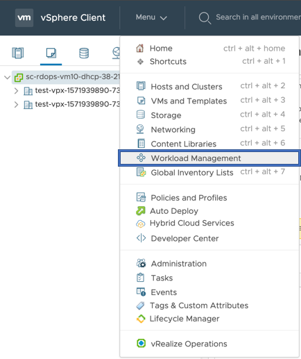
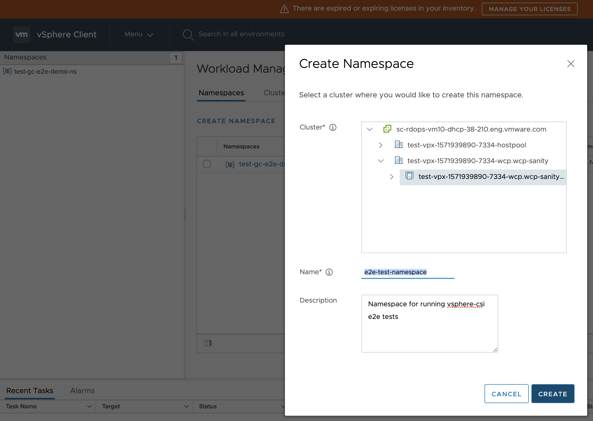
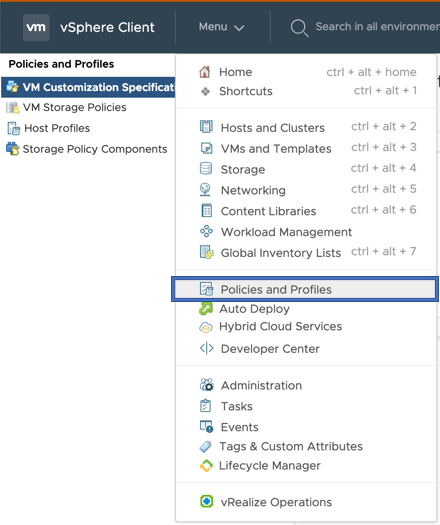
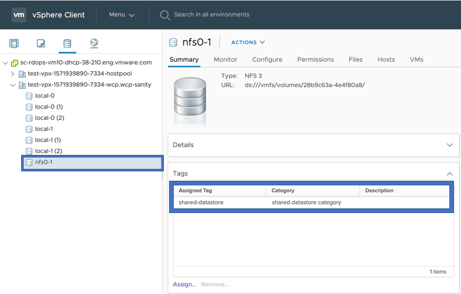
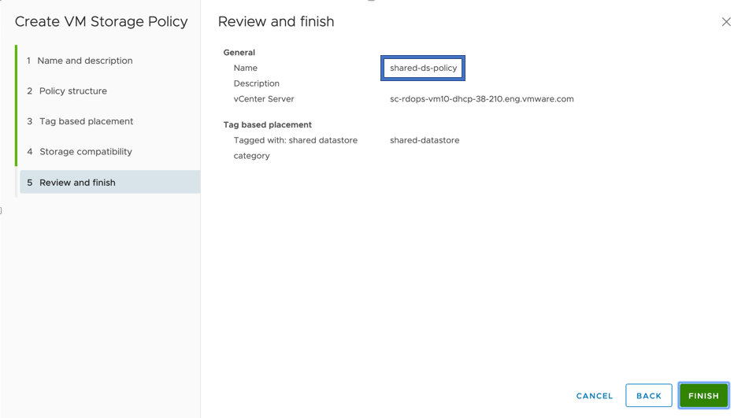
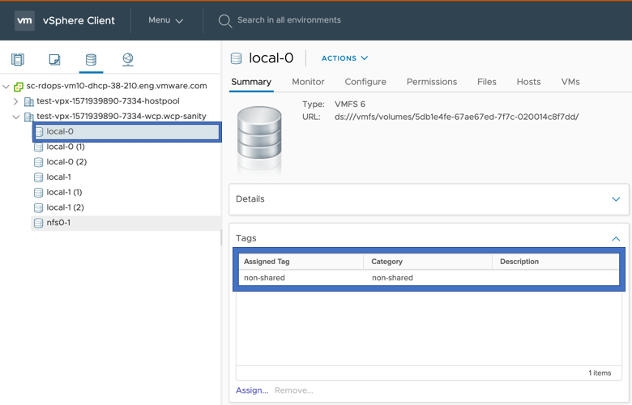
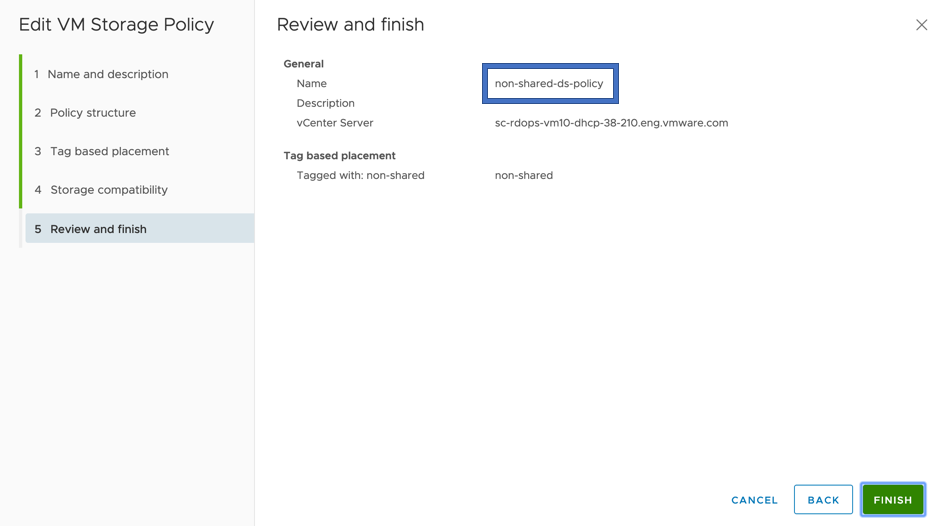
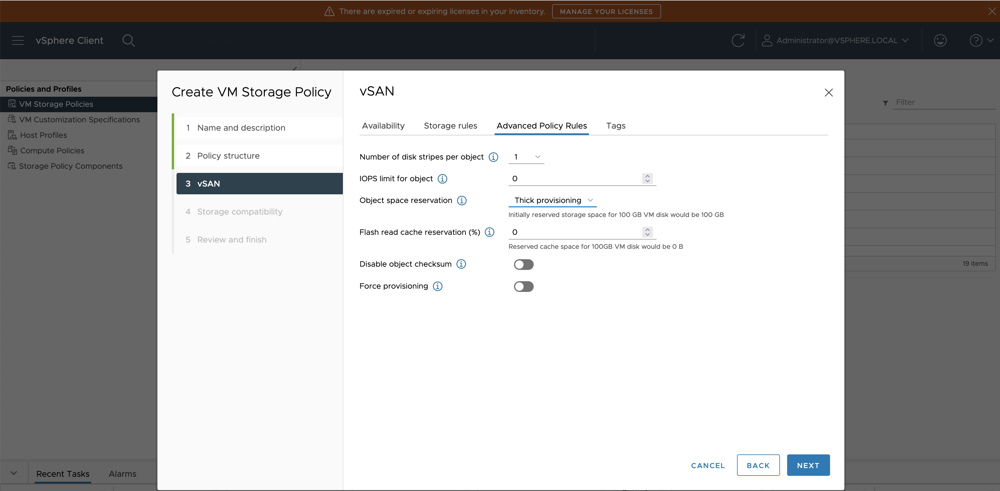
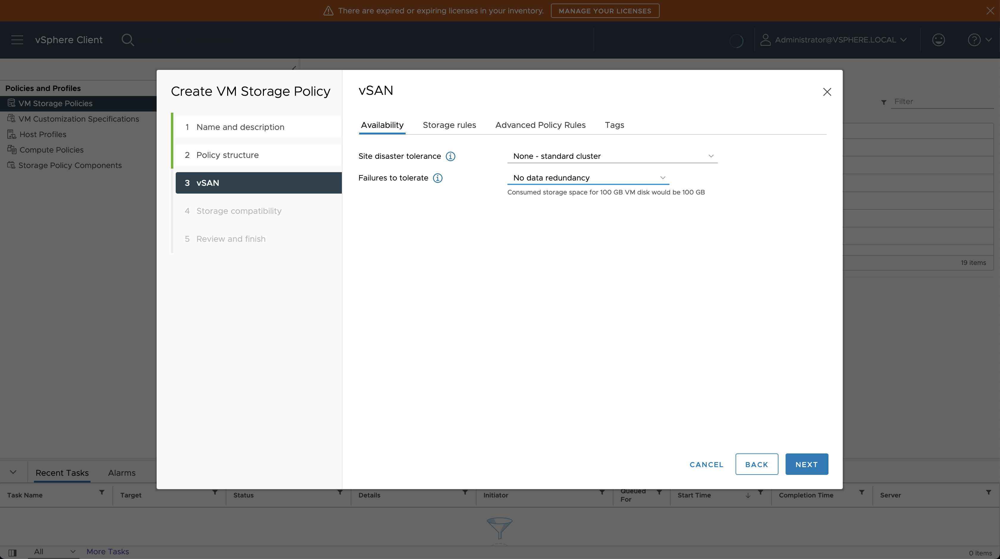

# E2E tests on Guest Cluster

## Configuring VCenter

### 1. Create namespace

#### Go to Workload Management

#### Click on Create Namespace and enter necessary inputs

### 2. Create a VM Storage Policy for shared datastore

#### Go to Policies and Profiles

#### Assign tag to a shared datastore

#### Create tag based Storage Policy using the tag created in previous step

### 3. Create a VM Storage Policy for local datastore

#### Assign tag to a local datastore

#### Create tag based Storage Policy using the tag created in previous step for local datastore

### 4. Create Thick Provisioning Policy(Specific to vSAN datastore)

### 5. Create Raid-0-Policy(Specific to vSAN datastore)

## Running e2e Tests

The section outlines how to set the env variable for running e2e test.

### Building e2eTest.conf

    [Global]
    insecure-flag = "true"
    hostname = "<VC_IP>"
    user = "<USER>"
    password = "<PASSWORD>"
    port = "443"
    datacenters = "<Datacenter_Name>"

- Please update the `hostname` and `datacenters` as per your testbed configuration.
  datacenters should be comma separated if deployed on multi-datacenters

### Copy contents of ~/.kube/config from Guest Cluster master node to your e2e test environment

    cat ~/.kube/config
    #PASTE CONTENTS OF ~/.kube/config FROM GUEST CLUSTER MASTER NODE>

### Copy contents of ~/.kube/config from Supervisor Cluster master node to your e2e test environment

    cat /path/to/supervisor-cluster-kube-config-file
    #PASTE CONTENTS OF ~/.kube/config FROM SUPERVISOR CLUSTER MASTER NODE>

### Setting env variables

    # Setting env variables for non-zone e2e tests
    export E2E_TEST_CONF_FILE="/path/to/e2eTest.conf"
    export KUBECONFIG=~/.kube/config
    export SUPERVISOR_CLUSTER_KUBE_CONFIG=/path/to/supervisor-cluster-kube-config-file
    export SHARED_VSPHERE_DATASTORE_URL="ds:///vmfs/volumes/5cf05d97-4aac6e02-2940-02003e89d50e/"
    export NONSHARED_VSPHERE_DATASTORE_URL="ds:///vmfs/volumes/5cf05d98-b2c43515-d903-02003e89d50e/"
    export STORAGE_POLICY_FOR_SHARED_DATASTORES="shared-ds-policy"
    export STORAGE_POLICY_FOR_NONSHARED_DATASTORES="non-shared-ds-policy"
    export CLUSTER_FLAVOR="GUEST_CLUSTER"
    export GINKGO_FOCUS="csi-guest"
    export SVC_NAMESPACE="test-gc-e2e-demo-ns"
    # Make sure env var FULL_SYNC_WAIT_TIME should be at least double of the manifest variable FULL_SYNC_INTERVAL_MINUTES in pvcsi.yaml
    export FULL_SYNC_WAIT_TIME=350    # In seconds
    export NEW_GUEST_CLUSTER_KUBE_CONFIG=/path/to/second-guest-cluster-kube-config-file
    export STORAGE_POLICY_WITH_THICK_PROVISIONING="<policy-name>"
    export COMPUTE_CLUSTER_NAME="<your_cluster_name>"
    export RAID_0_STORAGE_POLICY="raid-0-policy"
    #shared VVOL datastore url
    export SHARED_VVOL_DATASTORE_URL="<shared-VVOL-datastore-url>"
    #shared NFS datastore url
    export SHARED_NFS_DATASTORE_URL="<shared-NFS-datastore-url>"
    #shared VMFS datastore url
    export SHARED_VMFS_DATASTORE_URL="<shared-VMFS-datastore-url>"
    export BUSYBOX_IMAGE="<image-used-to-deploy-pods>"

    # `STORAGE_POLICY_FOR_SHARED_DATASTORES` and `STORAGE_POLICY_FOR_NONSHARED_DATASTORES` need to be
    # added to `SVC_NAMESPACE` with storage limit >=20GiB each
    # Second guest cluster for `NEW_GUEST_CLUSTER_KUBE_CONFIG` should be created under `SVC_NAMESPACE`
    # For few GC block volume expansion tests we need a storage policy which has thick provisioning enabled
    # `STORAGE_POLICY_WITH_THICK_PROVISIONING` needs to be added to `SVC_NAMESPACE` with storage limit >=20GiB
    # For Few Volume health test scenarios we need a storage policy with no data redundancy
    # 'RAID_0_STORAGE_POLICY' needs to be added to `SVC_NAMESPACE` with storage limit >=20GiB

#### Setting SSH keys for VC with your local machine to run tests which toggle states of VC services and full sync tests

    1.ssh-keygen -t rsa (ignore if you already have public key in the local env)
    2.ssh root@<vc-ip-address> mkdir -p .ssh
    3.cat ~/.ssh/id_rsa.pub | ssh root@<vc-ip-address> 'cat >> .ssh/authorized_keys'
    4.ssh root@<vc-ip-address> "chmod 700 .ssh; chmod 640 .ssh/authorized_keys"

## Requirements

Go version: 1.13

Export the go binary in your PATH to run end-to-end tests

    echo $PATH
    <path-1>:<path-2>:...:/Users/<user-name>/go/bin/

### Run e2e tests

    make test-e2e

### Running specific e2e test

To run a particular e2e test, set GINKGO_FOCUS to the string located “ginkgo.It()” for that test:

To run the Disk Size test (located at /tests/e2e/vsphere_volume_disksize.go

    export GINKGO_FOCUS="Volume\sDisk\sSize"

Note that specify spaces using “\s”.

### Running the guest NFS RWX volume test

`gc_nfs_rwx_basic.go` tests RWX volumes that pvCSI serves from an NFS export (a StorageClass with `server` and
`share` parameters). It checks nothing in vCenter, CNS or the Supervisor, so `E2E_TEST_CONF_FILE` and
`SUPERVISOR_CLUSTER_KUBE_CONFIG` are not needed. Before running it:

- Set `"guest-nfs-volume": "true"` in the `internal-feature-states.csi.vsphere.vmware.com` ConfigMap in the pvCSI
  namespace (`vmware-system-csi`, or `CSI_NAMESPACE` if set). The test fails if it is not enabled.
- Export the share to all VKS cluster nodes, control plane nodes included (the pvCSI controller runs there and
  mounts the export to create and delete volume directories). Use `no_root_squash`, or permissions that let root
  in the controller and in the test pods create and write files.

Set these and run:

    export KUBECONFIG=/path/to/guest-cluster-kube-config-file
    export CLUSTER_FLAVOR="GUEST_CLUSTER"
    export VC_IP1=""    # read by the suite at startup; this test does not use it
    export NFS_SERVER_IP="<nfs-server-ip-or-hostname>"
    export NFS_SERVER_SHARE="/<exported-path>"
    export GINKGO_FOCUS="guest-nfs-rwx"
